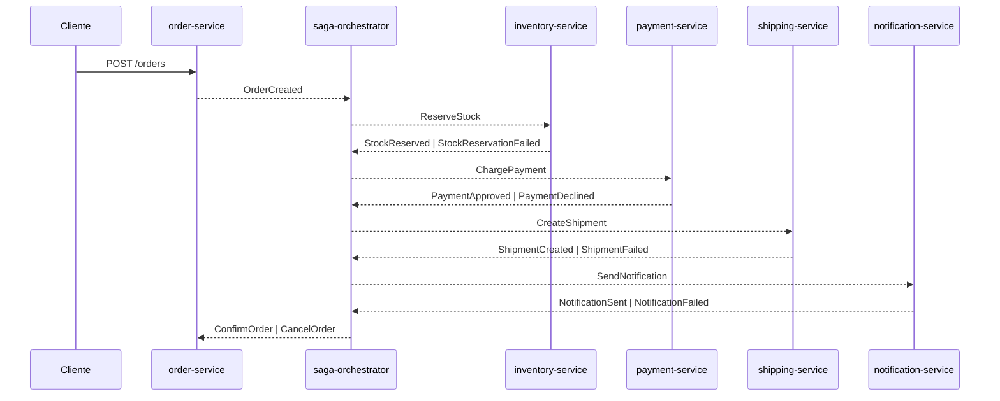

# Saga de E-commerce (Java/Quarkus + Kafka)

Implementación de una **transacción distribuida** para el flujo completo de un e-commerce, desde que el cliente crea la orden hasta que se confirma la entrega. Se resuelve con el **patrón Saga, en su variante de orquestación**, repartido en **6 microservicios Quarkus independientes** que se coordinan exclusivamente a través de Kafka.

**¿Por qué Saga y no una transacción normal de base de datos?** Porque cada paso del proceso (reservar stock, cobrar, generar el envío, notificar) vive en una base de datos distinta, propiedad de un microservicio distinto. No existe una transacción ACID que pueda abarcar las 6 bases de datos a la vez. La Saga resuelve esto dividiendo la operación en una serie de pasos locales, cada uno con su propia transacción, y define además qué hacer si un paso falla a mitad de camino: **deshacer con compensaciones** los pasos que ya se completaron con éxito, en lugar de un `ROLLBACK` clásico.

**Regla de oro de este diseño:** ningún microservicio llama por REST a otro microservicio. La única comunicación entre ellos es a través de comandos y eventos publicados en tópicos de Kafka. Esto es intencional: si `payment-service` estuviera caído, un `ROLLBACK` en tiempo real vía REST fallaría también; con Kafka, el comando queda en el tópico esperando a que el consumidor vuelva a estar disponible.

## Los 6 microservicios

| Servicio | Qué gestiona (su "bounded context") | Ruta raíz de su API |
|---|---|---|
| `order-service` | El agregado Order (la orden de compra en sí) | `/orders/api/v1` |
| `inventory-service` | Catálogo de productos y reserva de stock | `/inventory/api/v1` |
| `payment-service` | Pagos (con una pasarela de pago simulada) | `/payments/api/v1` |
| `shipping-service` | Envíos (con un transportista simulado) | `/shipping/api/v1` |
| `notification-service` | Registro de notificaciones enviadas al cliente (simuladas) | `/notifications/api/v1` |
| `saga-orchestrator-service` | La máquina de estados de la saga — el **único** servicio que conoce el flujo completo de principio a fin | `/sagas/api/v1` |

Cada uno es un proyecto Maven independiente, con su propia imagen Docker y su propio esquema de base de datos. Ningún servicio comparte código con otro (ni siquiera una librería común de "eventos compartidos") — es una decisión deliberada de independencia entre microservicios, explicada más abajo en la sección de Kafka.

Para el detalle de endpoints, contratos de Kafka y esquema de base de datos de cada uno, revisa el `README.md` dentro de la carpeta de cada servicio.

## Flujo de la saga (camino feliz)



**Cómo leer este diagrama:** el cliente solo habla con `order-service` (paso 1). A partir de ahí, todo lo demás ocurre de forma asíncrona: `order-service` publica el evento `OrderCreated` y termina su trabajo ahí mismo — no espera a que el resto de la saga termine. Es `saga-orchestrator-service` quien recibe ese evento, decide "ahora toca reservar stock" y envía el comando `ReserveStock` a `inventory-service`. Cuando `inventory-service` responde (con éxito o con fallo), el orquestador decide el siguiente paso. Así sucesivamente hasta llegar a `ConfirmOrder` (éxito) o `CancelOrder` (fallo, ver compensaciones abajo).

## Compensaciones (qué pasa cuando algo falla)

A diferencia de una transacción SQL, aquí no existe un `ROLLBACK` automático. Si un paso falla, el orquestador tiene que **emitir explícitamente los comandos que deshacen** lo que ya se hizo con éxito en pasos anteriores. Esta tabla es el corazón del diseño:

| Si falla... | El orquestador compensa emitiendo (comandos independientes entre sí, no importa el orden) |
|---|---|
| `StockReservationFailed` (no hay stock suficiente) | `CancelOrder` — no se llegó a cobrar ni reservar nada más, así que no hay nada más que deshacer. |
| `PaymentDeclined` (el pago fue rechazado) | `ReleaseStock` (para devolver el stock que sí se había reservado) + `CancelOrder`. |
| `ShipmentFailed` (el envío no se pudo crear) | `RefundPayment` (ya se había cobrado, hay que devolver el dinero) + `ReleaseStock` + `CancelOrder`. |
| `NotificationFailed` | **Ninguna compensación.** Para este punto, la orden ya está pagada y despachada — no hay nada que deshacer solo porque el correo/SMS de confirmación falló. Se registra el fallo, pero la saga igual llega a `COMPLETED`. **Esta es la única regla del diseño que no es obvia a primera vista**, y por eso vale la pena resaltarla: no todo fallo debe disparar una compensación completa. |

**Disparadores deterministas para poder probar cada camino sin necesidad de mocks manuales** (así puedes reproducir cualquiera de estos escenarios llamando directamente a la API pública):
- **Stock insuficiente**: pedir más unidades de las que indica `availableQuantity` del producto.
- **Pago rechazado**: que el total de la orden supere `PAYMENT_DECLINE_THRESHOLD` (por defecto, 5000).
- **Envío fallido**: que `shippingAddress.city` sea exactamente `"FAIL"` (no distingue mayúsculas/minúsculas).
- **Notificación fallida** (no bloqueante): que `customerId` sea `"fail"` — el destinatario de la notificación se construye como `<customerId>@example.com`, y `fail@example.com` es el valor que la pasarela simulada de notificaciones rechaza a propósito.

## Diseño de Kafka

Se reutiliza el broker que ya está corriendo en [`../kafka/`](../kafka/README.md) — no se levanta un segundo broker, sería redundante. Se crean 21 tópicos en total (10 pares comando/evento, cada uno con su propio tópico de "cartas muertas" o DLQ, más el tópico de auditoría), a cargo de un `topic-init` propio de este stack (que reutiliza la misma imagen Docker de `../kafka/topic-init`, sin duplicar el Dockerfile).

| Tópico | Particiones | Quién lo produce | Quién lo consume (`group.id`) |
|---|---|---|---|
| `ecommerce.order.events.v1` | 6 | order-service | saga-orchestrator |
| `ecommerce.order.commands.v1` | 6 | saga-orchestrator | order-service |
| `ecommerce.inventory.commands.v1` | 6 | saga-orchestrator | inventory-service |
| `ecommerce.inventory.events.v1` | 6 | inventory-service | saga-orchestrator |
| `ecommerce.payment.commands.v1` | 6 | saga-orchestrator | payment-service |
| `ecommerce.payment.events.v1` | 6 | payment-service | saga-orchestrator |
| `ecommerce.shipping.commands.v1` | 6 | saga-orchestrator | shipping-service |
| `ecommerce.shipping.events.v1` | 6 | shipping-service | saga-orchestrator |
| `ecommerce.notification.commands.v1` | 6 | saga-orchestrator | notification-service |
| `ecommerce.notification.events.v1` | 6 | notification-service | saga-orchestrator |
| `ecommerce.saga.events.v1` | 3 | saga-orchestrator | *(tópico de auditoría, hoy no tiene consumidor)* |

Cada uno de los tópicos de la tabla (menos el de auditoría) tiene además su propio `<tópico>.dlq` con 3 particiones, para los mensajes que un consumidor no logró procesar tras los reintentos.

**Orden de los mensajes y entrega confiable, explicado con calma:**

- **¿Por qué el orden importa aquí?** Si el evento "pago aprobado" de una orden se procesara antes que el evento "orden creada" de esa misma orden (por llegar desordenados), el orquestador se rompería. Kafka garantiza el orden **dentro de una misma partición**, pero un tópico tiene varias particiones (6, en la mayoría de los casos) para poder procesar mensajes en paralelo. La solución es usar el **`orderId` como key de Kafka en absolutamente todos los mensajes**: Kafka siempre envía mensajes con la misma key a la misma partición, así que todos los eventos y comandos de una orden en particular quedan siempre en la misma partición y se procesan siempre en el orden en que se publicaron — sin importar que haya 6 particiones ni que haya varias instancias del mismo consumidor corriendo en paralelo.
- **Productores confiables**: todos usan `enable.idempotence=true` (evita que un reintento de red duplique un mensaje) y `acks=all` (el productor no considera el mensaje enviado hasta que el broker confirma que lo escribió de forma durable).
- **Consumidores confiables**: `enable.auto.commit=false` — el offset de Kafka solo se confirma después de que el efecto (por ejemplo, guardar el pago en la base de datos) ya quedó aplicado de forma durable. Si el proceso se cae a la mitad, el mensaje se vuelve a entregar en el siguiente arranque.
- **Outbox transaccional**: cada servicio, cuando necesita publicar un evento, no lo manda directo a Kafka dentro de la misma operación de negocio. En su lugar, guarda una fila en su propia tabla `outbox_event`, **dentro de la misma transacción de base de datos** que el cambio de negocio (por ejemplo, crear la orden y guardar el evento `OrderCreated` ocurre en una sola transacción SQL). Un job programado (`@Scheduled`, corre cada segundo) lee esas filas pendientes y las publica de verdad en Kafka. Esto evita el problema clásico de "guardé en la base de datos pero se cayó antes de publicar en Kafka" (o viceversa): o se guardan ambas cosas, o no se guarda ninguna.
- **Inbox idempotente**: al recibir un comando o evento, cada servicio primero revisa una tabla `processed_message` usando el `eventId` del mensaje como clave. Si ya existe, significa que ese mensaje ya se procesó antes (una redelivery de Kafka) y se descarta sin volver a aplicar el efecto. Si no existe, se aplica el efecto y se inserta el `eventId` en la misma transacción.

Juntando estas dos técnicas (outbox + inbox), toda la cadena se comporta como si fuera "exactamente una vez" (*effectively-once*), a pesar de que Kafka por diseño solo garantiza "al menos una vez" (*at-least-once*).

## Base de datos

Un solo contenedor de Postgres (`ecommerce/db`), con **una sola base de datos** llamada `ecommerce`, y dentro de ella, **un esquema por servicio** (`orders`, `inventory`, `payment`, `shipping`, `notification`, `saga`), cada uno con su propio rol de mínimo privilegio — **no son 6 bases de datos separadas**.

¿Cómo se logra el aislamiento entre servicios si comparten la misma base física? Cada servicio se conecta con su propio usuario de Postgres, y ese usuario **no tiene ningún permiso fuera de su propio esquema** — el rol de `payment_service` literalmente no puede ni ver las tablas de `orders`. El aislamiento lo garantiza el sistema de permisos de Postgres, no la separación física de instancias.

El SQL completo de cada servicio (creación de tablas, índices, restricciones) vive en `src/main/resources/db/migration/V1__init.sql` de cada proyecto, y se ejecuta automáticamente vía Flyway cuando el servicio arranca — no hay que correr ningún script a mano.

## Cómo correrlo de forma independiente

Necesita que `../kafka/` ya esté levantado (o usa el `docker-compose.yml` de la raíz del repositorio, que levanta ambos stacks juntos):

```sh
cd ../kafka && cp .env.example .env && docker compose up -d --build   # si no está corriendo todavía

cd ../ecommerce
cp .env.example .env   # edita las contraseñas de base de datos
docker compose up -d --build
```

APIs REST expuestas: order `:8081`, inventory `:8082`, payment `:8083`, shipping `:8084`, notification `:8085`, saga `:8086` (todos los puertos son configurables en `.env`).

## Prueba guiada (smoke test)

```sh
# 1. Crear un producto con stock
curl -X POST http://localhost:8082/inventory/api/v1/products \
  -H "Content-Type: application/json" \
  -d '{"sku":"WIDGET-1","name":"Widget","unitPrice":19.99,"initialQuantity":100}'
# → anota el "id" que devuelve la respuesta

# 2. Crear una orden usando ese producto
curl -X POST http://localhost:8081/orders/api/v1 \
  -H "Content-Type: application/json" \
  -d '{
    "customerId": "cust-001",
    "currency": "USD",
    "shippingAddress": {"street":"Av. Siempre Viva 123","city":"Springfield","state":"IL","zip":"62701","country":"US"},
    "items": [{"productId":"<id del producto del paso 1>","productName":"Widget","quantity":2,"unitPrice":19.99}]
  }'
# → anota el "id" que devuelve (es el orderId)

# 3. Observar cómo avanza la saga hasta terminar
curl http://localhost:8086/sagas/api/v1/<orderId>
# el estado avanza: STARTED -> STOCK_RESERVED -> PAYMENT_APPROVED -> SHIPMENT_CREATED -> COMPLETED

# 4. Confirmar el estado final en cada servicio involucrado
curl http://localhost:8081/orders/api/v1/<orderId>          # status: CONFIRMED
curl http://localhost:8083/payments/api/v1/<orderId>        # status: APPROVED
curl http://localhost:8084/shipping/api/v1/<orderId>        # status: CREATED
curl http://localhost:8085/notifications/api/v1/<orderId>   # un registro con status: SENT
```

Para ver un camino de compensación en acción, repite el paso 2 pero con `"city": "FAIL"` (o con un monto mayor a 5000) y observa cómo la saga termina en `FAILED` con la orden en estado `CANCELLED`.

## Fuera de alcance, a propósito

- **Sin OIDC/Keycloak.** El proyecto guía (`sri-anexos-estructura-service`) sí lo tiene, pero en este entorno Docker no existe ninguna instancia de Keycloak corriendo, y montar una solo para esta implementación de referencia no se justificaba en alcance/esfuerzo. Punto de extensión ya identificado: agregar la dependencia `quarkus-oidc` y la anotación `@Authenticated` a cada recurso REST el día que exista un realm de Keycloak disponible.
- **Sin manifiestos de Kubernetes.** El objetivo de despliegue aquí es Docker Compose, igual que el resto de este repositorio.
- **Sin integraciones reales de pago/envío/notificación.** Los tres son simulaciones deterministas (ver "Disparadores deterministas" más arriba), precisamente para que los caminos de compensación se puedan reproducir sin depender de servicios externos de terceros. El día que esto deje de ser una implementación de referencia, hay que reemplazar `PaymentProcessingService`, `ShipmentProcessingService` y `NotificationSendingService` por integraciones reales con un proveedor de pagos, un transportista y un proveedor de email/SMS respectivamente.
