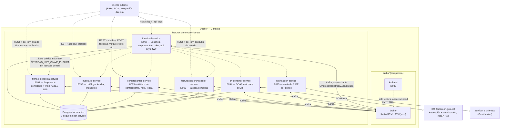
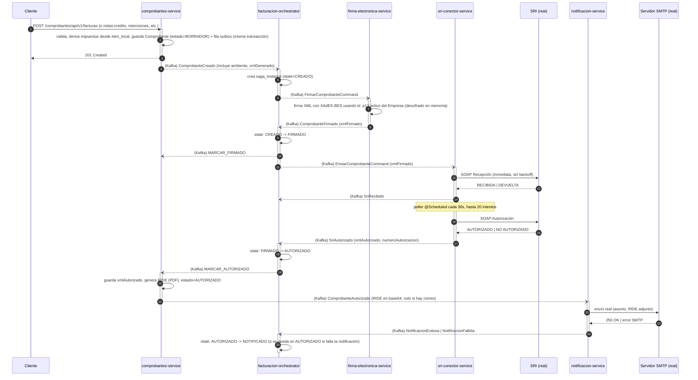
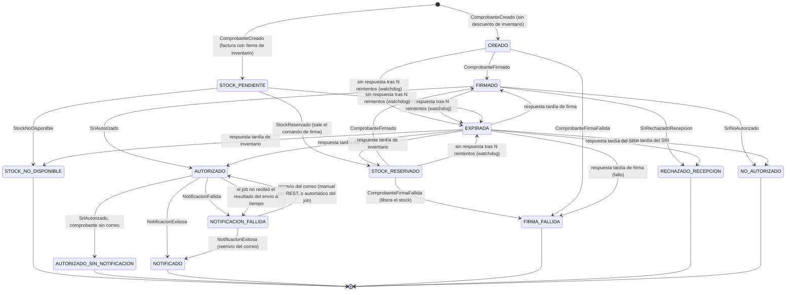
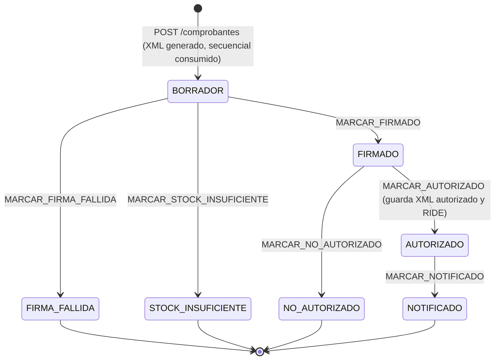
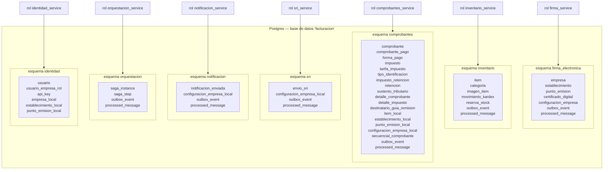

# Arquitectura — Facturación Electrónica SRI Ecuador (Java/Quarkus + Kafka)

Este documento explica **cómo está construido** el stack: el estilo arquitectónico, cómo se relaciona cada microservicio con los demás, el flujo completo de negocio de principio a fin (incluyendo la integración real con el SRI), el diseño detallado de Kafka que hace posible que los servicios de dominio se coordinen sin conocerse entre sí, y la capa de autenticación multi-tenant que protege todo el ecosistema. Usa una saga por orquestación y sus integraciones son **reales**, no simuladas: la firma digital, el envío al SRI y el envío de correo hablan con sistemas externos de verdad.

## 1. Estilo arquitectónico

| Decisión | Qué significa aquí |
|---|---|
| **Microservicios con base de datos propia** | 7 servicios Quarkus independientes (6 de dominio + `identidad-service`), cada uno dueño de su propio esquema de Postgres. Ninguno lee ni escribe directamente en las tablas de otro. |
| **Saga por orquestación** (no coreografía) | `facturacion-orchestrator-service` es el **único** que conoce el flujo completo (CREADO→FIRMADO→AUTORIZADO→NOTIFICADO). Los otros 5 no saben que forman parte de una saga — solo saben "me llegó un comando, lo ejecuto, publico si me salió bien o mal". |
| **Comunicación casi 100% asíncrona vía Kafka** | Ningún microservicio expone ni llama un endpoint REST de otro para el flujo transaccional. La única excepción deliberada es la subida del certificado `.p12` (`POST /empresas/{id}/certificado`, multipart — no tiene sentido modelar la subida de un archivo binario como un evento de Kafka). Todo lo demás — incluida la réplica de datos de Empresa (hacia `identidad-service`) e Item (hacia `comprobantes-service`) entre servicios — viaja por eventos. `identidad-service` no participa de la saga y no publica nada a Kafka, pero sí **consume** `facturacion.empresa.eventos.v1` para saber qué rucs tienen una Empresa real (ver sección 8) — ningún otro servicio le llama de vuelta. |
| **Todo el REST externo requiere api-key** | Los 6 servicios de dominio no tienen ninguna ruta pública — cada request necesita `Authorization: Bearer <api-key>`, un JWT emitido por `identidad-service` y verificado localmente (sin llamada de red) por cada servicio. Ver sección 8. |
| **Arquitectura hexagonal / DDD por servicio** | Cada servicio se organiza en capas `domain` (modelo puro, sin anotaciones de framework) → `application` (casos de uso) → `infrastructure` (JPA/Panache, Kafka, REST, SOAP, XML-DSig) → `shared`. El dominio no depende de Quarkus, Kafka, ni de las librerías de firma/SOAP; es al revés. **Reglas de dependencia:** `domain` no importa `application` ni `infrastructure`; `application` no importa `infrastructure`. Lo que un caso de uso necesita del exterior (base de datos, Kafka, SOAP, correo, cifrado, PDF…) lo pide por un **puerto** (`domain.port` o `domain.repository`) cuya implementación vive en `infrastructure`. Los mappers dominio→DTO van en `application.mapper`; el mapeo a entidades JPA, en `infrastructure.persistence.mapper`. Las reglas para quien escribe código nuevo están también en `CLAUDE.md`. |
| **Transactional Outbox + Inbox idempotente** | Ver sección 6. |
| **Stack reactivo** | Quarkus + Java 21 + Mutiny + Hibernate Reactive Panache + SmallRye Reactive Messaging. El I/O bloqueante que no tiene alternativa reactiva (firma XML-DSig del JDK, `java.net.http.HttpClient` SOAP hacia el SRI, `quarkus-mailer`) se offloadea al worker pool y se retoma en el contexto de Vert.x correcto. |
| **Integraciones externas reales, no simuladas** | La firma digital (XAdES-BES sobre un `.p12` real), el envío/autorización SOAP contra el SRI (`celcer.sri.gob.ec`) y el envío de correo (SMTP real) son genuinos. Es el punto central de este proyecto. |

### Diagrama de despliegue



**Lectura clave del diagrama:** el cliente primero le habla a `identidad-service` (crear cuenta, login, emitir una api-key) y luego usa esa api-key como `Authorization: Bearer` contra todo lo demás: `comprobantes-service` (para crear cualquiera de los 6 tipos de comprobante), `firma-electronica-service` (para dar de alta un Empresa y subir su certificado) y opcionalmente `facturacion-orchestrator-service` (para consultar el estado de la saga). Las flechas punteadas de `identidad-service` hacia el resto **no son llamadas de red** — representan que todos verifican el JWT de forma local con la llave pública de identidad (ver sección 8). `sri-conector-service` es el único servicio que sale fuera de Docker hacia una red externa real (el SRI); `notificacion-service` es el único que sale hacia un servidor SMTP real. Todos los demás servicios son invisibles para el cliente — su única puerta de entrada/salida es Kafka.

## 2. Los 7 microservicios y cómo se relacionan entre sí

| Servicio | Bounded context | Esquema BD | Ruta REST | A quién le manda comandos (Kafka) | Quién le manda comandos a él |
|---|---|---|---|---|---|
| `identidad-service` | Usuarios, asociación usuario↔ruc con rol, emisión/revocación de api-keys JWT | `identidad` | `/identidad/api/v1` | `facturacion.apikey.revocaciones.v1` (revocaciones de api-keys, ver sección 8); consume `facturacion.empresa.eventos.v1` | *(nadie le manda comandos — no participa de la saga)* |
| `firma-electronica-service` | Empresa (multi-tenant) + certificado digital + firma XAdES-BES | `firma` | `/empresas/api/v1` | *(nadie, solo responde)* | `facturacion-orchestrator-service` (`FirmarComprobanteCommand`) |
| `inventario-service` | Catálogo (productos/servicios), kardex, impuestos; con el descuento de inventario habilitado, reserva/confirma/libera stock | `inventario` | `/inventario/api/v1` | `facturacion.inventario.item.eventos.v1` y, si el descuento está habilitado, `facturacion.inventario.eventos.v1` (StockReservado, StockNoDisponible, StockConfirmado, StockLiberado) | `facturacion.inventario.comandos.v1` (RESERVAR, CONFIRMAR, LIBERAR) — solo con el descuento de inventario habilitado, ver sección 13 |
| `comprobantes-service` | Los 6 tipos de comprobante SRI, XML, RIDE | `comprobantes` | `/comprobantes/api/v1` | *(nadie — es el origen de la saga)* | `facturacion-orchestrator-service` (`MARCAR_FIRMADO`/`MARCAR_AUTORIZADO`/`MARCAR_NO_AUTORIZADO`/etc.) |
| `sri-conector-service` | Integración SOAP real con el SRI (Recepción + Autorización) | `sri` | `/sri/api/v1` | *(nadie, solo responde)* | `facturacion-orchestrator-service` (`EnviarComprobanteCommand`) |
| `notificacion-service` | Envío del RIDE autorizado por correo al receptor | `notificacion` | `/notificaciones/api/v1` | *(nadie, solo responde)* | *(nadie — no es comandado, actúa directamente sobre el evento `ComprobanteAutorizado`)* |
| `facturacion-orchestrator-service` | La saga completa de emisión | `orquestacion` | `/sagas/api/v1` | `comprobantes-service`, `firma-electronica-service`, `sri-conector-service` | `comprobantes-service` (evento `ComprobanteCreado`, el disparador inicial) |

**Por qué la relación tiene forma de estrella y no de cadena:** los servicios de dominio (firma, comprobantes, sri, notificación) **no se conocen entre sí** — ninguno le manda un mensaje directamente a otro (con la única excepción documentada abajo). Todos hablan únicamente con `facturacion-orchestrator-service`, que decide el orden de ejecución. Si un cambio en el flujo de negocio agrega o reordena un paso, ese conocimiento vive en un solo lugar: `SagaOrchestratorService.java` del orquestador.

**Las dos excepciones deliberadas a "cero REST/acoplamiento directo entre servicios":**
1. `inventario-service` y `firma-electronica-service` no reciben comandos de la saga: son **fuentes de datos de referencia**. `inventario-service` publica `ItemCreado`/`ItemActualizado`, que `comprobantes-service` replica en `item_local` (solo lectura, para derivar impuestos por `itemId`). `firma-electronica-service` publica `EmpresaRegistrada`/`EmpresaActualizada` (sin datos del certificado); su consumidor es `identidad-service` (`empresa_local`, sección 8). `comprobantes-service` no replica la Empresa: cada request de creación trae sus datos. Con el descuento de inventario habilitado, `inventario-service` además recibe comandos de stock del orquestador (sección 13).

2. `notificacion-service` no es comandado por el orquestador — consume directamente `ComprobanteAutorizado` desde `facturacion.comprobante.eventos.v1` (publicado por `comprobantes-service`, no por el orquestador) porque no hay ninguna decisión de negocio que tomar antes de notificar: si un comprobante quedó `AUTORIZADO` y tiene un correo, se notifica, punto. El orquestador igual observa `NotificacionExitosa`/`NotificacionFallida` para completar su propia máquina de estados, pero no es quien dispara el envío.

**Independencia real, no solo de código:** los servicios solo comparten `facturacion-commons` (ver sección 12): errores/excepciones con su mapper, verificación del JWT, paginación — **infraestructura transversal sin lógica de negocio ni contratos de mensajes**. Los records de mensaje Kafka NO se comparten: cada servicio define los suyos en su paquete `application/event`, aunque el *shape* del JSON coincida con el que espera el consumidor. Trade-off: pequeña duplicación de definiciones a cambio de poder redesplegar cada servicio de forma independiente.

## 3. Flujo completo de emisión de un comprobante (camino feliz)



**Puntos importantes de este flujo:**

1. **El cliente nunca espera a la saga completa.** El `POST /comprobantes/...` devuelve `201` en cuanto el comprobante queda guardado como `BORRADOR` — firmar, enviar al SRI y notificar ocurre después, de forma asíncrona. Para saber si terminó, el cliente hace polling a `GET /sagas/api/v1/{comprobanteId}`.
2. **Cada flecha `--)` (Kafka) implica, por debajo, el patrón outbox → relay → broker → inbox → efecto** (ver sección 6).
3. **La autorización del SRI puede tardar** — el SRI documenta hasta 24h de SLA, aunque en la práctica observada contra el ambiente de pruebas responde en segundos. El poller de `sri-conector-service` está diseñado para esa espera (backoff, no polling agresivo). **Con varias instancias** cada ciclo reclama sus envíos con `FOR UPDATE SKIP LOCKED` y los reserva (`ultima_consulta_en`, `sri.autorizacion.poll.reserva`, menor que el intervalo) en una transacción corta, así que dos instancias no consultan el mismo envío; si aun así dos consultan el mismo (la reserva venció durante una llamada lenta), el resultado se aplica con el envío bloqueado y solo si nadie más lo aplicó (`EnvioSri.esConsultaVigente`, log `SRI-207`): no se publica un segundo `SriAutorizado`.
4. **El correo es la única rama verdaderamente "best effort"**: un comprobante `AUTORIZADO` ya es legalmente válido tenga o no tenga correo, y tenga o no éxito el envío — ver sección 5.
5. **Tiempo real medido de punta a punta** (CREADO→AUTORIZADO, con el certificado real del usuario, contra el SRI real): ~19 segundos en el peor caso observado.

### 3.1 Idempotencia de la emisión (`Idempotency-Key`)

Los `POST` de emisión aceptan la cabecera opcional `Idempotency-Key` (8 a 128 caracteres: letras, números y `. _ : -`). Un cliente que reintenta tras un timeout o un corte de red con la misma clave y el mismo cuerpo recibe el comprobante ya creado (`201` con la cabecera `Idempotency-Replayed: true`, en su estado actual) en vez de uno nuevo, que gastaría otro secuencial. La clave se reserva al inicio de la transacción de la emisión (`INSERT ... ON CONFLICT DO NOTHING` sobre `idempotencia_emision`, única por RUC y clave) y se asocia al comprobante en esa misma transacción:

- Mismo cuerpo (huella SHA-256 del tipo y del JSON): se devuelve el comprobante original.
- Cuerpo distinto con la misma clave: `422` (`COMP-422-851`).
- Dos solicitudes simultáneas con la misma clave: la segunda espera a que la primera confirme y recibe su comprobante; si la primera se deshace, la segunda emite.
- Si la emisión falla, la transacción se deshace con la reserva y el reintento con la misma clave vuelve a intentar.
- Las claves se purgan pasado `COMPROBANTES_IDEMPOTENCIA_RETENCION` (7 días); desde entonces la misma clave emitiría uno nuevo.

Sin cabecera se emite como siempre, salvo que `COMPROBANTES_IDEMPOTENCIA_OBLIGATORIA=true` (entonces `400`). El código vive en `EmisionIdempotente`; el gateway (WSO2) no debe reescribir ni quitar la cabecera.

## 4. Máquina de estados de la saga

Los estados `STOCK_PENDIENTE`, `STOCK_RESERVADO` y `STOCK_NO_DISPONIBLE` solo existen con el descuento de inventario habilitado (sección 13); sin él la saga arranca en `CREADO`. Un estado es *terminal* (`SagaState.esTerminal()`) cuando el watchdog ya no lo toca; `NOTIFICACION_FALLIDA` y `EXPIRADA` lo son para el watchdog pero aún tienen salidas (reenvío del correo, respuesta tardía), y por eso aparecen con flechas de salida en el diagrama.



### 4.1 Watchdog: sagas que esperan una respuesta que no llega

La saga es asíncrona por Kafka: "no pasó nada" no se distingue de "todavía no contestan". `SagaWatchdog` (en `facturacion-orchestrator-service`) revisa cada 30 s las sagas en estados *reintentables* y aplica `PoliticaReintentoSaga` (lógica pura, probada sin base de datos):


| Estado | Espera a | Plazo (configurable) | Al vencer el plazo |
|---|---|---|---|
| `CREADO` y `STOCK_RESERVADO` | firma-electronica-service | `saga.watchdog.plazo-firma` = 2 min | reintenta `FirmarComprobante` |
| `STOCK_PENDIENTE` | inventario-service | el mismo plazo de la firma | reintenta `RESERVAR` |
| `FIRMADO` | el SRI | `saga.watchdog.plazo-sri` = 15 min (el SRI puede tardar más) | reintenta `EnviarComprobante` |
| cualquiera de los dos, con `reintentos >= saga.watchdog.max-reintentos` (3) | — | un plazo más tras el último reintento | pasa a **`EXPIRADA`** (el watchdog no la toca más; `failure_reason` explica por qué; ver respuestas tardías abajo) |

El reintento vuelve a publicar el **payload exacto** del último comando (mismo `eventId`), así que la idempotencia del servicio destino (inbox) decide si era un reintento genuino o si ya lo había procesado. El contador `reintentos` se incrementa con compare-and-set por estado, y cada acción deja una fila `NOTA` en `saga_step`. Las sagas `EXPIRADA` se listan con `GET /sagas?state=EXPIRADA`; `saga.watchdog.habilitado=false` lo apaga.

**`EXPIRADA` acepta respuestas tardías.** Expirar no significa que el destino no vaya a contestar: puede responder horas después. `ComprobanteFirmado`, `FirmaFallida`, `SriAutorizado`, `SriNoAutorizado` y `SriRechazadoRecepcion` también se aceptan desde `EXPIRADA` y la saga sigue su camino normal; `failure_reason` conserva el motivo de la expiración y manda el estado. `POST /sagas/{id}/retry` no cambia el estado: solo vuelve a publicar el último comando, y si el destino ya lo procesó lo descarta (inbox).


**Estados que el watchdog no toca:** los terminales, y `AUTORIZADO` (espera la notificación pero su último comando ya se cumplió).

**Otros puntos de la revisión de la saga**
- **Varios destinatarios:** `compradorCorreo`, `proveedorCorreo` y `sujetoRetenidoCorreo` aceptan una lista separada por coma (`a@x.com,b@x.com`). Al crear el comprobante se valida (forma de cada correo, sin repetidos, máximo `comprobantes.correo.maximo-destinatarios` = 3, y que quepa en 300 caracteres) y se guarda normalizada; `notificacion-service` la parte con `ListaCorreos` y manda **un solo mensaje** con todos en `to`.
- **Sagas sin correo:** `comprobantes-service` solo publica `ComprobanteAutorizado` si hay `compradorCorreo`. `ComprobanteCreado` lleva `notificacionEsperada` (`null` = `true`); si es `false`, la saga pasa de `AUTORIZADO` a **`AUTORIZADO_SIN_NOTIFICACION`** (terminal) en cuanto el SRI autoriza.

- **Una saga que falla no frena a las demás:** cada saga se procesa en su propia transacción (`idsParaRecuperar` lee; `recuperarSaga` actúa sobre una). Un reintento fallido deja una nota `ORQ-402` y cuenta como intento: una saga con un dato corrupto termina en `EXPIRADA`.

- **Relay del outbox con `FOR UPDATE SKIP LOCKED`** (los 6 servicios con outbox): con varias instancias, cada una toma lotes distintos. La corrección la garantiza el inbox de los consumidores; el bloqueo solo evita tráfico duplicado.

- **DLQ sin consumidor ni alerta** (ver 6.5): un mensaje que falla se aparta pero nadie recibe aviso. Falta una alerta sobre el tamaño de los `.dlq` y una herramienta de reproceso.

- **La saga no reintenta la notificación sola, salvo que se encienda el job** (apagado por defecto): tras `NOTIFICACION_FALLIDA` el correo se reenvía a mano con `POST /comprobantes/{id}/reenviar-correo` o `POST /sagas/reenviar-notificaciones` (ver 13.5), o automáticamente con `ReenvioNotificacionesJob` (ver 4.2).


`SriRecibido` queda registrado en la bitácora de pasos (`saga_step`) pero **no** cambia `SagaInstance.state` — es un checkpoint informativo entre Recepción y Autorización, no un estado de negocio nuevo. La validación de transición es atómica: `UPDATE saga_instance SET state = ? WHERE id = ? AND state IN (...)` atómico — una redelivery duplicada de Kafka simplemente no afecta ninguna fila.

### 4.2 Reenvío automático de correos (`ReenvioNotificacionesJob`)

El correo puede fallar por motivos pasajeros (la red, el SMTP). Hay **dos vías independientes** para reenviar:

| Vía | Quién la dispara | Alcance | Tope |
|---|---|---|---|
| REST `POST /sagas/reenviar-notificaciones` | una persona (api-key de escritura) | las sagas **de su empresa** en `NOTIFICACION_FALLIDA`, hasta `limite` (máx. 500) | ninguno: siempre reenvía |
| Job `ReenvioNotificacionesJob` | el orquestador, cada `intervalo` | las de **todas** las empresas | `max-intentos` por saga |

La bandera `saga.reenvio-notificaciones.habilitado` (**apagada por defecto**, variable `SAGA_REENVIO_NOTIFICACIONES_HABILITADO`)
gobierna **solo el job**; el REST está disponible siempre, con el job encendido o apagado.

**Qué hace en cada ciclo** (lógica pura en `PoliticaReenvioNotificacion`, probada sin base de datos):
- `NOTIFICACION_FALLIDA` con menos de `max-intentos` reenvíos automáticos y quieta desde hace `espera-minima` → cuenta un intento, la pasa a
  `AUTORIZADO` y registra (outbox) el comando `REENVIAR_NOTIFICACION`. El resultado vuelve por el camino normal: `NOTIFICADO` si el
  correo sale, o de nuevo `NOTIFICACION_FALLIDA` con el motivo nuevo.
- `AUTORIZADO` que espera una notificación y no recibió el resultado en `plazo-respuesta` → vuelve a `NOTIFICACION_FALLIDA` (nota `ORQ-301`),
  **sin gastar intento**. Así ninguna saga queda esperando para siempre un resultado que se perdió.
- Con los intentos agotados la saga **se queda en `NOTIFICACION_FALLIDA`**, visible con `GET /sagas?state=NOTIFICACION_FALLIDA` (campo
  `reintentosNotificacion`), y el job ya no la toca; solo el reenvío manual por REST la saca de ahí.

| Variable | Por defecto | Qué controla |
|---|---|---|
| `SAGA_REENVIO_NOTIFICACIONES_HABILITADO` | `false` | enciende el job |
| `SAGA_REENVIO_NOTIFICACIONES_INTERVALO` | `5m` | cada cuánto corre |
| `SAGA_REENVIO_NOTIFICACIONES_LOTE` | `20` | sagas que atiende por ciclo (las demás, en el siguiente) |
| `SAGA_REENVIO_NOTIFICACIONES_ESPERA_MINIMA` | `PT15M` | espera entre dos reenvíos de la misma saga |
| `SAGA_REENVIO_NOTIFICACIONES_PLAZO_RESPUESTA` | `PT10M` | cuánto esperar el resultado del envío antes de darlo por perdido |
| `SAGA_REENVIO_NOTIFICACIONES_MAX_INTENTOS` | `3` | reenvíos automáticos por saga |

**Contador.** `saga_instance.reintentos_notificacion` (migración V8 del orquestador), separado de `reintentos` (el del watchdog de
firma/SRI): una saga que ya gastó reintentos de firma no llega al reenvío con menos intentos. El reenvío manual no lo incrementa.

**Cómo cuida los recursos.** Una ejecución a la vez (`ConcurrentExecution.SKIP`); un lote acotado por ciclo (20); las sagas **de a una, nunca
en paralelo**, así que usa una conexión a la vez; la selección va en una sesión de solo lectura que se cierra antes de escribir; cada saga se
procesa en **su propia transacción corta** (cambio de estado + comando del outbox, atómicos), igual que el watchdog, así que una que falla no
deshace ni frena a las demás (se registra `ORQ-409` y se reintenta en el siguiente ciclo). El filtro (estado, intentos, antigüedad) y el
orden por antigüedad van en SQL, con un índice parcial (`idx_saga_instance_notificacion_pendiente`): las sagas con los intentos agotados no
ocupan lugar en el lote. El cambio de estado es compare-and-set, así que dos instancias del orquestador, o el job y un reenvío manual a la
vez, no mandan el mismo correo dos veces. A 20 por ciclo y un ciclo cada 5 min el ritmo máximo es de 240 correos por hora, por debajo de la
cuota diaria de un SMTP típico.

**Al activarlo por primera vez:** las sagas que ya estén en `AUTORIZADO` con notificación esperada y sin actividad desde hace más de
`plazo-respuesta` (p. ej. un resultado que se perdió antes) pasan a `NOTIFICACION_FALLIDA` y se reenvían de a 20 por ciclo.

### 4.3 Estados del comprobante (`comprobantes-service`) y su relación con la saga

El comprobante tiene su propia máquina de estados (`EstadoComprobante.puedePasarA`); solo la mueve el orquestador con comandos por Kafka, y el ciclo de vida **solo avanza**: un comando repetido o atrasado se ignora (`ResultadoComando.IGNORADO_TRANSICION_NO_PERMITIDA`) y uno que se salta pasos (`saltaPasos`: llega `MARCAR_AUTORIZADO` con el comprobante todavía en `BORRADOR`) falla de forma visible, va a la DLQ y se reprocesa en orden.



| Estado de la saga | Estado del comprobante | Nota |
|---|---|---|
| `STOCK_PENDIENTE`, `STOCK_RESERVADO`, `CREADO` | `BORRADOR` | todavía sin firmar |
| `FIRMADO` | `FIRMADO` | firmado y enviado al SRI |
| `AUTORIZADO`, `AUTORIZADO_SIN_NOTIFICACION`, `NOTIFICACION_FALLIDA` | `AUTORIZADO` | el comprobante ya es válido con o sin correo (sección 5) |
| `NOTIFICADO` | `NOTIFICADO` | terminal feliz |
| `NO_AUTORIZADO` y `RECHAZADO_RECEPCION` | `NO_AUTORIZADO` | el comprobante no distingue entre rechazo de recepción y no autorización; el motivo queda en `motivo_rechazo` |
| `FIRMA_FALLIDA` | `FIRMA_FALLIDA` | |
| `STOCK_NO_DISPONIBLE` | `STOCK_INSUFICIENTE` | los ítems faltantes quedan en `motivo_rechazo` |
| `EXPIRADA` | el del último paso cumplido (`BORRADOR` o `FIRMADO`) | si llega la respuesta tardía, ambos avanzan |

`ANULADO` existe en el enum pero ningún flujo lo alcanza: la anulación formal ante el SRI no está implementada y un comprobante autorizado se corrige con una nota de crédito (sección 5). `FIRMA_FALLIDA`, `NO_AUTORIZADO` y `STOCK_INSUFICIENTE` son finales: para volver a emitir se crea un comprobante nuevo (el secuencial del anterior queda sin usar).


## 5. Por qué esta saga casi no tiene compensación

> Excepción: con el descuento de inventario habilitado, el stock reservado sí se compensa con `LIBERAR` (sección 13); el resto de la saga sigue sin compensación.

Una saga clásica deshace lo ya hecho cuando algo falla a mitad de camino. **Acá casi no hay comandos de compensación** (la única es liberar el stock reservado, sección 13), porque no hay nada que sea seguro o legal deshacer automáticamente:

| Punto de fallo | Qué pasa | Por qué no hay compensación |
|---|---|---|
| Falla la firma (`ComprobanteFirmaFallida`) | `FIRMA_FALLIDA`, estado terminal | Nada se envió a ningún sistema externo todavía — no hay nada que deshacer. |
| El SRI rechaza en Recepción (`SriRechazadoRecepcion`) | `RECHAZADO_RECEPCION`, estado terminal | El comprobante nunca llegó a existir para el SRI — es como si nunca se hubiera enviado. |
| El SRI no autoriza (`SriNoAutorizado`) | `NO_AUTORIZADO`, estado terminal | Mismo caso — el documento no tiene validez legal, no hay "reversa" que hacer ante el SRI. |
| Falla la notificación (`NotificacionFallida`) | `NOTIFICACION_FALLIDA`, que solo se abandona con un reenvío exitoso del correo — **pero el Comprobante en `comprobantes-service` se queda en `AUTORIZADO`, no cambia** | Una vez que el SRI autoriza, el comprobante **es legalmente válido con o sin correo enviado** — no hay ninguna acción de negocio que "cancelar" solo porque el destinatario no recibió el email. La discrepancia (saga en `NOTIFICACION_FALLIDA`, comprobante en `AUTORIZADO`) es intencional y es el único lugar donde queda registrada: reintentar el envío es una operación aparte (reenviar el correo), no una compensación de la saga. |

Esto es coherente con la resolución NAC-DGERCGC25-00000017 (vigente desde 2026-01-01): un final-consumer invoice ya autorizado no puede anularse salvo dentro de la ventana legal de 7 días del mes siguiente, y ni siquiera eso es una "compensación de saga" — es un proceso de negocio aparte (emitir una Nota de Crédito), no algo que este orquestador automatice.

## 6. Flujo detallado de Kafka

### 6.1 Convención de tópicos

`facturacion.<dominio>.<events|commands>.v1`, más un `.dlq` por cada tópico con consumidor real. 29 tópicos en total (14 pares evento/comando + su dlq, más el tópico de auditoría del orquestador, más el par de configuración), creados al arrancar el stack por `facturacion-topic-init` (reutiliza la imagen `../kafka/topic-init`).

| Tópico | Productor | Consumidor (`group.id`) |
|---|---|---|
| `facturacion.empresa.eventos.v1` (+ `.dlq`) | firma-electronica-service | identidad-service (réplica local `empresa_local`, ver sección 8) |
| `facturacion.empresa.establecimientos.eventos.v1` (+ `.dlq`) | firma-electronica-service | comprobantes-service (réplica local `establecimiento_local`/`punto_emision_local`, valida antes de emitir — ver sección 7.1) **y** identidad-service (misma réplica, valida el alcance de una api-key nueva — ver sección 8) |
| `facturacion.empresa.configuracion.eventos.v1` (+ `.dlq`) | firma-electronica-service | comprobantes-service, notificacion-service, sri-conector-service (cada uno con su propia réplica local `configuracion_empresa_local` — `ride.color`, `notificacion.asunto`/`notificacion.remitente_nombre`, `sri.recepcion.url`/`sri.autorizacion.url`/`sri.autorizacion.poll.max-intentos` respectivamente — ver sección 7.2) |
| `facturacion.inventario.eventos.v1` (+ `.dlq`) | inventario-service | facturacion-orchestrator-service (respuestas a los comandos de stock) |
| `facturacion.inventario.comandos.v1` (+ `.dlq`) | facturacion-orchestrator-service (solo con el descuento de inventario habilitado) | inventario-service |
| `facturacion.inventario.item.eventos.v1` (+ `.dlq`) | inventario-service | comprobantes-service (réplica local `item_local`, deriva IVA/ICE) |
| `facturacion.comprobante.eventos.v1` (+ `.dlq`) | comprobantes-service | facturacion-orchestrator (filtra `ComprobanteCreado`) **y** notificacion-service (filtra `ComprobanteAutorizado`) — mismo tópico, dos shapes de evento, cada consumidor ignora la que no le corresponde vía el campo `eventType` |
| `facturacion.comprobante.comandos.v1` (+ `.dlq`) | facturacion-orchestrator | comprobantes-service (`MARCAR_FIRMADO`/`MARCAR_AUTORIZADO`/`MARCAR_NO_AUTORIZADO`/etc.) |
| `facturacion.firma.comandos.v1` (+ `.dlq`) | facturacion-orchestrator | firma-electronica-service |
| `facturacion.firma.eventos.v1` (+ `.dlq`) | firma-electronica-service | facturacion-orchestrator |
| `facturacion.sri.comandos.v1` (+ `.dlq`) | facturacion-orchestrator | sri-conector-service |
| `facturacion.sri.eventos.v1` (+ `.dlq`) | sri-conector-service | facturacion-orchestrator |
| `facturacion.notificacion.comandos.v1` (+ `.dlq`) | *(reservado, no usado — notificación no es comandada, ver sección 2)* | notificacion-service |
| `facturacion.notificacion.eventos.v1` (+ `.dlq`) | notificacion-service | facturacion-orchestrator |
| `facturacion.orquestacion.eventos.v1` | facturacion-orchestrator | *(auditoría, sin consumidor obligatorio)* |

`facturacion-orchestrator-service` produce hacia **4 tópicos de comando** (comprobante, firma, SRI e inventario) y consume de **5**: su relay del outbox enruta cada mensaje según la columna `outbox_event.topic`. `inventario-service` también enruta hacia dos tópicos de salida (`ItemCreado` en su propio tópico, separado de `eventos.v1`).


### 6.2 Orden garantizado: `comprobanteId` como key

**Todo mensaje relacionado con un comprobante usa `comprobanteId` como key** (ver `OutboxRelay.java` de cada servicio, `OutgoingKafkaRecordMetadata.withKey(event.aggregateId.toString())`). Kafka enruta siempre la misma key a la misma partición, así que todos los eventos y comandos de un comprobante en particular se procesan siempre en el orden en que se publicaron, sin importar cuántas particiones tenga el tópico.

### 6.3 Outbox transaccional y 6.4 Inbox idempotente

Mecánica: escritura de negocio + fila de outbox en la misma transacción SQL, `OutboxRelay` `@Scheduled(every = "1s")` como único publicador real, e inbox con `processed_message` para descartar redeliveries sin reaplicar el efecto. La cadencia de 1s del relay es, además, una decisión regulatoria explícita: satisface el requisito de "transmisión inmediata" de la Resolución NAC-DGERCGC25-00000017 (vigente 2026-01-01) — no hay ninguna ventana de gracia de días hábiles como existía antes de esa resolución.

### 6.5 Dead Letter Queue

Cada tópico con consumidor real tiene `failure-strategy=dead-letter-queue`: un mensaje que falla su procesamiento de forma repetida se mueve a `<tópico>.dlq` en vez de bloquear la partición.

**Procedimiento para revisar y reprocesar un DLQ** (hoy es manual; no hay alerta automática):
```sh
# ¿cuántos mensajes tiene cada DLQ? (offset final = total acumulado)
docker exec kafka-broker-1 /opt/kafka/bin/kafka-get-offsets.sh --bootstrap-server localhost:9092 --topic <topico>.dlq
# leer los mensajes (el motivo del fallo viaja en los headers dead-letter-reason / dead-letter-cause)
docker exec kafka-broker-1 /opt/kafka/bin/kafka-console-consumer.sh --bootstrap-server localhost:9092 \n  --topic <topico>.dlq --from-beginning --property print.headers=true --timeout-ms 5000
```
Para reprocesar: corregir la causa (un consumidor roto, una migración pendiente, un catálogo sin cargar) y volver a publicar el mensaje en el tópico original (`kafka-console-producer.sh --topic <topico> --property parse.key=true`). Los consumidores son idempotentes por inbox, así que reenviar un mensaje que sí se había procesado es inocuo.

### 6.6 Configuración de confiabilidad (resumen)

| Lado | Configuración | Por qué |
|---|---|---|
| Productor | `enable.idempotence=true`, `acks=all` | Evita duplicados por reintento de red; el productor no considera enviado el mensaje hasta que el broker lo confirmó de forma durable. |
| Productor | `delivery.timeout.ms=25000`, `request.timeout.ms=10000` | Menores que el plazo del relay del outbox (`outbox.relay.timeout-ack`, 30 s): el cliente se rinde antes de que el relay suelte su transacción, así que un broker caído no deja mensajes "en el aire". En la revocación de api-keys: 8 s y 5 s (el usuario espera la respuesta). |
| Tópicos | `replication.factor` y `min.insync.replicas` por ambiente | `KAFKA_REPLICATION_FACTOR` y `KAFKA_MIN_ISR`: desarrollo 1 y 1 (un broker), pruebas 2 y 2 (2 nodos), producción 3 y 2 (3 nodos). Con `acks=all` todo mensaje confirmado está en al menos 2 nodos en pruebas y producción. En producción un nodo caído no frena ni pierde mensajes y dos caídos detienen las escrituras a propósito (`NOT_ENOUGH_REPLICAS`); en pruebas, con 2 controladores no hay mayoría, así que un nodo caído detiene las escrituras (se recuperan solas, ~12 s tras volver el nodo) y sirve para ensayar la caída, no para tolerarla. Las DLQ se conservan 30 días (`KAFKA_DLQ_RETENCION_MS`), los eventos 7. |
| Consumidor | `enable.auto.commit=false` | El offset solo se confirma después de que el efecto de negocio ya quedó aplicado y persistido. |
| Consumidor | sin ajustar `max.poll.*` ni `session.timeout.ms` | SmallRye mantiene un hilo que llama a `poll()` mientras los mensajes se procesan (pausa las particiones), así que un manejador lento (SMTP, SRI) no vence `max.poll.interval.ms`; los valores por defecto de Kafka bastan. |
| Consumidor | `auto.offset.reset=earliest` | Un consumer group nuevo procesa desde el principio del tópico y no pierde mensajes ya publicados; un servicio nuevo arrancado tarde reprocesa todo el tópico (los consumidores son idempotentes). |

| Consumidor | `failure-strategy=dead-letter-queue` | Ver 6.5. |
| Todos los mensajes | `key = comprobanteId` | Ver 6.2. |

## 7. Base de datos

Un solo contenedor Postgres (`facturacion-db`), con **una base de datos** (`facturacion`) y **un esquema por servicio**. Vive fuera de este proyecto, en `D:\inf_sri\CONTENEDORES\postgres` (su propio `docker-compose.yml`, red externa `facturacion_net`, ver su README): hay que levantarlo antes que los microservicios, y su host se cambia con `DB_HOST`. Ese stack crea los esquemas y roles; las tablas las crean las migraciones Flyway de cada servicio (o, sin levantar los servicios, `docker compose --profile migrar run --rm migraciones` desde ese directorio):




**El aislamiento viene de los permisos de Postgres, no de bases físicas separadas**: cada servicio se conecta con su propio rol, sin permisos fuera de su propio esquema, con `search_path` fijado del lado del servidor. El SQL de cada servicio vive versionado en `src/main/resources/db/migration/V*.sql` (Flyway, `migrate-at-start=true`). Cada tabla y cada columna lleva `COMMENT ON` (descripción, valores posibles, unidades): se ven con `d+` en psql y en cualquier cliente SQL. Los comentarios de las tablas existentes están en la migración `…__comentarios_de_tablas_y_columnas.sql` de cada servicio; una tabla o columna nueva lleva su `COMMENT ON` en su misma migración.

**Particularidad de este proyecto:** los nombres de tabla y columna están en español y calcados de la terminología exacta del SRI (`clave_acceso`, `comprador_razon_social`, `docSustentoNumero`, etc.) — no traducidos libremente — para que el mapeo entre el modelo de datos y la ficha técnica del SRI sea directo al depurar un rechazo.

### 7.1 Establecimientos y puntos de emisión

`firma-electronica-service` expone un CRUD (`EstablecimientoResource`/`PuntoEmisionResource`, basados en id, sin re-chequeo de ruc) para las tablas `establecimiento`/`punto_emision` de la sección 7. `EmpresaService.crearEmpresa` crea en la misma transacción un establecimiento MATRIZ y un punto de emisión con los códigos por defecto de la empresa: no hace falta ningún paso manual.


`comprobantes-service` mantiene su propia réplica (`establecimiento_local`/`punto_emision_local`, indexadas por `(ruc, codigo)` — nunca por el id interno de firma-electronica-service, mismo principio "Empresa sin ID") vía el tópico `facturacion.empresa.establecimientos.eventos.v1` (ver 6.1), y **valida contra ella antes de reservar el secuencial** de cualquiera de los 6 tipos de comprobante (`ComprobanteService.emitir`) — un establecimiento o punto de emisión no registrado (o inactivo) devuelve 400, en vez de dejar pasar cualquier string como ocurría antes.


### 7.2 `configuracion_empresa`: ajustes por empresa

La tabla `configuracion_empresa` (clave/valor genérico, sección 7) guarda ajustes opcionales por empresa. `ConfiguracionEmpresaService.crear`/`actualizar`/`eliminar` publican un evento en el outbox (tópico de 6.1: cualquier `clave`/`valor`; un `valor` en `null` en el evento de eliminación vuelve al comportamiento por defecto). `crear` (`POST /{id}/configuracion/{clave}`) responde `409` si la clave ya existe y `actualizar` (`PATCH`) responde `404` si todavía no existe, igual que el resto de la API (`POST` = no debe existir; `PUT`/`PATCH` = ya existe). Tres servicios mantienen su réplica `configuracion_empresa_local` (indexada por `(ruc, clave)`), cada uno con sus claves:


- **`comprobantes-service`** — `ride.color` (hex RGB, ej. `#1A73E8`): color del número del documento en el RIDE (rojo si no está o es inválido). `ride.logo` (base64 de un PNG/JPEG): lo publica `firma-electronica-service` al subir el logo de la empresa (sección 13.2), no se edita a mano. `ActualizacionComprobanteService.autorizar` consulta ambos justo antes de generar el RIDE en `MARCAR_AUTORIZADO`.

- **`notificacion-service`** — `notificacion.asunto` (asunto del correo) y `notificacion.remitente_nombre`, `ride.logo` (el logo, que usa en el encabezado del correo) (nombre visible del remitente, ej. "Facturación Acme" — nunca cambia la dirección real autenticada ante el SMTP, `quarkus.mailer.from`): `NotificacionService.enviarCorreo` las lee en una sesión corta antes de llamar a `CorreoService.enviarComprobante`.
- **`sri-conector-service`** — `sri.recepcion.url`, `sri.autorizacion.url` (sobreescriben la URL fija por ambiente) y `sri.autorizacion.poll.max-intentos` (sobreescribe el default global): `SriConectorService` las consulta en `procesarComando`/`consultarAutorizacion`. `EnviarComprobanteCommand` y `EnvioSri` llevan `empresaRuc`. El máximo de intentos varía por empresa, así que el paso a `ERROR_CONSULTA` se decide fila por fila en `SriConectorService.aplicarResultadoAutorizacion`, no en el SQL del poller (`AutorizacionPoller`). Solo se respeta una URL `https` cuyo host esté en `sri.url.hosts-permitidos` (por defecto `*.sri.gob.ec`); si no, se usa la oficial.

- **`comprobantes-service`** — `sri.proveedor.ruc`: RUC del proveedor de sistemas informáticos o servicios de facturación electrónica, requisito del **Anexo 26** de la Ficha Técnica de Comprobantes Electrónicos v2.34 (Resolución SRI No. NAC-DGERCGC26-00000027, 27/07/2026 — plazo de 60 días calendario desde su publicación en Registro Oficial). Deliberadamente white-label: cada empresa (o cada cliente de un revendedor del propio sistema) configura su propio RUC de proveedor, no un valor único fijo de la plataforma. `ComprobanteService.emitir` la consulta junto con la construcción del comprobante (antes de generar el XML, no en el momento del RIDE como `ride.color` — este dato sí tiene que ir en el XML firmado y autorizado ante el SRI) y la guarda inline en `Comprobante.proveedorRuc` (columna `empresa_proveedor_ruc`, mismo criterio "Empresa sin ID" que el resto de datos de empresa en esta tabla). `XmlComprobanteUtil.construirInfoAdicional` la auto-inyecta como `<campoAdicional nombre="RUC Proveedor">...</campoAdicional>` en los 6 tipos de comprobante (mismo mecanismo que ya usaba `granContribuyente`, Anexo 24); `RideGenerador` también imprime la línea "RUC Proveedor" en el RIDE si está configurada. Si la empresa no la configuró, `proveedorRuc` queda `null` y no se agrega nada — retrocompatible.

El resto de claves posibles (feature flags, etc.) siguen sin un consumidor real — el patrón queda listo para el próximo ajuste que lo necesite, mismo criterio que los de arriba.

### 7.3 Validación XSD real contra el esquema oficial del SRI

`XsdValidador` (`comprobantes-service/infrastructure/xml`) valida el XML sin firmar de cada comprobante contra el XSD oficial de su tipo **antes** de persistirlo, con `javax.xml.validation` (JDK puro). Firmar no cambia la estructura (`ds:Signature` es `minOccurs="0"` en las 6 XSD), así que validar sin firmar equivale a validar lo que ve el SRI.


Los 6 XSD de referencia (copiados de `documentacion/XML y XSD */` del repo, que trae varias versiones reales por tipo) están empaquetados en `comprobantes-service/src/main/resources/xsd/`, junto con `xmldsig-core-schema.xsd` (el estándar W3C que todos importan para `ds:Signature`, sin el cual `SchemaFactory` no compila). Se usó siempre **la última versión disponible en `documentacion/`, con una única excepción deliberada**:

| Tipo | Versión usada | Última disponible en `documentacion/` |
|---|---|---|
| Factura | 2.1.0 | 2.1.0 |
| Nota de Crédito | 1.1.0 | 1.1.0 |
| Nota de Débito | 1.0.0 | 1.0.0 (única) |
| Guía de Remisión | 1.1.0 | 1.1.0 |
| Comprobante de Retención | 2.0.0 | 2.0.0 |
| Liquidación de Compra | 1.1.0 | 1.1.0 |

**Retención migró de 1.0.0 a 2.0.0 (estilo ATS)**: la 2.0.0 no es un cambio aditivo — reestructura todo el documento bajo un wrapper `docsSustento`/`docSustento`, donde cada documento sustento agrupa su propio `impuestosDocSustento` (el IVA/ICE que ya traía ese documento, no el valor retenido), sus `retenciones` y sus `pagos`, reemplazando el `<impuestos>` plano de la 1.0.0; `infoCompRetencion` suma `parteRel` (`SI|NO`, obligatorio). Esto obligó a un rediseño real del modelo de dominio de este comprobante, no solo del generador XML:
- `CrearRetencionRequest` cambió su forma (`documentosSustento: DocumentoSustentoRequest[]`, cada uno con `codSustento`/`pagoLocExt`/`totalSinImpuestos`/`importeTotal`/`impuestos`/`retenciones`/`pagos` propios, más `parteRelacionada` a nivel de comprobante) — reemplaza la lista plana `retenciones` de la 1.0.0. Los otros 5 tipos no se tocaron.
- Domain: dos VO nuevos, `ImpuestoDocSustento` (el impuesto del documento sustento) y `DocumentoSustento` (agrupa `impuestos`/`retenciones`/`pagos` de un mismo documento) — y dos campos nuevos en `Comprobante` (`parteRelacionada`, `documentosSustento`), ambos `null`/vacíos en los otros 5 tipos. `documentosSustento` es **transitorio**: solo lo usa `GeneradorXmlRetencion` para construir el XML dentro de `ComprobanteService.construirRetencion`, no se persiste (no hay migración nueva) — queda íntegro dentro de `xml_generado`, que sí se persiste. `Comprobante.detalles` se sigue llenando igual que en la 1.0.0 (una fila por línea de retención) para que el RIDE y el listado de comprobantes no necesiten ningún cambio.
- `XsdValidador` valida contra `ComprobanteRetencion_V2.0.0.xsd`.


Detalle de implementación: los `Schema` se compilan una sola vez por tipo al construir el bean `@ApplicationScoped` (compilar un XSD no es gratis); `Validator` no es thread-safe, así que se crea uno nuevo por llamada. `ComprobanteService.emitir` corre `xsdValidador.validar(...)` en el worker pool de Mutiny (`Infrastructure.getDefaultWorkerPool()`, mismo patrón que `CertificadoService.validarYExtraerMetadata`) y vuelve al contexto de Vert.x capturado al inicio del método antes de tocar Hibernate Reactive de nuevo — necesario porque el parsing/validación DOM es trabajo bloqueante. Un XML que no cumpla el XSD de su tipo responde 400 con el motivo SAX exacto (línea/columna), antes de persistir el comprobante — aunque el secuencial ya fue reservado en ese punto de la cadena (`ComprobanteService.emitir`), como con cualquier otro fallo de este método.

### 7.4 Formas de pago (Tabla 24) y reglas de `<pagos>`

**Qué dice el SRI.** Las formas de pago son la **Tabla 24** de la Ficha Técnica (catálogo del Anexo Transaccional Simplificado). Está idéntica en todas las versiones de la ficha que trae `documentacion/` (2.26 `.txt`, 2.33 `.txt` y 2.34 PDF — la 2.27 a la 2.34 no cambiaron formas de pago):

| Código | Descripción | Vigente desde |
|---|---|---|
| `01` | SIN UTILIZACION DEL SISTEMA FINANCIERO | 01/01/2013 |
| `15` | COMPENSACION DE DEUDAS | 01/01/2013 |
| `16` | TARJETA DE DEBITO | 01/06/2016 |
| `17` | DINERO ELECTRONICO | 01/06/2016 |
| `18` | TARJETA PREPAGO | 01/06/2016 |
| `19` | TARJETA DE CREDITO | 01/06/2016 |
| `20` | OTROS CON UTILIZACION DEL SISTEMA FINANCIERO | 01/06/2016 |
| `21` | ENDOSO DE TITULOS | 01/06/2016 |

**Qué comprobantes llevan `<pagos>`.** Factura, Nota de Débito y Liquidación de Compra (a nivel de `infoXxx`), y Comprobante de Retención v2.0.0 (dentro de cada `docSustento`). Nota de Crédito y Guía de Remisión no. Cada `<pago>` es `formaPago` + `total` + `plazo`/`unidadTiempo` opcionales — salvo en Retención v2.0.0, cuyo XSD define `pago` solo con `formaPago` y `total`.

**Por qué no basta el XSD.** El patrón de `formaPago` en los XSD de los 4 tipos que llevan `<pagos>` acepta cualquier código de `01` a `21`, que es más amplio que la Tabla 24 (los `02`–`14` no existen). Además el XSD no relaciona los pagos con el `importeTotal`, ni obliga a mandar `plazo` y `unidadTiempo` juntos. Esas reglas las aplica este servicio, antes de generar el XML, y devuelven **400** con el motivo (`PagoRequest` valida el formato; `PagosValidador` las reglas de negocio):

| Regla | Fuente |
|---|---|
| `formaPago` debe existir y estar vigente a la fecha de emisión en el catálogo de formas de pago (Tabla 24, tabla `forma_pago`, ver 7.6) | Ficha técnica, Tabla 24 |
| `plazo` y `unidadTiempo` van juntos o ninguno; `plazo` numérico `>= 0`, hasta 2 decimales; `unidadTiempo` de 1 a 10 caracteres | Ficha técnica ("obligatorio cuando corresponda") + XSD (`plazo` decimal 14,2) |
| La suma de los `total` (cada uno a 2 decimales, como sale en el XML) debe ser igual al `importeTotal` impreso | **Regla de este sistema** — la ficha no la dice expresamente |
| Retención v2.0.0: el pago **no admite** `plazo`/`unidadTiempo` | XSD `ComprobanteRetencion_V2.0.0` |
| Factura con forma de pago `21` (endoso de títulos): exige `plazo`, `unidadTiempo` y `compradorDireccion` | Anexo 11 (factura comercial negociable) |

El vocabulario de `unidadTiempo` no está definido por la ficha (todos sus ejemplos usan `dias`), por eso solo se valida longitud y que vaya acompañado de `plazo`. Si el llamador no manda `pagos`, se asume un único pago `01` por el importe total.

El Anexo 11 también menciona `<tipoNegociable><correo>` para la notificación masiva de facturas negociables; eso **no** está implementado (aplica solo a quien notifica masivamente por el portal del SRI).

### 7.5 `comprobante_pago` y `detalle_impuesto`

Los pagos de un comprobante viven en `comprobante_pago` y los impuestos de cada línea en `detalle_impuesto` (columnas tipadas, consultables y protegidas por constraints; migración `V11__pagos_e_impuestos_formalizados.sql`):


```
forma_pago (codigo PK, descripcion, vigente_desde, vigente_hasta)        ← catálogo, Tabla 24
   ▲ FK
comprobante_pago (id, comprobante_id FK→comprobante, orden, forma_pago,
                  total numeric(14,2) >= 0, plazo numeric(14,2) >= 0, unidad_tiempo varchar(10))

detalle_impuesto (id, detalle_id FK→detalle_comprobante, orden, codigo, codigo_porcentaje,
                  tarifa numeric(7,2), base_imponible numeric(22,8), valor numeric(14,2),
                  codigo_retencion, doc_sustento_codigo, doc_sustento_numero, doc_sustento_fecha date)
```

Decisiones:
- **`orden`** preserva la posición dentro del comprobante/línea, porque el orden de `<pago>` e `<impuesto>` en el XML sale de ahí. Su `unique (padre_id, orden)` también sirve de índice por padre.
- **`base_imponible` es `numeric(22,8)`, no `(14,2)`**, a propósito: es `cantidad × precioUnitario − descuento` (hasta 8 decimales) y los totales de encabezado se suman sobre ese valor sin redondear antes de formatear; redondearlo al guardar cambiaría los totales al recargar un comprobante.

- **Constraints `NOT VALID`** (`fk_comprobante_pago_forma_pago`, `chk_comprobante_pago_plazo_unidad`): se exigen a toda fila nueva o modificada, pero no a las históricas — el XSD sí dejaba pasar códigos `02`–`14` y `plazo` sin `unidadTiempo`, y esas filas no deben impedir que la migración corra. Cuando se depuren: `ALTER TABLE comprobantes.comprobante_pago VALIDATE CONSTRAINT <nombre>`.
- **En Retención**, cada línea de retención sigue siendo una fila de `detalle_comprobante` con su `detalle_impuesto`: `codigo_porcentaje` queda en `null` y se llenan `codigo_retencion` y los `doc_sustento_*` (`doc_sustento_fecha` es `date` en la base; el dominio y el XML siguen usando `dd/MM/aaaa`). Los `pagos` por documento sustento siguen siendo transitorios (solo viven en `xml_generado`, ver 7.3) — `comprobante_pago` solo guarda los de Factura/Nota de Débito/Liquidación de Compra.
- `campos_adicionales_json` **sigue siendo JSON**: es información libre (`nombre`/`valor`) sin esquema fijo ni consultas previstas.

Permite, por ejemplo, el total vendido por forma de pago:


```sql
select fp.codigo, fp.descripcion, count(*) as pagos, sum(p.total) as total
from comprobantes.comprobante_pago p
join comprobantes.forma_pago fp on fp.codigo = p.forma_pago
group by fp.codigo, fp.descripcion order by total desc;
```

### 7.6 Catálogos del SRI: un módulo de `comprobantes-service`

Los catálogos de la ficha técnica (formas de pago, impuestos y tarifas de IVA, tipos de identificación, retenciones, sustento) son datos **globales** —no pertenecen a una empresa— y cambian cuando el SRI publica una nueva versión de la ficha. Viven en `comprobantes-service` porque es el servicio que **aplica** las reglas del SRI (XSD, generadores de XML, validaciones) y el único que los necesita para emitir: un cambio de catálogo y un cambio de XSD/regla van juntos.

**Decisión.** Los catálogos son un módulo dentro de `comprobantes-service`: solo este servicio consume 5 de los 7, e inventario guarda únicamente los códigos de impuesto del ítem (`codigoPorcentajeIva`, `codigoIce`, `codigoIrbpnr`). Se lee la base con entidades en cada emisión. **Si aparece un segundo consumidor real** (un servicio de ATS o reportes, una pantalla que liste catálogos), conviene separarlo: la API y las tablas ya tienen la forma de un servicio.


| Alternativa evaluada | Costo por emisión | Acoplamiento | Decisión |
|---|---|---|---|
| Servicio aparte + REST en cada emisión | salto de red + JSON; si cae, no se emite | en tiempo de ejecución | Descartada: rompe "cero REST en la ruta de emisión" y crea un punto único de falla para datos que casi nunca cambian |
| Servicio aparte + réplicas por Kafka | consulta local | eventos entre servicios | Probada y retirada (ver arriba): complejidad sin segundo consumidor |
| Leer el esquema de otro servicio | 1 consulta | **de datos** (comparten tablas) | Descartada: rompe el aislamiento por esquema y rol |
| Entidades JPA por catálogo, leídas en cada emisión | 7 consultas (~8–11 ms más por emisión, medido) | ninguno | **Elegida** (decisión del dueño del proyecto: el valor de la base manda, sin desfase entre instancias) |
| Tablas propias + caché en memoria | 0 consultas (acierto de caché) | ninguno | Probada y retirada: ahorraba ~8–11 ms por emisión a cambio de hasta 30 s de desfase entre instancias y una invalidación que mantener |

**Cómo funciona**
- **Datos:** las 7 tablas (`forma_pago`, `impuesto`, `tarifa_impuesto`, `tipo_identificacion`, `impuesto_retencion`, `retencion`, `sustento_tributario`) son del esquema `comprobantes`. La migración `V14` las **siembra con los datos de la ficha v2.34** y les pone las restricciones (FK, `check`).
- **API** (`/comprobantes/api/v1/catalogos`, todo con api-key): `GET /catalogos` (lista los catálogos), `GET /catalogos/{catalogo}?vigentes=true&fecha=yyyy-MM-dd`, `PUT /catalogos/{catalogo}` (crea o actualiza por clave). **Escribir exige además el header `X-Catalogos-Admin-Token`** (variable `CATALOGOS_ADMIN_TOKEN`): los catálogos son globales y una api-key de una empresa no debe poder cambiarlos para todas las demás. Sin token configurado la escritura está deshabilitada (403). Dar de baja = `"activo": false` (no se borra: el histórico lo necesita). Para cambiar un catálogo **no hace falta redesplegar**.
- **Sin caché:** `CatalogoSriRepositoryImpl` lee las siete tablas con entidades de solo lectura (`FormaPagoEntity`, `ImpuestoEntity`, `TarifaImpuestoEntity`, …) en cada emisión, dentro de la transacción del comprobante, y evalúa la vigencia a la fecha de emisión (hora de Ecuador, UTC-5) en memoria. Un `PUT /catalogos/...` aplica a la siguiente factura en cualquier instancia. La administración (`GET`/`PUT`) sigue siendo genérica sobre `CatalogoDef` con SQL directo, porque los 7 catálogos se operan igual.
- **Cambios de normativa sin desplegar:** las tarifas (IVA, ICE de la Tabla 18, IRBPNR) y los códigos de retención son filas, no código. La clave de `tarifa_impuesto` es (impuesto, código, `tipo_tarifa`, `vigente_desde`): cuando el SRI publica una tarifa nueva se agrega una fila con su `vigente_desde` y se cierra la anterior con `vigente_hasta` (`PUT /catalogos/tarifa_impuesto`); los comprobantes ya emitidos conservan su tarifa y los nuevos usan la vigente a su fecha de emisión. Lo único que sigue siendo código (enums de dominio) son los códigos estructurales: tipo de impuesto (`ImpuestoSri`), clasificación de IVA no objeto/exento (`CodigoIva`), tipo de comprobante, ambiente y tipo de tarifa.
- **Vigencia:** un registro aplica en la fecha F si está activo y `vigente_desde <= F <= vigente_hasta` (sin `hasta` = sin fin). `vigente_desde = 1900-01-01` significa "la ficha no publica fecha de inicio".
- **Catálogo vacío:** las validaciones que dependen de un catálogo sin filas **no bloquean**, solo se validan por formato (ver `CatalogosSriAFecha`). La excepción es la tarifa de IVA: sin tarifas en la tabla y sin tarifa en el request, la emisión falla con `COMP-400-204`.
- **Inventario** solo guarda los códigos de impuesto de cada ítem (`codigoPorcentajeIva` obligatorio, `codigoIce` y `codigoIrbpnr` opcionales) y **no los valida ni guarda tarifas**: comprobantes los valida y resuelve la tarifa al emitir. Un código inexistente se detecta al facturar, no al crear el ítem.

| Catálogo | Tabla de la ficha | Qué se valida con él |
|---|---|---|
| `forma_pago` | 24 | `formaPago` de cada pago existe y está vigente |
| `impuesto` | 16 | `codigo` del impuesto de cada línea |
| `tarifa_impuesto` | 17 (IVA) | `codigoPorcentaje` existe y vigente; la **tarifa se toma de aquí**; si el cliente manda tarifa debe coincidir |
| `tipo_identificacion` | 6 | tipo de identificación; `07` (consumidor final) solo en Factura |
| `impuesto_retencion` | 19 | impuesto a retener (1 Renta, 2 IVA, 6 ISD) |
| `retencion` | 20 | `codigoRetencion` existe y vigente para ese impuesto y `porcentajeRetener` coincide (IVA e ISD; el ISD 4580 tiene una fila por período) |
| `sustento_tributario` | ATS | `codSustento` |

**Lección vigente:** un parámetro `$n::numeric` hace que el cliente de Postgres exija un tipo numérico y rechace el `String` con el que viajan los decimales y las fechas del body JSON; se declara `::text` y se convierte (`$n::text::numeric`, `$n::text::date`), en el `PUT` y en el filtro `vigentes` del `GET`. `CatalogoAdminServiceSqlTest` fija la forma del SQL.


**Qué NO está cargado, y por qué** (la documentación del proyecto no lo trae y no se inventó):
- **ICE (Tabla 18) e IRBPNR:** cargados en `tarifa_impuesto` (migración V20) con la columna `tipo_tarifa`: `PORCENTAJE` (ad valorem) o `ESPECIFICA` (USD por unidad). Un código con las dos modalidades (3031) tiene una fila por tipo y se usa la porcentual salvo que el request pida `tipoTarifa: ESPECIFICA`. La ficha publica valores hasta 2023; las tarifas específicas se actualizan cada año con `PUT /catalogos/tarifa_impuesto` (fila nueva con `vigente_desde`, la anterior se cierra con `vigente_hasta`), sin desplegar.
- **Códigos de retención de Renta** (303, 304, 312, …) y **`codSustento`**: pertenecen al Catálogo del Anexo Transaccional Simplificado (ATS), que no está en `documentacion/`. Las tablas existen (la de sustento, vacía); se cargan con `PUT /catalogos/retencion` y `PUT /catalogos/sustento_tributario` desde el catálogo oficial. Mientras estén vacías solo se valida el formato; desde que tengan filas la validación pasa a ser estricta.
- **Fechas de vigencia de las tarifas de IVA:** la ficha lista los códigos (0, 2, 3, 4, 5, 6, 7, 8, 10) sin fechas; se cargaron sin fecha. Para acotar una tarifa cuando el SRI la cambie: `PUT /catalogos/tarifa_impuesto` con `vigente_hasta`.
- **Países, tipos de comprobante del ATS y demás tablas** de la ficha: nadie los necesita todavía.

Para agregar un catálogo nuevo: tabla + entrada en `Catalogo` y en `CatalogoDef.TODOS` (el REST y el SQL son genéricos), y la lectura en `CatalogoSriRepositoryImpl` si alguna validación lo usa.

### 7.7 Otras validaciones de negocio al emitir

Controles que el XSD no hace y que se aplican antes de generar el XML (todos devuelven 400 con el motivo):

| Regla | Dónde |
|---|---|
| Un ítem dado de baja (`activo=false`) no se puede facturar cuando el impuesto se deriva del ítem | `comprobantes` |
| Un código de ICE o IRBPNR debe existir y estar vigente en el catálogo a la fecha de emisión (`COMP-400-202`); la tarifa mandada debe coincidir con la del catálogo | `comprobantes` |
| `07` (consumidor final) exige la identificación `9999999999999`, y ese número solo es válido con `07` (Tabla 6) | `comprobantes` |
| RUC (`04`) = 13 dígitos; cédula (`05`) = 10 dígitos (máscaras de la Tabla 5). No se valida el dígito verificador: el algoritmo no está en la ficha | `comprobantes` |
| `valorRetenido` = `baseImponible × porcentajeRetener / 100` (tolerancia de 1 centavo) | `comprobantes` |
| `docSustentoFecha` debe ser una fecha real (no 31/02) | `comprobantes` |
| Nota de crédito y nota de débito: `docModificadoNumero` con el formato `001-001-000000001` y `docModificadoFecha` no futura. Si el documento (factura o liquidación de compra) lo emitió este sistema para la empresa: debe estar autorizado y la fecha debe ser la de su emisión (`COMP-400-861` a `864`). Solo la nota de crédito, además, sumada a las notas de crédito ya emitidas sobre él (en camino o autorizadas), no puede superar su valor (`COMP-400-865`) | `comprobantes` |

**Monto máximo a consumidor final.** Una factura con identificación `07` por encima del monto máximo se rechaza con `COMP-400-306` (ficha técnica 8.10: más de 50 USD exige los datos del adquirente). El monto es configurable (`comprobantes.consumidor-final.monto-maximo`, variable `CONSUMIDOR_FINAL_MONTO_MAXIMO`, 50.00 por defecto) porque el historial de la ficha dice que se ha actualizado y no da el valor vigente. Lo que se pudo confirmar (fuentes de prensa y un estudio jurídico, no el texto del Registro Oficial): desde el 10/11/2022 (Decreto Ejecutivo 586, que reformó el artículo 19 numeral 1 del Reglamento de Comprobantes de Venta) el tope general bajó de 200 a 50 USD. Una sola fuente secundaria dice que para RIMPE Negocio Popular el tope es 200 USD; no está confirmado y esos contribuyentes no están obligados a facturar electrónicamente, así que el sistema aplica un único tope. Tampoco queda claro si exactamente 50,00 puede ir a consumidor final (la implementación lo permite: rechaza solo lo que supere el tope). **Confirmar ambos puntos con el texto oficial del Reglamento.**

**Notas de crédito y de débito contra el documento que modifican.** Las dos pasan por `DocumentoModificadoValidador` y `BuscadorDocumentoModificado`; el tope de valor es solo de la de crédito (`NotaCreditoValidador`), porque la de débito agrega cargos. Si el documento no está en este sistema (emitido en papel, por otro sistema o antes de este), no se puede comprobar: solo se validan el formato y la fecha, y el SRI hace el resto. La comprobación bloquea la fila del documento hasta el final de la transacción, para que dos notas de crédito simultáneas sobre el mismo documento no se pasen del valor.

**Sin implementar**: validación del dígito verificador de RUC/cédula (a propósito, ver sección 11).

### 7.8 Errores de negocio con código y textos en `mensajes.properties`

Las reglas de negocio nuevas (catálogos, pagos, identificación, retención, ICE, saga) **no lanzan `IllegalArgumentException` ni texto suelto**. Cada servicio tiene el mismo esquema:

| Pieza | Qué hace |
|---|---|
| `shared/error/CodigoError` (enum) | Catálogo cerrado de errores. Cada uno lleva `codigo` estable (`COMP-400-101`...), `estadoHttp` y `claveMensaje`. |
| `src/main/resources/mensajes.properties` | El **texto** de cada error, con `{0}`, `{1}`... para los parámetros (UTF-8). Cambiar un texto no cambia el código que recibe el cliente. |
| `Mensajes` (en `facturacion-commons`) | Lee `mensajes.properties` del servicio (y `mensajes-comunes.properties` del jar) y reemplaza los parámetros (reemplazo literal, sin reglas de comillas ni formato de números). |
| `ErrorNegocioException` (en `facturacion-commons`) | Excepción de las reglas: lleva la entrada del catálogo (`ErrorCatalogo`), sus parámetros y, si agrupa varios problemas, una lista de `detalles`. |
| `ApiExceptionMapper` (en `facturacion-commons`) | **Único** mapper de toda excepción que extienda `ApiException` (NotFound, SinPermiso, TokenInvalido, Conflicto, ErrorNegocio y las propias de cada servicio): status y `codigo` salen de su entrada del catálogo. El código de negocio solo lanza, nunca arma un `Response`. |

El catálogo completo (códigos, HTTP y mensajes) está en [`CATALOGO_ERRORES.md`](CATALOGO_ERRORES.md).

Respuesta de error: `{"timestamp", "status", "error", "message", "codigo": "COMP-400-101", "details": [...]}` — toda respuesta de error lleva `codigo`: los `throw new NotFoundException("texto")` y similares salen con el código genérico `GEN-*`.


Prefijos: `GEN-` comunes (jar), `COMP-` comprobantes, `INV-` inventario, `FIR-` firma, `IDE-` identidad, `ORQ-` orquestador (sin HTTP). En cada servicio hay un `MensajesTest` que **falla** si un `CodigoError` no tiene clave en `mensajes.properties` o si sobra una clave sin código; los demás tests verifican el **código** devuelto, no el texto.

**Códigos fijos como enums, no como strings:** las formas de pago con regla propia (`FormaPagoSri`: `01` por defecto y `21` endoso/factura negociable), los tipos de identificación y sus reglas de forma (`TipoIdentificacionSri`), los impuestos (`ImpuestoSri`), los nombres de catálogo del contrato de Kafka (`Catalogo`) y la zona horaria (`ZonaHoraria.ECUADOR`). Los enums de dominio **no son el catálogo**: la lista de formas de pago, tarifas, etc. y su vigencia viven en las tablas de catálogo de `comprobantes-service` (ver 7.6).

Alcance: **los 7 servicios** usan el mismo esquema. Las excepciones propias de cada servicio (`StockInsuficienteException`, `CertificadoInvalidoException`, `EmailDuplicadoException`...) extienden `ApiException` y tienen su entrada en el enum del servicio (`CodigoError`, `FirmaError`, `IdentidadError`); un único `ApiExceptionMapper` (en `facturacion-commons`) las convierte. `IllegalArgumentException` → 400 `GEN-400-002`, Bean Validation → 400 `GEN-400-001`, el resto → 500 `GEN-500-001`. El 401 del filtro de api-key también sale por el mapper (JSON con `codigo`).


### 7.9 Organización del código de `comprobantes-service` (una responsabilidad por clase)

`ComprobanteService` llegó a 940 líneas con cinco responsabilidades mezcladas. Se repartió sin cambiar el comportamiento (los 6 tipos se siguen emitiendo y autorizando igual; se verificó con la prueba de integración):

| Clase | Responsabilidad |
|---|---|
| `ComprobanteService` | Solo el flujo común de emisión (`emitir`): validar establecimiento y punto de emisión, reservar el secuencial, generar y validar el XML y dejarlo en el outbox. |
| `construccion/Constructor*` (6) | Armar el agregado de UN tipo (factura, nota de crédito, nota de débito, guía de remisión, retención, liquidación de compra), todos detrás de `ConstructorComprobante<R>`. **Agregar un tipo = agregar una clase** (abierto a extensión, sin tocar el flujo). |
| `construccion/ConstructorComun` | Encabezado (clave de acceso, snapshot de la empresa), pagos, campos adicionales y fechas dd/MM/aaaa. |
| `construccion/ConstructorDetalles` | Líneas de detalle: ítems en lote, impuestos desde el catálogo, totales. El ICE (% sobre el subtotal de la línea) entra en la base del IVA (art. 58 LRTI): base IVA = subtotal + ICE. El IRBPNR es tarifa específica: base = unidades, valor = unidades × tarifa, fuera de la base del IVA. |
| `ActualizacionComprobanteService` | Aplicar al comprobante las transiciones que manda el orquestador (`MARCAR_*`) y generar el RIDE al autorizar. |
| `ComprobanteConsultaService` | Consultas (por id, XML, RIDE, listado), siempre acotadas a la empresa de la api-key. |
| `EventosComprobante` | Contenido y serialización de `ComprobanteCreado` y `ComprobanteAutorizado` para el outbox. |

Dos reglas: (1) **el ciclo de vida solo avanza**: `EstadoComprobante.puedePasarA` rechaza un comando repetido o fuera de orden, y el agregado `Comprobante` valida cada transición; (2) **las fechas dd/MM/aaaa son estrictas**: `31/02/2026` se rechaza (`COMP-400-408`) y no se corrige en silencio.


### 7.10 Ticket: recibo corto para impresora de recibos

`GET /comprobantes/api/v1/comprobantes/{id}/ticket?formato=texto|escpos&ancho=80|58` devuelve los datos mínimos para entregar al cliente: emisor, número, fecha, cliente, líneas, totales (los mismos del RIDE, `TotalesComprobante`), forma de pago y estado de autorización con la clave de acceso. No guarda nada y se puede pedir en cualquier estado (si no está autorizado lo dice). Solo factura, nota de crédito, nota de débito y liquidación de compra (`COMP-400-811` en los demás).
- `formato=texto` (por defecto): texto plano UTF-8 ya ajustado al papel. Los anchos son configuración, no código: `ticket.anchos.<mm>=<columnas>` y `ticket.ancho-por-defecto` en `application.properties` (hoy 58 mm = 32 columnas y 80 mm = 48); un papel nuevo es una línea más.
- `formato=escpos`: bytes ESC/POS para enviar tal cual a la impresora (negrita, corte parcial); solo ASCII, porque la página de códigos varía por modelo.
El servicio no imprime: el punto de venta toma la respuesta y la manda a la impresora (por red, USB o un agente local). Código: `TicketService` → puerto `GeneradorTicket` → `infrastructure/ticket/TicketGenerador`.


### 7.11 Excepciones y fechas (commons)

- **Excepciones:** toda excepción que llega al cliente es una `ApiException` con su entrada del catálogo (`CodigoError`, `FirmaError`, `ErrorComun`...) y parámetros; el texto sale de `mensajes.properties` y no hay constructores con texto fijo. Las fallas de infraestructura (serializar un payload, generar XML o RIDE, cifrar, contactar al SRI) son `ErrorInternoException(causa, ENTRADA)` con estado 5xx: el cliente recibe el texto genérico y el código, y el detalle con su causa queda en el log `GEN-403`. `IllegalStateException`/`IllegalArgumentException` quedan para invariantes de programación y validación de configuración al arrancar. Los permisos por api-key se piden con `TokenPrincipal.exigirEmpresa/exigirAlcance/exigirEscritura/exigirAdmin`.
- **Fechas:** `FechasSri` y `ZonaHoraria` (`com.facturacion.commons.time`) son el único lugar con los patrones de fecha y la zona de Ecuador; "hoy" es `FechasSri.obtenerHoy()`, la fecha de Ecuador y no la del servidor.


## 8. Autenticación y autorización multi-tenant (api-key JWT)

`identidad-service` no participa de la saga de emisión, pero sí consume un tópico de Kafka (ver más abajo) — su razón de ser central es emitir y (junto con los otros 6) verificar las credenciales que protegen todo el ecosistema.

**Modelo de datos** (`identidad`): `Usuario` (email + password) se asocia a un `ruc` con un `Rol` (`ADMIN`: todo, incluida la gestión de api-keys y de miembros; `OPERADOR`: puede emitir comprobantes; `LECTURA`: solo consulta, los servicios la rechazan con `403` en cualquier creación o modificación, ver "Autorización en los servicios"). **No existe la autoasociación.** El acceso a una empresa se obtiene de dos formas: (1) quien da de alta la empresa queda como `ADMIN` automáticamente (evento `EmpresaRegistrada` con `usuarioCreadorId`, consumido por `EmpresaEventConsumer`), y (2) un `ADMIN` del ruc agrega a otros con `POST /empresas/{ruc}/usuarios`. `empresa_local` es una copia de solo lectura alimentada por `facturacion.empresa.eventos.v1` (mismo patrón que `item_local`, sección 6.1).


**Gobernanza de miembros**: `EmpresaMiembroResource` (`POST /empresas/{ruc}/usuarios`, `GET`/`PATCH`/`DELETE /empresas/{ruc}/usuarios/{usuarioId}`) — solo un `ADMIN` ya existente de ese `ruc` puede listar sus miembros, agregar a un usuario ya registrado (por su correo y rol), cambiarle el rol o revocarle el acceso; `UsuarioService.exigirAdmin` lo comprueba (403 `RolInsuficienteException`). No es un flujo de invitación/aprobación (no hay estado pendiente ni se notifica a nadie). `UsuarioService.asegurarNoUltimoAdmin` bloquea (`409`) cualquier cambio de rol o revocación que deje al `ruc` sin ningún `ADMIN`, incluso si lo pide el propio afectado; `DELETE /usuarios/me/empresas/{ruc}` (abandonar un ruc) usa la misma protección. **Quitarle el acceso a un miembro, o cambiarle el rol, revoca sus api-keys vigentes de ese ruc**: el token lleva el rol de cuando se emitió y, sin esto, seguiría operando con él.

**Autorización en los servicios (aislamiento por empresa y roles).** Una api-key es de UN ruc y lleva un rol; ningún servicio puede fiarse solo de que el JWT sea válido:
- **Por empresa.** Todo recurso se resuelve contra el RUC de la api-key. Un recurso de otra empresa responde **404** (igual que uno inexistente, para no revelar que existe); pedir en un listado el RUC de otra empresa responde **403**. Cubre comprobantes (por id, `/xml`, `/ride` y el listado), sagas (consulta y `retry`), envíos al SRI, notificaciones, ítems/categorías/kardex/imágenes de inventario y, en firma-electronica-service, la empresa, su certificado, su configuración, sus establecimientos y puntos de emisión (y `GET /empresas` solo devuelve la de la api-key). Cada servicio tiene su `TokenPrincipal.esDeLaEmpresa(ruc)` y, donde hay varios recursos hijos, una guardia `AccesoEmpresa` (inventario, firma) que resuelve el dueño del recurso. notificacion-service deduce el RUC de la propia clave de acceso (dígitos 11–23). Las categorías de inventario también son por empresa (columna `ruc`, migración `V6__categoria_por_empresa.sql`): un ítem solo puede usar categorías de su propio RUC.
- **Por rol.** `LECTURA` solo consulta (`403` al crear o modificar comprobantes, ítems, kardex, imágenes, categorías o al reintentar una saga); `OPERADOR` además emite y gestiona inventario; `ADMIN` además gestiona la empresa (certificado, configuración, establecimientos y puntos de emisión de firma-electronica-service) y los miembros (identidad-service).
- **Revocación de api-keys (efectiva).** Cada servicio verifica el JWT localmente, sin consultar a identidad-service; para que revocar una api-key (`DELETE /api-keys/{id}`) la invalide de inmediato, identidad publica el `jti` en el tópico compactado `facturacion.apikey.revocaciones.v1` (clave = jti, mensaje `jti|vencimientoEpoch`, 1 partición, `cleanup.policy=compact`, creado por `facturacion-topic-init`) y todos los servicios lo cargan en memoria (`RevocacionApiKeys`, en `facturacion-commons`) con un `group.id` propio de cada instancia y `auto.offset.reset=earliest`: una instancia nueva relee el tópico completo. `JwtVerificador` rechaza (401) un token con firma y vencimiento válidos si su `jti` está en la lista; cada entrada se descarta al vencer el token, así que la lista no crece sin límite. La publicación espera la confirmación del broker (`acks=all`) dentro de la misma transacción: si falla, la revocación se revierte y el usuario puede reintentar (revocar de nuevo una key ya revocada reenvía el aviso). Revocar también ocurre al quitar el acceso o cambiar el rol de un miembro (ver "Gobernanza de miembros"). **Límites conocidos:** hay una ventana de segundos entre la revocación y que cada instancia consuma el mensaje, y otra al arrancar una instancia, mientras relee el tópico. Los tokens de sesión (login) no se revocan; su vida es corta.

**Autogestión de cuenta**: `PATCH /usuarios/me` (nombres/apellidos — el email de login no cambia por ahí, es un flujo más sensible fuera de alcance de esta versión) y `PATCH /usuarios/me/password` (exige la contraseña actual, `401` si no coincide) cierran el hueco de que una cuenta, una vez creada, no tuviera ninguna forma de editarse a sí misma — ambos son `PATCH`, no `PUT`, porque cada uno toca solo una parte del recurso `Usuario` (nunca las 7 columnas completas a la vez).

**`PUT` vs `PATCH` vs `POST` en este ecosistema**: se usa `PUT` cuando el body reemplaza por completo el estado mutable del recurso direccionado por la URL (`ActualizarEmpresaRequest`/`ActualizarEstablecimientoRequest`/`ActualizarPuntoEmisionRequest`/`ActualizarItemRequest`/`ActualizarCategoriaRequest` — cada uno espejea casi todos los campos de su `Crear*Request` correspondiente, más `activo`), y `PATCH` cuando el body toca solo un subconjunto de un recurso más amplio (perfil de usuario, contraseña, rol de un miembro). `configuracion_empresa` es el único recurso que expone `POST` y `PATCH` sobre la misma URL (`/{id}/configuracion/{clave}`) — `POST` crea la clave (`409` si ya existe) y `PATCH` cambia el valor de una que ya existe (`404` si no) — ver 7.2, mismo criterio de "`POST` = no debe existir todavía" que el resto de la API (`POST /categorias`, `POST /items`, etc., todos `409`/lo que aplique en su dominio si hay choque de identidad). Los 6 endpoints de creación de comprobante siguen siendo `POST` (crean un recurso nuevo, nunca se actualizan después de creados — ver sección 5).

**Dos tipos de JWT, firmados con una llave asimétrica (Ed25519)**: identidad-service firma con la llave **privada** (`IDENTIDAD_JWT_CLAVE_PRIVADA`, solo existe en ese servicio); los demás servicios reciben solo la **pública** (`IDENTIDAD_JWT_CLAVE_PUBLICA`) y verifican localmente, así que un servicio comprometido no puede emitir tokens. El par se genera con `scripts/generar-claves-jwt.sh`; para rotarlo se despliega primero la pública nueva en todos los servicios y al final la privada. `JwtVerificador` rechaza la confusión de algoritmo (un token HS256 firmado con la llave pública como secreto) y exige el emisor (`iss=facturacion-identidad`).


| Tipo | Emitido por | Dónde sirve | Duración |
|---|---|---|---|
| **Sesión** | `POST /usuarios/login` | Solo contra `identidad-service` (`/usuarios/me/*`, `/api-keys/*`) **y, como única excepción, `POST /empresas` de firma-electronica-service** (ver más abajo) | Corta (`identidad.jwt.sesion.duracion-horas`) |
| **Api-key** | `POST /api-keys` (requiere sesión) | Contra los 6 servicios de dominio | Configurable, default 365 días — el valor solo se muestra una vez, al crearla |

**Bootstrap de una empresa nueva**: una api-key solo se emite para un ruc al que el usuario ya esté asociado, así que una empresa nueva necesita otro camino. `PermiteSesion` (`facturacion-commons`) es la única excepción a "todo endpoint exige una api-key": marca `EmpresaResource.crear`, que además de una api-key acepta un token de sesión (`JwtVerificador.verificarApiKeyOSesion`; con una sesión, `ruc`/`rol`/`establecimiento`/`puntoEmision` quedan en `null` y el chequeo de titularidad se salta: no hay dueño previo que proteger). `EmpresaService.crearEmpresa` incluye el `usuarioCreadorId` en el evento `EmpresaRegistrada` e `identidad-service` (`EmpresaEventConsumer`) le otorga `ADMIN` sobre ese ruc: el usuario ya puede pedir su primera api-key sin pasos manuales.


El api-key **es** el JWT — no hay lookup en base de datos del lado de quien lo verifica. Lleva `ruc` y `rol` como claims siempre, y **opcionalmente** `establecimiento`/`puntoEmision` — eso es lo que cada servicio necesita para decidir si el caller puede operar sobre ese ruc (y, si aplica, sobre ese establecimiento/punto de emisión específico).

**Verificación 100% local, cero llamadas de red**: los servicios de dominio comparten el paquete `com.facturacion.commons.security` (jar `facturacion-commons`, sección 12):

- `ApiKeyAuthFilter` — un `ContainerRequestFilter` **global** (sin `@NameBinding`): exige `Authorization: Bearer <api-key>` en *todo* endpoint, no existen rutas públicas en ninguno de los 6 servicios.
- `JwtVerificador` (en `facturacion-commons`) — valida la firma Ed25519 contra `identidad.jwt.clave-publica`, el emisor y el vencimiento, y confirma que el claim `tipo` sea `api_key` (rechaza un token de sesión si alguien lo usa por error). **Una api-key vale para una única empresa y un único rol**: debe traer exactamente un `ruc` de 13 dígitos y un `rol` (`ADMIN`, `OPERADOR` o `LECTURA`) como texto —una lista, un valor desconocido o un campo ausente se rechazan aunque la firma sea válida—, un `jti` (para poder revocarla) y un vencimiento. El `rol` sale de la asociación usuario↔ruc al emitirla, nunca del request.
- `TokenPrincipal` — request-scoped, con `usuarioId`/`ruc`/`rol`/`establecimiento`/`puntoEmision` ya verificados, disponible para inyectar en cualquier recurso. `establecimiento` y `puntoEmision` son `null` cuando la key no está acotada (sin restricción).


**Validación de propiedad del ruc — solo donde el body la trae directamente**: `comprobantes-service` (los 6 endpoints `crearX`, comparando `request.getEmpresa().getRuc()`), `inventario-service` (`POST /items`) y `firma-electronica-service` (`POST /empresas`) comparan el `ruc` del request contra el `ruc` del token y responden `403 Forbidden` (`SinPermisoException`) si no coinciden. Los endpoints basados en `id` (actualizar, subir certificado, kardex, configuración, `/retry` de saga) **no** repiten esa validación — solo exigen una api-key válida de *cualquier* ruc, igual que las superficies puramente de observabilidad (`sri-conector-service`, `notificacion-service`, `facturacion-orchestrator-service`), que son GET-mayoritariamente y donde filtrar por ruc se dejó fuera de alcance a propósito.

**Api-key acotada a establecimiento/punto de emisión (opcional)**: pensado para empresas con varias sucursales/cajas que no quieren que la key de un punto de venta pueda emitir con el de otro — sin tocar en nada el principio "Empresa sin ID" (comprobantes-service sigue sin conocer `usuarioId` ni ningún id interno, solo compara valores del propio request contra los claims del token, igual que ya hacía con `ruc`).
- `POST /api-keys` (identidad-service) acepta `establecimiento`/`puntoEmision` opcionales — `puntoEmision` sin `establecimiento` es 400. `ApiKeyService.crear` valida que sean reales y estén activos contra su propia réplica `establecimiento_local`/`punto_emision_local` (alimentada por el mismo tópico `facturacion.empresa.establecimientos.eventos.v1` que ya consume comprobantes-service — ver 6.1) antes de emitir el JWT.
- `ComprobanteResource.validarAlcance`: además del ruc, si el token trae `establecimiento`/`puntoEmision`, exige que el request de creación coincida exactamente (`403` si no). Una api-key sin esos claims no se ve afectada.

- Alcance deliberadamente acotado: solo se aplica en la creación de comprobantes (donde vive el establecimiento/punto de emisión del request) — no en el CRUD de establecimientos/puntos de emisión de firma-electronica-service (esos endpoints siguen siendo solo por `id`, mismo criterio que el resto de mutaciones basadas en `id`).

**Por qué firma asimétrica y no un secreto HS256 compartido ni OIDC**: los tokens los consumen solo los backends del ecosistema, no un navegador. Con una llave asimétrica, comprometer un servicio de dominio no permite fabricar tokens (solo tiene la pública); con un secreto compartido sí. No hace falta un proveedor OIDC (ver sección 11: sigue fuera de alcance como *proveedor de identidad externo*; esto es autenticación propia del ecosistema y no reemplaza un futuro Keycloak).


## 9. Particularidades técnicas de la integración real

Cómo se resolvió cada integración externa:

| Integración | Cómo se resolvió | Por qué |
|---|---|---|
| Firma XAdES-BES | Hand-built sobre `javax.xml.crypto.dsig` del JDK (sin librería externa) | No existe una librería Java mantenida que implemente el perfil exacto de firma que exige el SRI; se verificó contra un certificado real (Security Data S.A.) que el X509 resultante y las 3 References (comprobante/KeyInfo/SignedProperties) son correctas. |
| SOAP hacia el SRI | Envoltorios SOAP hand-built + `java.net.http.HttpClient` + parsing DOM (sin CXF/JAX-WS ni generación de código desde el WSDL) | Mismo criterio "solo JDK" que la firma; los contratos reales (`RecepcionComprobantesOffline?wsdl`, `AutorizacionComprobantesOffline?wsdl`) se verificaron a mano contra el WSDL real antes de escribir los clientes. |
| Correo con el RIDE | `quarkus-mailer` estándar (SMTP real, STARTTLS puerto 587) | A diferencia de la firma/SOAP, acá sí hay una extensión estándar que cubre el caso sin necesidad de nada a medida. |
| Clave de acceso | 49 dígitos, mod-11 check digit, calculada en `comprobantes-service` | Algoritmo documentado en la ficha técnica del SRI, es el identificador único del comprobante ante el SRI y ante el propio sistema. |
| RIDE (representación impresa) | Generado en `comprobantes-service` a partir del comprobante autorizado, antes de que exista cualquier necesidad de notificarlo | Se genera una sola vez y viaja embebido (base64) en el evento `ComprobanteAutorizado` — `notificacion-service` no tiene ni necesita lógica de renderizado propia. |

## 10. Observabilidad y operación

| Qué | Dónde |
|---|---|
| Swagger UI de cada servicio | Solo en desarrollo (`mvn quarkus:dev`): `http://localhost:<puerto>/<root-path>/q/swagger-ui/`. Apagado, junto con el documento OpenAPI, en producción |

| OpenAPI JSON | `http://localhost:<puerto>/<root-path>/q/openapi` |
| Health check | `http://localhost:<puerto>/<root-path>/q/health/ready` |
| Estado + línea de tiempo de una saga | `GET http://localhost:8096/sagas/api/v1/{comprobanteId}` |
| Inspeccionar tópicos/mensajes/consumer groups de Kafka | Kafka UI, `http://localhost:8080` |

| Servicio | Puerto host | Root path |
|---|---|---|
| firma-electronica-service | 8091 | `/empresas/api/v1` |
| inventario-service | 8092 | `/inventario/api/v1` |
| comprobantes-service | 8093 | `/comprobantes/api/v1` |
| sri-conector-service | 8094 | `/sri/api/v1` |
| notificacion-service | 8095 | `/notificaciones/api/v1` |
| facturacion-orchestrator-service | 8096 | `/sagas/api/v1` |
| identidad-service | 8097 | `/identidad/api/v1` |
| Postgres (`facturacion-db`) | 5436 (desarrollo), 5435 (pruebas) | — |
| Kafka broker (host) | 9091 (`kafka/.env` → `KAFKA_HOST_PORT`) | — |
| Kafka UI | 8080 | — |

### 10.1 Puesta en producción: qué hace el servicio y qué la plataforma

| Tema | Lo resuelve | Configuración |
|---|---|---|
| Límite de peticiones, bloqueo por intentos de login y de creación de api-keys, cuotas por api-key | **WSO2** (políticas de throttling por aplicación, IP y recurso) | Políticas en `POST /identidad/api/v1/usuarios/login`, `POST …/usuarios` (alta), `PATCH …/usuarios/me/password`, `POST …/api-keys` y `POST /comprobantes/api/v1/*`; el servicio devuelve `429` solo si su propio pool se satura |
| TLS, WAF, lista de IP, tamaño máximo de cuerpo | WSO2 / balanceador | TLS 1.2+; cuerpo máximo acorde al logo (200 KB), la imagen del ítem y el `.p12`; los servicios no se publican, solo el gateway |
| `/q/health`, `/q/metrics`, swagger | Red interna | Fuera del gateway público; Swagger y OpenAPI ya están apagados en producción |
| Secretos (clave de cifrado de los `.p12`, llaves JWT, base, SMTP) | Gestor de secretos (Vault o KMS) | Se inyectan como variables de entorno desde `env/<ambiente>.secretos.env`; nunca en archivos versionados; rotación documentada |
| Alta disponibilidad | Plataforma | Postgres con réplica de solo lectura (stack `../postgres`, 10.4; la conmutación automática la da Patroni o un Postgres administrado); Kafka: `../kafka/docker-compose.ha.yml` (KRaft, sin elección de líder desactualizado): 2 nodos con replicación 2 en pruebas (`../kafka/env/pruebas.env`) y 3 nodos con replicación 3 y min ISR 2 en producción (`../kafka/env/produccion.env`); 2 o más réplicas de cada servicio (outbox con `SKIP LOCKED` e inbox ya lo toleran) |
| Salud y reinicio | Compose / orquestador | `healthcheck` sobre `/q/health/ready`, límites de CPU, memoria y procesos, sistema de archivos de solo lectura, sin capacidades de Linux, `restart: unless-stopped` (10.5) |
| Observabilidad | Opcional, con bandera | Prometheus + Alertmanager + Grafana + Loki sobre `/q/metrics` y los logs; alertas de servicios, Kafka, Postgres y negocio: ver 10.3 |
| Respaldos y retención (7 años de XML y RIDE) | Stack `../postgres` (bandera) / plataforma | Respaldo continuo de Postgres con pgBackRest a S3 y restauración a un instante, ensayada con `postgres/scripts/probar-restauracion.sh` (10.4); el archivado de 7 años de los XML autorizados queda pendiente |
| Hora | Servidor | NTP sincronizado (chrony o systemd-timesyncd): la fecha de emisión y la clave de acceso dependen de la hora (los servicios calculan "hoy" en hora de Ecuador) y el SRI rechaza comprobantes con fecha futura. La alerta `RelojDesfasado` (perfil `host`) avisa si el reloj del servidor se desvía más de 1 s |

Dentro del servicio, lo que protege su disponibilidad: bcrypt en ejecutor acotado (`identidad.password.hilos`, `identidad.password.cola`), llamadas al SRI y firma fuera del event loop con `TrabajoBloqueante`, saga con watchdog, DLQ y reintentos.


### 10.2 Timeouts (ninguna espera es infinita)

| Qué | Valor por defecto | Dónde se cambia |
|---|---|---|
| Sentencia SQL | 30 s (`statement_timeout`) | `DB_STATEMENT_TIMEOUT` |
| Espera de un bloqueo de fila (p. ej. el secuencial) | 10 s (`lock_timeout`) | `DB_LOCK_TIMEOUT` |
| Transacción abierta e inactiva (esperando algo externo) | 60 s (`idle_in_transaction_session_timeout`) | `DB_IDLE_EN_TRANSACCION_TIMEOUT` |
| Conexión del pool sin uso / vida máxima | 10 min / 30 min | `quarkus.datasource.reactive.idle-timeout`, `max-lifetime` |
| SRI: conexión / respuesta | 10 s / 30 s | `SRI_TIMEOUT_CONEXION`, `SRI_TIMEOUT_RESPUESTA` |
| Correo: envío por SMTP | 30 s | `CORREO_TIMEOUT` (`notificacion.correo.timeout`) |
| Kafka: entrega de un mensaje / petición | 25 s / 10 s | `KAFKA_DELIVERY_TIMEOUT_MS`, `KAFKA_REQUEST_TIMEOUT_MS` |
| Outbox: ack de Kafka (relay) | 30 s | `OUTBOX_TIMEOUT_ACK` |
| Revocación de api-key: ack de Kafka | 10 s | `REVOCACIONES_TIMEOUT_ACK` |
| Apagado ordenado (peticiones en curso) | 30 s (compose espera 45 s) | `SHUTDOWN_TIMEOUT`, `stop_grace_period` |
| Saga: firma / SRI sin respuesta | 2 min / 15 min | ver 4.1 |

Los timeouts de base de datos se envían a Postgres como parámetros de cada conexión nueva (`quarkus.datasource.reactive.additional-properties.*`); Flyway usa JDBC y no se ve afectado. Cuando un plazo vence, la operación falla con su causa y se reintenta por el camino normal (saga, relay, reenvío); nunca se queda colgada reteniendo una conexión o un hilo. Si lo que vence es un plazo de la base de datos en una petición REST (bloqueo, sentencia o transacción inactiva: estados SQL `55P03`, `57014` y `25P03`), el cliente recibe `503` con `Retry-After: 5` y el mismo formato de error (`GEN-503-001`, "El servicio está ocupado en este momento: reintenta en unos segundos"); la operación no se hizo y puede reintentarse. Lo decide `GenericExceptionMapper` leyendo el estado SQL de la causa (`EstadoSql`), aunque Hibernate la haya envuelto.

### 10.3 Observabilidad (opcional, con bandera)

Con `OBSERVABILIDAD_HABILITADA=true` en `env/<ambiente>.env` (la lee `scripts/compose.sh` y activa el perfil `observabilidad` de Compose) se levantan Prometheus, Alertmanager, Grafana, Loki, Alloy y los exportadores de Postgres y Kafka; con la bandera apagada esos contenedores no existen y los servicios funcionan igual. `OBSERVABILIDAD_HOST_HABILITADA` agrega node-exporter y cAdvisor en un servidor Linux. Los servicios solo exponen sus métricas Micrometer (`<root-path>/q/metrics`, sin api-key y sin publicarse fuera de la red de Docker); `LOG_FORMATO_JSON` hace que escriban una línea JSON por log.

Las métricas de negocio (sagas por estado, outbox sin publicar, certificados por vencer) salen de consultas de solo conteo con un rol de Postgres que únicamente puede leer esas columnas. Las alertas (17 reglas: servicio caído, errores 5xx, DLQ con mensajes, sagas `EXPIRADA`, outbox atascado, certificado por vencer, reloj desfasado...) están en `observabilidad/prometheus/reglas/alertas.yml`; Alertmanager las muestra y, con `ALERTAS_CORREO_HABILITADO=true` (destinatarios, remitente y servidor SMTP en `env/<ambiente>.env`, clave en el archivo de secretos), las envía por correo: su configuración se genera al arrancar (`observabilidad/alertmanager/entrypoint.sh`). Guía de uso, tableros y tabla de alertas: `observabilidad/README.md`. Las variables: `documentacion/VARIABLES_DE_ENTORNO.md`.

### 10.4 Postgres: pooler, réplica y respaldo (stack `../postgres`, con banderas)

- **PgBouncer** (`PGBOUNCER_HABILITADO`): modo `transaction` entre los servicios y Postgres. Los 7 servicios abren hasta 140 conexiones; Postgres mantiene como máximo `PGBOUNCER_MAX_CONEXIONES_BD` (100). Los servicios usan la URL del pooler (reactiva); Flyway va directo. Los plazos de sesión (`statement_timeout`, `lock_timeout`, `idle_in_transaction_session_timeout`) se fijan además por rol en Postgres, porque PgBouncer descarta los parámetros de arranque de la conexión.
- **Réplica** (`REPLICACION_HABILITADA`): hot standby por streaming con slot, de solo lectura, sin conmutación automática; sirve de copia caliente y de punto de partida si el primario se pierde. Los servicios no leen de ella.
- **Respaldo continuo** (`RESPALDO_HABILITADO`): pgBackRest archiva el WAL (restauración a cualquier instante, pérdida máxima `RESPALDO_ARCHIVE_TIMEOUT` = 60 s), un completo semanal y un diferencial diario, cifrado, comprimido y por bloques, hacia S3 (un almacén propio solo en desarrollo y pruebas). Es independiente de la aplicación: no cambia el código ni lo que hacen los servicios. La métrica `facturacion_archivado_fallos` dispara `ArchivadoWalFallando`. Operación, restauración y ensayo: `postgres/README.md`.

### 10.5 Contenedores de los servicios

Los 7 servicios comparten `x-contenedor` y `x-jvm` en `docker-compose.yml`: límites de memoria (`CONTENEDOR_MEMORIA`), CPU y procesos; sistema de archivos de solo lectura con `/tmp` aparte (PDFBox guarda su caché de fuentes allí), `cap_drop: ALL`, `no-new-privileges`, `init`, rotación de logs y `HEALTHCHECK` en el Dockerfile. La JVM usa un porcentaje de la memoria del contenedor (`JVM_MAX_RAM_PORCENTAJE`, no un `-Xmx` fijo) y termina ante un `OutOfMemoryError` para que `restart` la levante limpia. Valores: `documentacion/VARIABLES_DE_ENTORNO.md`, sección 9.

## 11. Fuera de alcance, a propósito

- **Sin proveedor de identidad externo (OIDC/Keycloak)** — `identidad-service` es autenticación propia del ecosistema (JWT firmado con Ed25519, ver sección 8), no un reemplazo de un IdP externo si un cliente lo necesitara más adelante. El límite de peticiones y el bloqueo por intentos (login, creación de api-keys) los aplica el gateway WSO2 (ver 10.1), no el servicio. Sin flujo de **reset** de contraseña por correo (el típico "olvidé mi contraseña", sin conocer la actual) — sí existe **cambio** de contraseña autenticado (`PATCH /usuarios/me/password`, exige la contraseña actual, ver sección 8), que es un caso distinto.
- **Sin manifiestos de Kubernetes** — el objetivo de despliegue es Docker Compose.
- **Sin esquema de contingencia del SRI** — solo se implementó el esquema offline (el que usa el SRI en producción); el esquema de contingencia online queda fuera de alcance.
- **Factura 1.1.0 (bloque de reembolso)** — fuera de alcance; si se agrega en el futuro, cada tipo de comprobante nuevo o campo opcional nuevo debe re-verificarse contra una llamada real de Recepción antes de darse por bueno (la ficha técnica por sí sola no basta para detectar desajustes de XSD).
- **El reintento automático de notificación es opcional y acotado** — por defecto, si `NotificacionFallida` deja la saga en `NOTIFICACION_FALLIDA`, reenviar el correo es una operación manual. El job `ReenvioNotificacionesJob` (4.2) lo automatiza solo si se enciende, y con un tope de intentos (3) a propósito: reintentar SMTP indefinidamente sin intervención podría enmascarar un problema real de configuración, como una contraseña de aplicación inválida, y agotar la cuota diaria del proveedor.

### Pendientes conocidos

- **El login no se limita en el servicio** (fuerza bruta): el límite por cliente, IP y cuenta se configura en WSO2 (10.1). El servicio solo protege su propio pool: bcrypt corre en un ejecutor acotado y, saturado, responde `429` (`IDE-429-001`). `POST /usuarios` responde `409` a un correo repetido.
- **No se valida el dígito verificador de cédula/RUC** a propósito: el SRI es la autoridad y tiene excepciones. La longitud y el tipo sí se validan.
- **Los consumidores de Kafka** no validan el sobre del mensaje de forma uniforme: firma y sri-conector rechazan un comando sin `eventId`/`comprobanteId` (va a la DLQ), el resto depende de que venga bien formado. Los DLQ no tienen consumidor ni alerta (ver 6.5).
- **Logs con código en todos los niveles**: `LogCodificado` y el catálogo de `CATALOGO_ERRORES.md` (sección "Logs"); el primer dígito del código es el nivel. Quedan fuera los logs de las librerías (SmallRye, Quarkus, Hibernate), p. ej. los mensajes de DLQ.
- **Fase 2 de compartir código** (outbox/inbox, `ConfiguracionEmpresaLocal`, serializadores de Kafka): descartada a propósito, ver sección 12.


## 12. `facturacion-commons`: el jar de recursos compartidos

El código transversal vive una sola vez en `facturacion-commons` (jar, paquete `com.facturacion.commons`) en lugar de copiarse en cada servicio:


| Paquete | Contenido |
|---|---|
| `error` | `ErrorCatalogo`/`MensajeCatalogo` (contrato del catálogo), `ErrorComun` (`GEN-*`), `Mensajes`, `ApiErrorResponse`, mappers (`ApiExceptionMapper`, Bean Validation, `IllegalArgument`, catch-all) |
| `exception` | `ApiException` y sus derivadas: `NotFoundException`, `SinPermisoException`, `TokenInvalidoException`, `ConflictoException`, `ErrorNegocioException` |
| `security` | `JwtVerificador`, `ApiKeyAuthFilter`, `TokenPrincipal`, `@PermiteSesion`, `SecurityRequirementOpenApiFilter` (los 6 servicios de dominio; identidad conserva su propia seguridad de sesión) |
| `paging` | `PageRequest`, `PagedResponse`, `PageResult` |
| `reactive` | `TrabajoBloqueante`: único lugar que corre trabajo bloqueante (firma XML, parseo SOAP, leer un archivo subido, bcrypt) fuera del event loop y vuelve al contexto de Vert.x; admite un ejecutor propio y acotado |

**Qué NO se comparte, a propósito:** los records de mensajes Kafka, las entidades JPA/outbox/inbox, los modelos de réplica local (`ConfiguracionEmpresaLocal`, `EstablecimientoLocal`...) y cualquier regla de negocio — compartirlos acoplaría los bounded contexts y su despliegue independiente. El jar es solo infraestructura transversal y todas sus dependencias son `provided` (no cambia el classpath de los servicios). Un `META-INF/beans.xml` hace que Quarkus lo indexe y descubra sus `@Provider` y beans CDI.

**Construcción:** el jar debe estar instalado antes de compilar un servicio: `mvn install` en esta carpeta (pom agregador) construye todo en orden, o solo el jar con `mvn -f facturacion-commons/pom.xml install`. Los Dockerfiles construyen el jar dentro de la imagen, por eso el contexto de build de `docker-compose.yml` es esta carpeta (`context: .` + `dockerfile: <servicio>/Dockerfile`, con un `.dockerignore` en la raíz). Quarkus 3.40 LTS en los 8 módulos.


**Reglas del catálogo (`CatalogoErroresTest` en el jar; el `MensajesTest` de cada servicio las aplica a su enum):** código único con formato `PREFIJO-HTTP-NNN`, el segmento HTTP coincide con `estadoHttp`, y toda entrada tiene su texto en un `.properties`.

**Fase 2 (outbox/inbox, `ConfiguracionEmpresaLocal`, serializadores de Kafka): no se comparte.** Cada `XxxDeserializer`/`XxxSerializer` es una clase de 5 líneas que ata un record de mensaje a `ObjectMapperDeserializer` de Quarkus; compartirlas obligaría a compartir también los records de mensaje, y entonces un cambio de contrato en un servicio rompería a los demás en el mismo despliegue (hoy cada consumidor tolera campos nuevos y evoluciona a su ritmo). Las entidades de outbox/inbox y las réplicas locales son tablas que cada servicio crea con su propio Flyway; moverlas a un jar obligaría a que Hibernate las indexe desde fuera, a versionar migraciones fuera del servicio dueño y a que los 6 relays (84–124 líneas, con diferencias por servicio) pasen por una abstracción genérica. El costo y el riesgo superan la duplicación que se quita. Lo que sí tiene valor se hizo: cada servicio accede al outbox/inbox solo a través del puerto `EventosSalientes`/`MensajesProcesados`, así que cambiar o compartir la implementación más adelante no toca la lógica de negocio.


## 13. Inventario, logo, RIDE y certificado de firma

### 13.1 Descuento de inventario en la saga

El inventario conserva sus comandos `RESERVAR` / `CONFIRMAR` / `LIBERAR` (`StockCommandConsumer`) y el orquestador decide si los usa con una bandera: `orquestacion.inventario.descuento.habilitado` (variable `INVENTARIO_DESCUENTO_HABILITADO`, por defecto `true`). Con `false` la saga es exactamente la de las secciones 3–5, sin pasos de inventario.

Con `true` y solo para una **FACTURA** con al menos una línea que apunte a un ítem de inventario (`itemId`):

1. `ComprobanteCreado` lleva `tipoComprobante` y los `items` (`itemId`, `cantidad`). El orquestador crea la saga en **`STOCK_PENDIENTE`**, guarda el comando de firma ya armado como una nota (`FIRMA_PENDIENTE`) y envía `RESERVAR` a inventario.
2. `StockReservado` → **`STOCK_RESERVADO`** y sale el comando de firma guardado; de ahí en adelante sigue el camino de siempre (`FIRMADO` → SRI → …). `FIRMADO` y `FIRMA_FALLIDA` aceptan `STOCK_RESERVADO` como estado de origen.
3. `StockNoDisponible` → **`STOCK_NO_DISPONIBLE`** (terminal): inventario ya devolvió lo reservado de más, así que no hay nada que liberar; el orquestador manda `MARCAR_STOCK_INSUFICIENTE` y el comprobante queda en **`STOCK_INSUFICIENTE`** con los ítems faltantes en `motivo_rechazo`. No se firma ni se envía al SRI.
4. El SRI **autoriza** → se envía `CONFIRMAR` (escribe el kardex). El SRI **rechaza** o la **firma falla** → se envía `LIBERAR` (devuelve la reserva; es la compensación de la reserva).

Detalles: la bandera se evalúa **al crear** la saga y se guarda en ella (`saga_instance.usa_stock`), así que una saga en curso termina como empezó aunque cambies la bandera. Los `SERVICIO` no tienen stock y se ignoran al reservar (`StockReservationService.sinServicios`); un ítem inexistente sí cuenta como insuficiente. Las notas de crédito/débito, guías, retenciones y liquidaciones no descuentan inventario. El watchdog reintenta `STOCK_PENDIENTE` y `STOCK_RESERVADO` con el plazo de la firma. Una saga `EXPIRADA` no libera su reserva sola (requiere atención humana, como el resto de `EXPIRADA`). El secuencial del comprobante ya se consumió al crearlo, así que un `STOCK_INSUFICIENTE` deja ese número sin usar.

Con `true`, un ítem `PRODUCTO` sin existencias registradas (`cantidadInicial` o una entrada de kardex) rechaza toda factura que lo incluya.

### 13.2 Logo de la empresa en el RIDE

Se sube a la tabla `empresa` de firma-electronica-service (`logo bytea`, `logo_tipo`): `POST /empresas/{id}/logo` (multipart, campo `archivo`, PNG o JPEG, hasta 200 KB; solo `ADMIN`), `GET /empresas/{id}/logo` y `DELETE /empresas/{id}/logo`. El tipo se decide por los primeros bytes, no por el nombre. Al subirlo o quitarlo se publica el ajuste `ride.logo` (base64) por `facturacion.empresa.configuracion.eventos.v1`, el mismo canal que ya replica los ajustes por empresa, y comprobantes-service lo lee de su réplica al generar el RIDE: sin llamadas entre servicios. El RIDE dibuja el logo en el recuadro del emisor (escalado, nunca deformado); sin logo —o con un archivo que no se pueda leer— muestra el nombre comercial. Solo afecta a los comprobantes que se autoricen después de subirlo.

### 13.3 Formato del RIDE

A4 vertical, con el formato de factura del SRI: arriba a la izquierda el recuadro del emisor (logo o nombre comercial, razón social, direcciones, contribuyente especial, obligado a llevar contabilidad) y debajo el del comprador (fecha de emisión, identificación, razón social; en notas de crédito/débito, el documento que modifica y la razón); a la derecha el recuadro del documento (RUC, tipo, número en el color de `ride.color`, número y fecha de autorización, ambiente, emisión y la clave de acceso con su código de barras Code 128, `ZXing`). Sigue la tabla del detalle con bordes (continúa en otra página repitiendo el encabezado), y abajo "Información Adicional" (forma de pago, RUC proveedor y campos adicionales) y los totales por tarifa de IVA, ICE, propina y valor total.

### 13.4 Datos tributarios del emisor y de la línea (XML y RIDE)

La ficha técnica v2.34 exige estos datos en el XML y en el RIDE cuando aplican. Los manda el llamador en el bloque `empresa` de la petición (y quedan copiados en el comprobante); si no aplican, no se escriben.

| Dato | Anexo | Petición | XML | RIDE |
|---|---|---|---|---|
| Contribuyente especial | — | `contribuyenteEspecial` + `numeroContribuyenteEspecial` | `<contribuyenteEspecial>` en `infoFactura` y equivalentes | `Contribuyente Especial Nro:` |
| Agente de retención | 21 | `agenteRetencion` (número de resolución sin ceros, máx. 8 dígitos) | `<agenteRetencion>` al final de `infoTributaria` | `Agente de Retención Resolución No. N` |
| Régimen RIMPE | 22 | `regimenRimpe`: `RIMPE` o `NEGOCIO_POPULAR` | `<contribuyenteRimpe>` con la leyenda, después de `agenteRetencion` | la leyenda, en el recuadro del emisor |
| Gran contribuyente | 24 | `esGranContribuyente` + `numeroResolucionGranContribuyente` | `<campoAdicional nombre="Gran Contribuyente">resolución</campoAdicional>` | fila `Gran Contribuyente:` en Información Adicional |
| RUC del proveedor | 26 | configuración `sri.proveedor.ruc` de la empresa | `<campoAdicional nombre="RUC Proveedor">` | fila `RUC Proveedor:` |
| Placa | 12 y 25 | `placa` en la factura: letras y números sin espacios, máx. 20 (Tabla 29) | `<placa>` en `infoFactura`, entre `moneda` y `pagos` | no sale |

En Información Adicional el orden es: forma de pago, RUC proveedor, gran contribuyente y los `campoAdicional` del llamador.

**Combustibles y transporte comercial.** La placa es obligatoria en la factura de venta de combustibles líquidos (Anexo 12) y de transporte terrestre comercial (Anexo 25); en cualquier otra factura va vacía. En la línea, el Anexo 16 (Tabla 30) fija `codigoPrincipal` y `descripcion` del combustible (`0103` SÚPER, `0101` EXTRA, `0174` EXTRA CON ETANOL, `0121` DIESEL PREMIUM, `0104` DIESEL 2) y el Anexo 25 el `codigoAuxiliar` del transporte (`H492001` operadora al cliente, `H492002` socio a la operadora); el llamador los manda en la línea. Ninguno va en `detallesAdicionales`. La línea acepta `precioSinSubsidio` opcional (sale entre `precioUnitario` y `descuento`, en factura y liquidación de compra). Una factura con un `codigoPrincipal` de la Tabla 30 sin `placa` se rechaza con `COMP-400-504` antes de generar el XML; no hay un indicador "vende combustibles" en la empresa, porque el SRI no lo define y bastan la placa y los códigos de la línea.

El SRI valida `agenteRetencion` contra el RUC del emisor: si no figura como agente de retención, rechaza con `ERROR AL VALIDAR AGENTE RETENCION`.

**Detalles adicionales de la línea.** Cada línea admite hasta 3 `detallesAdicionales` (`nombre`/`valor`) que salen como `<detAdicional>` entre `precioTotalSinImpuesto` e `impuestos` y en la columna "Detalles Adicionales" del RIDE. Si la línea referencia un ítem con unidad de medida y no trae un detalle `Medida`, se agrega `Medida: <unidad>` como primero. La unidad viaja en el evento de ítem de inventario (`unidadMedida`) y se guarda en `item_local.unidad_medida`. Se guardan como JSON en `detalle_comprobante.detalles_adicionales_json`.

Los XSD incluidos aceptan las dos leyendas RIMPE del Anexo 22 (`CONTRIBUYENTE RÉGIMEN RIMPE` y `CONTRIBUYENTE NEGOCIO POPULAR - RÉGIMEN RIMPE`).

El `xmldsig-core-schema.xsd` empaquetado no lleva el DOCTYPE del original: ese DTD externo se descargaba de w3.org al compilar los esquemas y, cuando w3.org no respondía, el servicio no arrancaba o las pruebas fallaban.

### 13.5 Reenvío del correo

`POST /comprobantes/{id}/reenviar-correo` (api-key de escritura de la empresa, `202`) vuelve a publicar `ComprobanteAutorizado` con un `eventId` nuevo, con el RIDE y el XML ya guardados; no toca el estado del comprobante ni llama a otro servicio. `notificacion-service` lo procesa como un envío más: crea la notificación o, si ya existe (una por comprobante), actualiza su estado, motivo y fecha, y publica `NotificacionEnviada` o `NotificacionFallida`. Si el envío sale bien, el orquestador pasa la saga de `NOTIFICACION_FALLIDA` a `NOTIFICADO` (borra el motivo) y el comprobante de `AUTORIZADO` a `NOTIFICADO`. Responde `409` si el comprobante no está autorizado, no tiene RIDE o no tiene correo del receptor (`COMP-409-901` y `COMP-409-902`). El resultado se consulta en `GET /notificaciones/comprobante/{id}`.

**En masa.** `POST /sagas/reenviar-notificaciones?limite=100` (orquestador, api-key de escritura, `202` con `{"solicitados": n}`) toma las sagas de la empresa en `NOTIFICACION_FALLIDA` (hasta `limite`, máx. 500), las devuelve a `AUTORIZADO` (así una segunda llamada no las reenvía otra vez) y publica a cada una el comando `REENVIAR_NOTIFICACION`; `comprobantes-service` lo atiende como el reenvío individual (vuelve a publicar `ComprobanteAutorizado`, o lo ignora si el comprobante ya no se puede reenviar). El resultado vuelve por el camino normal: `NOTIFICADO` si sale bien, o de nuevo `NOTIFICACION_FALLIDA` con el motivo nuevo. Si hay más de `limite`, se repite la llamada. Una saga que quedó en `AUTORIZADO` por un reenvío cuyo resultado nunca llegó (notificacion-service caído) se reenvía con `POST /comprobantes/{id}/reenviar-correo`.

### 13.5.1 Plantillas del correo

El asunto y el cuerpo del correo (HTML y, como alternativa para clientes sin HTML, texto plano: `multipart/alternative`, más el RIDE en PDF y el XML autorizado como adjuntos) salen de dos orígenes, en este orden:

1. **La plantilla propia de la empresa**, guardada en `notificacion.plantilla_correo` (una por empresa y tipo de comprobante: `FACTURA`, `NOTA_CREDITO`, `NOTA_DEBITO`, `GUIA_REMISION`, `RETENCION`, `LIQUIDACION_COMPRA`; `GENERICO` aplica a cualquier tipo sin plantilla propia). Se administra con la API `/plantillas-correo` (abajo). Si la plantilla no se puede aplicar, el correo no se pierde: se registra `NOT-302` y sale con la plantilla por defecto.
2. **La plantilla por defecto**, versionada en `notificacion-service/src/main/resources/templates/correo` (Qute): `asunto.txt`, `documento.html` (doctype, cabecera y cuerpo que envuelve a todo HTML), `logo.html`, `base.html` / `base.txt` (diseño común) y una pareja `<tipo>.html` / `<tipo>.txt` por tipo (`comprobante` es la genérica para un tipo que el servicio no conozca). Cada tipo solo define su texto de introducción. Si la empresa tiene el ajuste `notificacion.asunto`, ese reemplaza al asunto por defecto; una plantilla propia activa lo reemplaza a su vez.

**Variables.** Una lista cerrada, escrita `{{nombre}}`: `tipoComprobante`, `numero`, `fechaEmision`, `total`, `claveAcceso`, `rucEmisor`, `nombreEmisor`, `nombreReceptor` y `logo` (`GET /plantillas-correo/variables` las lista con su descripción). El número, la fecha y el RUC salen de la clave de acceso; el total, el nombre comercial y la razón social del emisor y la razón social del receptor vienen en el evento `ComprobanteAutorizado`. `nombreEmisor` es el ajuste `notificacion.remitente_nombre` o, si no existe, el nombre comercial o la razón social. `nombreReceptor` es "cliente" si no hay nombre. Un valor ausente es vacío.

**Logo.** `{{logo}}` pone la imagen de la empresa (el ajuste `ride.logo`, el mismo del RIDE, que `notificacion-service` ya recibe por `facturacion.empresa.configuracion.eventos.v1`) y, **si la empresa no tiene logo, su nombre en negrita**; sin logo ni nombre, nada. La imagen viaja **incrustada en el correo** (`cid:logo@facturacion`, adjunta como imagen en línea) y no como enlace externo ni `data:` (Gmail y Outlook los bloquean); solo se incrusta si el HTML la usa. Un logo que no sea PNG o JPEG válido se ignora (`NOT-303`) y el correo sale sin logo.

**Seguridad del HTML.**
- Al guardar, el HTML pasa por OWASP Java HTML Sanitizer con una lista de lo permitido: texto, tablas, listas, enlaces e imágenes, y `style` en línea con CSS de la lista del sanitizador. Se quitan `script`, `style`, `iframe`, `form`, `input`, `object`, `svg`, `meta`, `link`, `html`/`head`/`body`, los atributos de evento (`onclick`...) y toda dirección que no sea `https`, `mailto` o `cid`. Los enlaces llevan `rel="nofollow noopener noreferrer"`. Se guarda el HTML ya limpio y el `PUT` lo devuelve tal como quedó; si no queda contenido se rechaza (`NOT-400-006`).
- Las variables son un reemplazo de texto (`SustitutoVariables`), no un lenguaje de plantillas: no se evalúan expresiones ni se llama a nada. En el HTML cada valor se escapa; solo `{{logo}}` produce HTML. Una variable solo puede ir en el texto, no dentro de una etiqueta (`<a href="{{x}}">` se rechaza, `NOT-400-003`), y una que no exista se rechaza con la lista de las permitidas (`NOT-400-002`).
- El asunto va en una sola línea (`NOT-400-004`) y no admite `{{logo}}` (`NOT-400-005`); además se le quitan los saltos de línea al enviar.
- El texto plano, si se da, es independiente; si no, se deriva del HTML (`HtmlATexto`).

**API** (`/notificaciones/api/v1/plantillas-correo`, api-key de la empresa; escribir exige rol `ADMIN` y nunca se indica otro RUC):

| Método y ruta | Qué hace |
|---|---|
| `GET /` | Las plantillas de la empresa |
| `GET /variables` | Las variables permitidas |
| `GET /por-defecto/{tipo}` | La plantilla por defecto con las variables escritas, para partir de ella |
| `POST /vista-previa` | Arma el correo con la plantilla recibida, datos de ejemplo y el logo real (en la vista previa el logo va como `data:` para que un navegador lo muestre); no guarda nada y aplica las mismas reglas que al guardar |
| `GET /{tipo}` | La plantilla guardada (`404` / `NOT-404-002` si no hay) |
| `PUT /{tipo}` | Crea (`201`) o reemplaza (`200`); cada reemplazo sube la versión y deja la anterior en el historial. `activa: false` la deja guardada sin uso |
| `DELETE /{tipo}` | Elimina (`204`); el correo vuelve a la plantilla por defecto |
| `GET /{tipo}/historial` | Versiones anteriores, la más nueva primero (`REEMPLAZADA` o `ELIMINADA`) |

**Rendimiento y caché.** Cada correo lee la plantilla activa de su empresa y tipo (después la genérica de la empresa). Esa lectura se guarda en memoria (`quarkus-cache`, 60 s y 2000 entradas por defecto: `PLANTILLA_CORREO_CACHE_TTL`, `PLANTILLA_CORREO_CACHE_MAXIMO`); guardar o eliminar vacía la caché de esa instancia cuando la transacción ya terminó, y con varias instancias las demás ven el cambio al vencer el plazo. El envío ya es asíncrono (por Kafka), así que armar el correo no afecta la respuesta de emisión; reemplazar variables cuesta microsegundos frente al SMTP y el PDF. Si leer la plantilla falla, el correo sale con la plantilla por defecto.

**Un tipo nuevo** se agrega con un valor en `TipoComprobanteCorreo` y sus dos archivos; `PlantillaCorreoTest` recorre todos los tipos (también comprueba que la plantilla por defecto exportada es una plantilla válida y se ve igual que la de archivo).

### 13.6 Vencimiento del certificado de firma

Un certificado vencido no firma. Los estados del certificado son `ACTIVO`, `EXPIRADO` y `REVOCADO`; solo puede haber uno `ACTIVO` por empresa.

- **Al subirlo** (`POST /empresas/{id}/certificado`): se rechaza con `400` un `.p12` que ya venció o que todavía no es válido (`CertificadoService.exigirVigente`).
- **Al firmar** (`FirmaXadesService`): si el certificado activo ya pasó su fecha de expiración, se marca `EXPIRADO` y la firma falla con el motivo "El certificado de la empresa con ruc … venció el dd/MM/aaaa: sube uno vigente"; la saga queda en `FIRMA_FALLIDA` (y, con el descuento de inventario, libera el stock). Si el último certificado ya estaba `EXPIRADO`, el motivo sigue diciendo que venció, no "no tiene certificado".
- **Cada hora** (`CertificadoExpiracionJob`): pasa a `EXPIRADO` los certificados activos vencidos (de todas las empresas) y deja un `WARN` con cuántos. Es idempotente, así que varias instancias no se estorban.

Para volver a emitir hay que subir un certificado vigente (el nuevo queda `ACTIVO`).

## 14. Convenciones de código

Reglas que debe seguir el código nuevo; las de arquitectura de la sección 1 y estas dos conviven con el resumen de `CLAUDE.md`.

### 14.1 Formato único de las respuestas REST que escriben

Todos los endpoints que escriben responden igual, y el formato se arma en un solo lugar (`Respuestas`, en `facturacion-commons`):

| Operación | Respuesta | Helper |
|---|---|---|
| Crear (`POST` que crea un recurso) | `201` + el recurso creado en el cuerpo + `Location` si ese recurso se puede consultar con un `GET` | `Respuestas.creado(uri, recurso)`; sin `GET` propio (api-key, miembro, movimiento de kardex): `Respuestas.creado(recurso)` |
| Actualizar (`PUT`/`PATCH`) | `200` + el recurso ya actualizado | `Respuestas.actualizado(recurso)` |
| Borrar, o una orden sin nada que mostrar (revocar, cambiar contraseña, salir de una empresa) | `204` sin cuerpo | `Respuestas.sinContenido()` |
| Orden que se atiende de forma asíncrona (reintentar una saga) | `202` sin cuerpo | `Respuestas.aceptado()` |
| Cualquier error | `ApiErrorResponse` con su `codigo` del catálogo (lanzando una `ApiException`; nunca un código a mano) | — |

Subir un archivo que reemplaza al anterior (certificado, logo) es un `POST` que crea: `201` + metadatos (nunca los bytes) + `Location` al `GET` del mismo recurso. `PUT` reemplaza el estado por completo; `PATCH` toca solo una parte (ver "`PUT` vs `PATCH` vs `POST`" en la sección 8).

**Regla:** un método que escribe (`@POST`/`@PUT`/`@PATCH`/`@DELETE`) devuelve `Uni<Response>` armado con `Respuestas`. No devuelve un DTO suelto (fija el `200` por defecto y esconde el código elegido) ni arma un `201` a mano con `Response.status(CREATED)`.

### 14.2 Resultados explícitos en vez de `void`

`void`/`Uni<Void>` es correcto cuando de verdad no hay nada que informar: un consumidor de Kafka (el framework lo exige), un `DELETE`, marcar un mensaje como procesado. No lo es cuando la operación puede terminar **sin hacer nada** y quien la llama necesita saberlo. Esos casos devuelven un resultado:

- `ResultadoComando` (comprobantes-service, `ActualizacionComprobanteService.aplicarComando`): `APLICADO` o `IGNORADO_TRANSICION_NO_PERMITIDA` (comando repetido o atrasado). Un comando que se salta pasos del ciclo no se ignora: falla y va a la DLQ, porque callarlo dejaría el comprobante atascado.
- `ResultadoEvento` (orquestador, los `procesarEvento…`): `APLICADO`, `DUPLICADO` (ya estaba en el inbox), `IGNORADO_TIPO` (evento informativo) o `IGNORADO_ESTADO_NO_ESPERADO` (la saga no estaba en un estado que admita el evento: llegó tarde, fuera de orden o ya terminó). El consumidor lo registra con una línea de log; la última se registra como `WARN`. El inbox (`ejecutarSiNoProcesado`) marca el mensaje como procesado en un solo lugar.

Un servicio de aplicación devuelve DTOs, nunca entidades de dominio, hacia REST; y los errores se comunican con excepciones, no con `boolean`, `null` ni códigos de retorno.

### 14.3 Nada bloqueante y ninguna transacción abierta durante trabajo lento

- **El event loop no se bloquea.** Todo trabajo bloqueante o de CPU (firma XAdES, parseo SOAP, llamadas HTTP síncronas al SRI, validación XSD, generar el RIDE en PDF, leer un archivo subido, bcrypt) corre con `TrabajoBloqueante.ejecutar(...)`, que lo saca del event loop y vuelve al contexto de Vert.x antes de tocar Hibernate Reactive. No hay `.await()`, `Thread.sleep` ni `.join()` en código de producción.
- **Una transacción (o sesión) no se mantiene abierta mientras se espera algo lento**, porque retiene una conexión del pool (20 en producción). Los consumidores que llaman a algo externo van en tres pasos: una lectura corta (inbox y ajustes), el trabajo lento sin base de datos, y una transacción corta que guarda el resultado y marca el inbox. Así lo hacen `sri-conector-service` (llamada al SRI), `FirmarComprobanteConsumer` (firma) y `ComprobanteEventConsumer` de notificación (SMTP).
- **Lo que sí retiene una transacción, a propósito:** reservar el secuencial en `ComprobanteService.emitir` toma el bloqueo de fila del contador del punto de emisión hasta confirmar, así que dos emisiones del mismo punto de emisión se serializan durante la construcción, el XSD y el guardado (decenas de milisegundos); puntos de emisión distintos no se estorban. Y `ActualizacionComprobanteService.autorizar` genera el RIDE (CPU, fuera del event loop) con la transacción del comando abierta, porque actualiza la misma fila.

