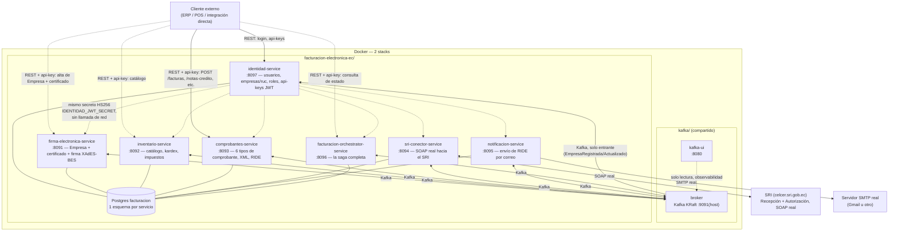
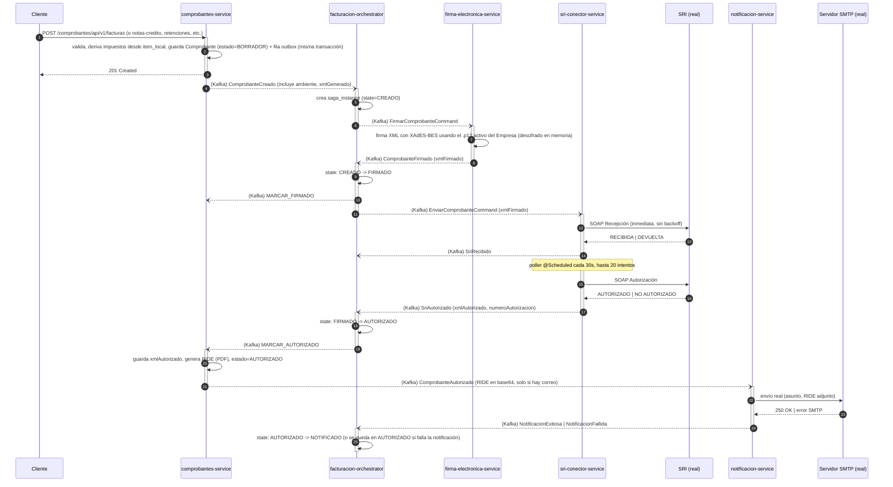
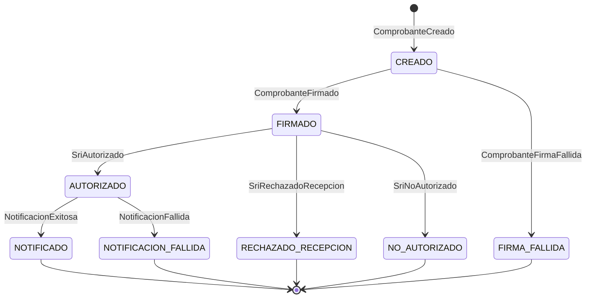
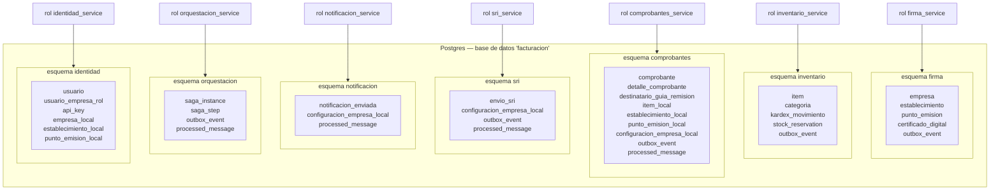

# Arquitectura — Facturación Electrónica SRI Ecuador (Java/Quarkus + Kafka)

Este documento explica **cómo está construido** el stack: el estilo arquitectónico, cómo se relaciona cada microservicio con los demás, el flujo completo de negocio de principio a fin (incluyendo la integración real con el SRI), el diseño detallado de Kafka que hace posible que los servicios de dominio se coordinen sin conocerse entre sí, y la capa de autenticación multi-tenant que protege todo el ecosistema. Sigue el mismo patrón de saga por orquestación que `ecommerce/` (ver `../ecommerce/ARQUITECTURA.md`), pero con una diferencia central: aquí **no hay simulaciones** — la firma digital, el envío al SRI y el envío de correo son integraciones reales con sistemas externos de verdad.

## 1. Estilo arquitectónico

| Decisión | Qué significa aquí |
|---|---|
| **Microservicios con base de datos propia** | 7 servicios Quarkus independientes (6 de dominio + `identidad-service`), cada uno dueño de su propio esquema de Postgres. Ninguno lee ni escribe directamente en las tablas de otro. |
| **Saga por orquestación** (no coreografía) | `facturacion-orchestrator-service` es el **único** que conoce el flujo completo (CREADO→FIRMADO→AUTORIZADO→NOTIFICADO). Los otros 5 no saben que forman parte de una saga — solo saben "me llegó un comando, lo ejecuto, publico si me salió bien o mal". |
| **Comunicación casi 100% asíncrona vía Kafka** | Ningún microservicio expone ni llama un endpoint REST de otro para el flujo transaccional. La única excepción deliberada es la subida del certificado `.p12` (`POST /empresas/{id}/certificado`, multipart — no tiene sentido modelar la subida de un archivo binario como un evento de Kafka). Todo lo demás — incluida la réplica de datos de Empresa (hacia `identidad-service`) e Item (hacia `comprobantes-service`) entre servicios — viaja por eventos. `identidad-service` no participa de la saga y no publica nada a Kafka, pero sí **consume** `facturacion.empresa.eventos.v1` para saber qué rucs tienen una Empresa real (ver sección 8) — ningún otro servicio le llama de vuelta. |
| **Todo el REST externo requiere api-key** | Los 6 servicios de dominio no tienen ninguna ruta pública — cada request necesita `Authorization: Bearer <api-key>`, un JWT emitido por `identidad-service` y verificado localmente (sin llamada de red) por cada servicio. Ver sección 8. |
| **Arquitectura hexagonal / DDD por servicio** | Cada servicio se organiza en capas `domain` (modelo puro, sin anotaciones de framework) → `application` (casos de uso) → `infrastructure` (JPA/Panache, Kafka, REST, SOAP, XML-DSig) → `shared`. El dominio no depende de Quarkus, Kafka, ni de las librerías de firma/SOAP; es al revés. |
| **Transactional Outbox + Inbox idempotente** | Ver sección 6. Igual que en `ecommerce/`. |
| **Stack reactivo** | Quarkus + Java 21 + Mutiny + Hibernate Reactive Panache + SmallRye Reactive Messaging. El I/O bloqueante que no tiene alternativa reactiva (firma XML-DSig del JDK, `java.net.http.HttpClient` SOAP hacia el SRI, `quarkus-mailer`) se offloadea al worker pool y se retoma en el contexto de Vert.x correcto — ver [[feedback-quarkus-reactive-kafka-gotchas]]. |
| **Integraciones externas reales, no simuladas** | A diferencia de `ecommerce/` (pago/envío/notificación simulados a propósito para poder reproducir cualquier camino sin depender de terceros), aquí la firma digital (XAdES-BES sobre un `.p12` real), el envío/autorización SOAP contra el SRI (`celcer.sri.gob.ec`) y el envío de correo (SMTP real) son genuinos. Es el punto central de este proyecto. |

### Diagrama de despliegue

**Lectura clave del diagrama:** el cliente primero le habla a `identidad-service` (crear cuenta, login, asociarse a un `ruc`, emitir una api-key) y luego usa esa api-key como `Authorization: Bearer` contra todo lo demás: `comprobantes-service` (para crear cualquiera de los 6 tipos de comprobante), `firma-electronica-service` (para dar de alta un Empresa y subir su certificado) y opcionalmente `facturacion-orchestrator-service` (para consultar el estado de la saga). Las flechas punteadas de `identidad-service` hacia el resto **no son llamadas de red** — representan que todos comparten el mismo secreto HS256 y verifican el JWT de forma local (ver sección 8). `sri-conector-service` es el único servicio que sale fuera de Docker hacia una red externa real (el SRI); `notificacion-service` es el único que sale hacia un servidor SMTP real. Todos los demás servicios son invisibles para el cliente — su única puerta de entrada/salida es Kafka.

## 2. Los 7 microservicios y cómo se relacionan entre sí

| Servicio | Bounded context | Esquema BD | Ruta REST | A quién le manda comandos (Kafka) | Quién le manda comandos a él |
|---|---|---|---|---|---|
| `identidad-service` | Usuarios, asociación usuario↔ruc con rol, emisión/revocación de api-keys JWT | `identidad` | `/identidad/api/v1` | *(no publica nada — solo consume `facturacion.empresa.eventos.v1` para validar rucs, ver sección 8)* | *(nadie le manda comandos — no participa de la saga)* |
| `firma-electronica-service` | Empresa (multi-tenant) + certificado digital + firma XAdES-BES | `firma` | `/empresas/api/v1` | *(nadie, solo responde)* | `facturacion-orchestrator-service` (`FirmarComprobanteCommand`) |
| `inventario-service` | Catálogo (productos/servicios), kardex, impuestos | `inventario` | `/inventario/api/v1` | *(nadie, es origen de eventos, no recibe comandos de la saga)* | *(nadie — no participa en la saga de emisión)* |
| `comprobantes-service` | Los 6 tipos de comprobante SRI, XML, RIDE | `comprobantes` | `/comprobantes/api/v1` | *(nadie — es el origen de la saga)* | `facturacion-orchestrator-service` (`MARCAR_FIRMADO`/`MARCAR_AUTORIZADO`/`MARCAR_NO_AUTORIZADO`/etc.) |
| `sri-conector-service` | Integración SOAP real con el SRI (Recepción + Autorización) | `sri` | `/sri/api/v1` | *(nadie, solo responde)* | `facturacion-orchestrator-service` (`EnviarComprobanteCommand`) |
| `notificacion-service` | Envío del RIDE autorizado por correo al receptor | `notificacion` | `/notificaciones/api/v1` | *(nadie, solo responde)* | *(nadie — no es comandado, actúa directamente sobre el evento `ComprobanteAutorizado`)* |
| `facturacion-orchestrator-service` | La saga completa de emisión | `orquestacion` | `/sagas/api/v1` | `comprobantes-service`, `firma-electronica-service`, `sri-conector-service` | `comprobantes-service` (evento `ComprobanteCreado`, el disparador inicial) |

**Por qué la relación tiene forma de estrella y no de cadena:** los servicios de dominio (firma, comprobantes, sri, notificación) **no se conocen entre sí** — ninguno le manda un mensaje directamente a otro (con la única excepción documentada abajo). Todos hablan únicamente con `facturacion-orchestrator-service`, que decide el orden de ejecución. Igual que en `ecommerce/`, si un cambio en el flujo de negocio agrega o reordena un paso, ese conocimiento vive en un solo lugar: `SagaOrchestratorService.java` del orquestador.

**Las dos excepciones deliberadas a "cero REST/acoplamiento directo entre servicios":**
1. `inventario-service` e `firma-electronica-service` no participan en la saga de comandos — son **fuentes de datos de referencia**. `inventario-service` publica `ItemCreado`/`ItemActualizado`, que `comprobantes-service` consume y mantiene como copia de solo lectura (`item_local`, usada para auto-derivar impuestos por `itemId`) — vista materializada vía evento. `firma-electronica-service` publica `EmpresaRegistrada`/`EmpresaActualizada` (sin datos del certificado); hoy el único consumidor es `identidad-service` (`empresa_local`, ver sección 8) — `comprobantes-service` **ya no** mantiene una réplica de Empresa: desde que el modelo pasó a ser scoped por `ruc` en vez de por `empresaId`, cada request de creación de comprobante trae los datos de la empresa inline (ver `V6__ecosistema_separado.sql`), así que no necesita consultar nada localmente.
2. `notificacion-service` no es comandado por el orquestador — consume directamente `ComprobanteAutorizado` desde `facturacion.comprobante.eventos.v1` (publicado por `comprobantes-service`, no por el orquestador) porque no hay ninguna decisión de negocio que tomar antes de notificar: si un comprobante quedó `AUTORIZADO` y tiene un correo, se notifica, punto. El orquestador igual observa `NotificacionExitosa`/`NotificacionFallida` para completar su propia máquina de estados, pero no es quien dispara el envío.

**Independencia real, no solo de código:** los 6 proyectos Maven no comparten ni una sola librería propia — cada servicio define sus propios records de mensaje Kafka en su paquete `application/event`, aunque el *shape* del JSON coincida con el que espera el consumidor. Mismo trade-off que en `ecommerce/`: pequeña duplicación de definiciones a cambio de poder redesplegar cada servicio de forma independiente.

## 3. Flujo completo de emisión de un comprobante (camino feliz)

**Puntos importantes de este flujo:**

1. **El cliente nunca espera a la saga completa.** El `POST /comprobantes/...` devuelve `201` en cuanto el comprobante queda guardado como `BORRADOR` — firmar, enviar al SRI y notificar ocurre después, de forma asíncrona. Para saber si terminó, el cliente hace polling a `GET /sagas/api/v1/{comprobanteId}`.
2. **Cada flecha `--)` (Kafka) implica, por debajo, el patrón outbox → relay → broker → inbox → efecto** (ver sección 6), igual que en `ecommerce/`.
3. **La autorización del SRI puede tardar** — el SRI documenta hasta 24h de SLA, aunque en la práctica observada contra el ambiente de pruebas responde en segundos. El poller de `sri-conector-service` está diseñado para esa espera (backoff, no polling agresivo).
4. **El correo es la única rama verdaderamente "best effort"**: un comprobante `AUTORIZADO` ya es legalmente válido tenga o no tenga correo, y tenga o no éxito el envío — ver sección 5.
5. **Tiempo real medido de punta a punta** (CREADO→AUTORIZADO, con el certificado real del usuario, contra el SRI real): ~19 segundos en el peor caso observado.

## 4. Máquina de estados de la saga

`SriRecibido` queda registrado en la bitácora de pasos (`saga_step`) pero **no** cambia `SagaInstance.state` — es un checkpoint informativo entre Recepción y Autorización, no un estado de negocio nuevo (misma idea que `StockReleased`/`PaymentRefunded` en `ecommerce/`). La validación de transición se aplica igual que en `ecommerce/`: `UPDATE saga_instance SET state = ? WHERE id = ? AND state IN (...)` atómico — una redelivery duplicada de Kafka simplemente no afecta ninguna fila.

## 5. Por qué esta saga no tiene compensación (a diferencia de `ecommerce/`)

Esta es la diferencia de diseño más importante frente a `ecommerce/`. Allá, un fallo a mitad de camino dispara comandos explícitos que deshacen lo ya hecho (`ReleaseStock`, `RefundPayment`, `CancelOrder`). **Acá no existe ningún comando de compensación**, porque no hay nada que sea seguro o legal deshacer automáticamente:

| Punto de fallo | Qué pasa | Por qué no hay compensación |
|---|---|---|
| Falla la firma (`ComprobanteFirmaFallida`) | `FIRMA_FALLIDA`, estado terminal | Nada se envió a ningún sistema externo todavía — no hay nada que deshacer. |
| El SRI rechaza en Recepción (`SriRechazadoRecepcion`) | `RECHAZADO_RECEPCION`, estado terminal | El comprobante nunca llegó a existir para el SRI — es como si nunca se hubiera enviado. |
| El SRI no autoriza (`SriNoAutorizado`) | `NO_AUTORIZADO`, estado terminal | Mismo caso — el documento no tiene validez legal, no hay "reversa" que hacer ante el SRI. |
| Falla la notificación (`NotificacionFallida`) | `NOTIFICACION_FALLIDA`, estado terminal — **pero el Comprobante en `comprobantes-service` se queda en `AUTORIZADO`, no cambia** | Una vez que el SRI autoriza, el comprobante **es legalmente válido con o sin correo enviado** — no hay ninguna acción de negocio que "cancelar" solo porque el destinatario no recibió el email. La discrepancia (saga en `NOTIFICACION_FALLIDA`, comprobante en `AUTORIZADO`) es intencional y es el único lugar donde queda registrada: reintentar el envío es una operación aparte (reenviar el correo), no una compensación de la saga. |

Esto es coherente con la resolución NAC-DGERCGC25-00000017 (vigente desde 2026-01-01): un final-consumer invoice ya autorizado no puede anularse salvo dentro de la ventana legal de 7 días del mes siguiente, y ni siquiera eso es una "compensación de saga" — es un proceso de negocio aparte (emitir una Nota de Crédito), no algo que este orquestador automatice.

## 6. Flujo detallado de Kafka

### 6.1 Convención de tópicos

`facturacion.<dominio>.<events|commands>.v1`, más un `.dlq` por cada tópico con consumidor real. 29 tópicos en total (14 pares evento/comando + su dlq, más el tópico de auditoría del orquestador, más el par de configuración), creados al arrancar el stack por `facturacion-topic-init` (reutiliza la imagen `../kafka/topic-init`, igual que en `ecommerce/`).

| Tópico | Productor | Consumidor (`group.id`) |
|---|---|---|
| `facturacion.empresa.eventos.v1` (+ `.dlq`) | firma-electronica-service | identidad-service (réplica local `empresa_local`, ver sección 8) |
| `facturacion.empresa.establecimientos.eventos.v1` (+ `.dlq`) | firma-electronica-service | comprobantes-service (réplica local `establecimiento_local`/`punto_emision_local`, valida antes de emitir — ver sección 7.1) **y** identidad-service (misma réplica, valida el alcance de una api-key nueva — ver sección 8) |
| `facturacion.empresa.configuracion.eventos.v1` (+ `.dlq`) | firma-electronica-service | comprobantes-service, notificacion-service, sri-conector-service (cada uno con su propia réplica local `configuracion_empresa_local` — `ride.color`, `notificacion.asunto`/`notificacion.remitente_nombre`, `sri.recepcion.url`/`sri.autorizacion.url`/`sri.autorizacion.poll.max-intentos` respectivamente — ver sección 7.2) |
| `facturacion.inventario.eventos.v1` (+ `.dlq`) | inventario-service | *(reservas de stock, uso interno de inventario)* |
| `facturacion.inventario.comandos.v1` (+ `.dlq`) | *(reservado, no usado por la saga de emisión)* | inventario-service |
| `facturacion.inventario.item.eventos.v1` (+ `.dlq`) | inventario-service | comprobantes-service (réplica local `item_local`, deriva IVA/ICE) |
| `facturacion.comprobante.eventos.v1` (+ `.dlq`) | comprobantes-service | facturacion-orchestrator (filtra `ComprobanteCreado`) **y** notificacion-service (filtra `ComprobanteAutorizado`) — mismo tópico, dos shapes de evento, cada consumidor ignora la que no le corresponde vía el campo `eventType` |
| `facturacion.comprobante.comandos.v1` (+ `.dlq`) | facturacion-orchestrator | comprobantes-service (`MARCAR_FIRMADO`/`MARCAR_AUTORIZADO`/`MARCAR_NO_AUTORIZADO`/etc.) |
| `facturacion.firma.comandos.v1` (+ `.dlq`) | facturacion-orchestrator | firma-electronica-service |
| `facturacion.firma.eventos.v1` (+ `.dlq`) | firma-electronica-service | facturacion-orchestrator |
| `facturacion.sri.comandos.v1` (+ `.dlq`) | facturacion-orchestrator | sri-conector-service |
| `facturacion.sri.eventos.v1` (+ `.dlq`) | sri-conector-service | facturacion-orchestrator |
| `facturacion.notificacion.comandos.v1` (+ `.dlq`) | *(reservado, no usado — notificación no es comandada, ver sección 2)* | notificacion-service |
| `facturacion.notificacion.eventos.v1` (+ `.dlq`) | notificacion-service | facturacion-orchestrator |
| `facturacion.orquestacion.eventos.v1` | facturacion-orchestrator | *(auditoría, sin consumidor obligatorio)* |

`facturacion-orchestrator-service` es el único servicio que produce hacia **3 tópicos de comando distintos** y consume de **4 tópicos distintos** — su relay del outbox enruta cada mensaje pendiente según la columna `outbox_event.topic` de esa fila, y su lado `inventario-service` sigue el mismo patrón que `ecommerce/` para las dos rutas que expone (`ItemCreado` con su propio tópico separado de `eventos.v1` — ver la nota de "tax auto-derivation" en el historial del proyecto: fue la primera vez que un `OutboxRelay` de este stack necesitó enrutar hacia dos tópicos de salida distintos).

### 6.2 Orden garantizado: `comprobanteId` como key

Igual que `ecommerce/` usa `orderId`, acá **todo mensaje relacionado con un comprobante usa `comprobanteId` como key** (ver `OutboxRelay.java` de cada servicio, `OutgoingKafkaRecordMetadata.withKey(event.aggregateId.toString())`). Kafka enruta siempre la misma key a la misma partición, así que todos los eventos y comandos de un comprobante en particular se procesan siempre en el orden en que se publicaron, sin importar cuántas particiones tenga el tópico.

### 6.3 Outbox transaccional y 6.4 Inbox idempotente

Idénticos en mecánica a `ecommerce/` (ver `../ecommerce/ARQUITECTURA.md` secciones 6.3/6.4): escritura de negocio + fila de outbox en la misma transacción SQL, `OutboxRelay` `@Scheduled(every = "1s")` como único publicador real, e inbox con `processed_message` para descartar redeliveries sin reaplicar el efecto. La cadencia de 1s del relay es, además, una decisión regulatoria explícita: satisface el requisito de "transmisión inmediata" de la Resolución NAC-DGERCGC25-00000017 (vigente 2026-01-01) — no hay ninguna ventana de gracia de días hábiles como existía antes de esa resolución.

### 6.5 Dead Letter Queue

Cada tópico con consumidor real tiene `failure-strategy=dead-letter-queue`: un mensaje que falla su procesamiento de forma repetida se mueve a `<tópico>.dlq` en vez de bloquear la partición — mismo mecanismo de contención que `ecommerce/`.

### 6.6 Configuración de confiabilidad (resumen)

| Lado | Configuración | Por qué |
|---|---|---|
| Productor | `enable.idempotence=true`, `acks=all` | Evita duplicados por reintento de red; el productor no considera enviado el mensaje hasta que el broker lo confirmó de forma durable. |
| Consumidor | `enable.auto.commit=false` | El offset solo se confirma después de que el efecto de negocio ya quedó aplicado y persistido. |
| Consumidor | `auto.offset.reset=earliest` | Un consumer group nuevo procesa desde el principio del tópico en vez de perderse mensajes ya publicados — con la contrapartida de que un servicio nuevo arrancado tarde replaya todo el historial (ver nota operativa sobre `facturacion-orchestrator-service` en el historial del proyecto). |
| Consumidor | `failure-strategy=dead-letter-queue` | Ver 6.5. |
| Todos los mensajes | `key = comprobanteId` | Ver 6.2. |

## 7. Base de datos

Un solo contenedor Postgres (`facturacion-electronica-ec/db`), con **una sola base de datos** (`facturacion`) y **un esquema por servicio**:

**El aislamiento viene de los permisos de Postgres, no de bases físicas separadas** — mismo patrón que `ecommerce/` (ver [[feedback-postgres-schema-per-service]]): cada servicio se conecta con su propio rol, sin permisos fuera de su propio esquema, con `search_path` fijado del lado del servidor. El SQL de cada servicio vive versionado en `src/main/resources/db/migration/V*.sql` (Flyway, `migrate-at-start=true`).

**Particularidad de este proyecto:** los nombres de tabla y columna están en español y calcados de la terminología exacta del SRI (`clave_acceso`, `comprador_razon_social`, `docSustentoNumero`, etc.) — no traducidos libremente — para que el mapeo entre el modelo de datos y la ficha técnica del SRI sea directo al depurar un rechazo.

### 7.1 Establecimientos y puntos de emisión

`firma-electronica-service` expone un CRUD real (`EstablecimientoResource`/`PuntoEmisionResource`, ambos basados en id, sin re-chequeo de ruc — igual que `PUT actualizar`/certificado) para las tablas `establecimiento`/`punto_emision` de la sección 7 — antes de esto, `establecimiento`/`puntoEmision` eran strings sueltos en cada request de creación de comprobante, sin ningún registro real detrás. `EmpresaService.crearEmpresa` crea automáticamente, en la misma transacción, un establecimiento MATRIZ y un punto de emisión con los códigos por defecto de la empresa — ninguna empresa nueva necesita un paso manual aparte.

`comprobantes-service` mantiene su propia réplica (`establecimiento_local`/`punto_emision_local`, indexadas por `(ruc, codigo)` — nunca por el id interno de firma-electronica-service, mismo principio "Empresa sin ID") vía el tópico `facturacion.empresa.establecimientos.eventos.v1` (ver 6.1), y **valida contra ella antes de reservar el secuencial** de cualquiera de los 6 tipos de comprobante (`ComprobanteService.emitir`) — un establecimiento o punto de emisión no registrado (o inactivo) devuelve 400, en vez de dejar pasar cualquier string como ocurría antes.

**Nota operativa:** la empresa semilla (RUC 1722039953001, creada antes de que este CRUD existiera) ya tiene su establecimiento `001`/punto de emisión `001` reales registrados a mano — cualquier otra empresa creada antes de esta funcionalidad necesitaría el mismo paso manual una sola vez.

### 7.2 `configuracion_empresa`: de infraestructura sin uso a ajustes reales

La tabla `configuracion_empresa` (clave/valor genérico, sección 7) existía desde antes con CRUD completo pero **sin ningún consumidor real** — nada leía sus valores para cambiar comportamiento. `ConfiguracionEmpresaService.establecer`/`eliminar` ahora publican un evento en el outbox (tópico de la tabla de 6.1: genérico, cualquier `clave`/`valor`, un `valor` en `null` en el evento de eliminación revierte al comportamiento por defecto). Tres servicios mantienen su propia réplica `configuracion_empresa_local` (mismo principio "Empresa sin ID", indexada por `(ruc, clave)`), cada uno con sus propias claves reales:

- **`comprobantes-service`** — `ride.color` (hex RGB, ej. `#1A73E8`): `ComprobanteService.aplicarComando` la consulta justo antes de generar el RIDE en `MARCAR_AUTORIZADO` y `RideGenerador` la dibuja como una barra de acento bajo el encabezado si es un hex válido; si no está configurada (o es inválida), el RIDE se ve exactamente igual que antes.
- **`notificacion-service`** — `notificacion.asunto` (asunto del correo) y `notificacion.remitente_nombre` (nombre visible del remitente, ej. "Facturación Acme" — nunca cambia la dirección real autenticada ante el SMTP, `quarkus.mailer.from`): `NotificacionService.procesarComprobanteAutorizado` las consulta antes de llamar a `CorreoService.enviarComprobante`.
- **`sri-conector-service`** — `sri.recepcion.url`, `sri.autorizacion.url` (sobreescriben la URL fija por ambiente) y `sri.autorizacion.poll.max-intentos` (sobreescribe el default global de `application.properties`): `SriConectorService` las consulta en `procesarComando`/`consultarAutorizacion`. Esto necesitó agregar `empresaRuc` a `EnviarComprobanteCommand` (facturacion-orchestrator-service) y a `EnvioSri` (columna nueva, nullable — los envíos de prueba anteriores a este cambio quedan sin ella, sin overrides aplicables, sin afectar su comportamiento ya fijado). El poller (`AutorizacionPoller`) dejó de filtrar por intentos a nivel de consulta SQL (ese máximo ahora varía por empresa) — la decisión de cuándo pasar a `ERROR_CONSULTA` se toma fila por fila en `SriConectorService.aplicarResultadoAutorizacion`, y una vez que una fila se agota deja de calificar por su propio cambio de `estado`, así que el filtro SQL nunca hizo falta como mecanismo de corte real.

El resto de claves posibles (feature flags, etc.) siguen sin un consumidor real — el patrón queda listo para el próximo ajuste que lo necesite, mismo criterio que los tres de arriba.

## 8. Autenticación y autorización multi-tenant (api-key JWT)

`identidad-service` no participa de la saga de emisión, pero sí consume un tópico de Kafka (ver más abajo) — su razón de ser central es emitir y (junto con los otros 6) verificar las credenciales que protegen todo el ecosistema.

**Modelo de datos** (`identidad`): `Usuario` (email + password con login) puede asociarse a cualquier número de `ruc` vía `POST /usuarios/me/empresas`, sin flujo de invitación/aprobación — pero el `ruc` **sí se valida contra una Empresa real**: el servicio mantiene `empresa_local`, una copia local de solo lectura alimentada consumiendo `facturacion.empresa.eventos.v1` (mismo patrón de vista materializada por eventos que `item_local` en `comprobantes-service`, ver sección 6.1), y `UsuarioService.asociarEmpresa` responde `404` si el ruc no corresponde a ninguna Empresa activa. Esto **no verifica titularidad** — cualquier usuario puede asociarse a cualquier ruc que exista, no se confirma que sea realmente el dueño de esa empresa — solo que el ruc es real y no un string inventado. Cada asociación usuario↔ruc lleva un `Rol`: `ADMIN` (todo, incluida gestión de api-keys), `OPERADOR` (puede emitir comprobantes), `LECTURA` (solo consulta — hoy no hay ningún endpoint que diferencie LECTURA de OPERADOR más allá de la intención documentada).

**Dos tipos de JWT, un solo secreto compartido (`IDENTIDAD_JWT_SECRET`, HS256)**:

| Tipo | Emitido por | Dónde sirve | Duración |
|---|---|---|---|
| **Sesión** | `POST /usuarios/login` | Solo contra `identidad-service` (`/usuarios/me/*`, `/api-keys/*`) **y, como única excepción, `POST /empresas` de firma-electronica-service** (ver más abajo) | Corta (`identidad.jwt.sesion.duracion-horas`) |
| **Api-key** | `POST /api-keys` (requiere sesión) | Contra los 6 servicios de dominio | Configurable, default 365 días — el valor solo se muestra una vez, al crearla |

**Bootstrap de una empresa nueva — el ciclo que había que romper**: una api-key solo se emite para un ruc al que el usuario ya esté asociado (`POST /usuarios/me/empresas`), y esa asociación exige que el ruc ya corresponda a una Empresa real (`empresa_local`, arriba). Para una empresa genuinamente nueva eso nunca se cumple — no hay forma de conseguir una api-key para darla de alta. `PermiteSesion` (`firma-electronica-service/infrastructure/security`) es la única excepción a "todo endpoint exige una api-key": marca `EmpresaResource.crear`, que además de una api-key acepta un token de sesión — `JwtVerificador.verificarApiKeyOSesion` reconoce ambos tipos (con una sesión, `ruc`/`rol`/`establecimiento`/`puntoEmision` quedan en `null`, así que el chequeo de titularidad se salta: no hay ningún dueño previo que proteger todavía). `EmpresaService.crearEmpresa` incluye el `usuarioCreadorId` en el evento `EmpresaRegistrada`, y `identidad-service.EmpresaEventConsumer` lo usa para otorgar automáticamente el rol `ADMIN` a ese usuario para ese ruc — así, apenas se crea la empresa, el usuario ya puede pedir su primera api-key sin ningún paso manual.

El api-key **es** el JWT — no hay lookup en base de datos del lado de quien lo verifica. Lleva `ruc` y `rol` como claims siempre, y **opcionalmente** `establecimiento`/`puntoEmision` — eso es lo que cada servicio necesita para decidir si el caller puede operar sobre ese ruc (y, si aplica, sobre ese establecimiento/punto de emisión específico).

**Verificación 100% local, cero llamadas de red**: cada uno de los 6 servicios de dominio tiene su propia copia (no una librería compartida — mismo criterio de independencia real que el resto del stack, ver sección 2) de un paquete `infrastructure/security/`:
- `ApiKeyAuthFilter` — un `ContainerRequestFilter` **global** (sin `@NameBinding`): exige `Authorization: Bearer <api-key>` en *todo* endpoint, no existen rutas públicas en ninguno de los 6 servicios.
- `JwtVerificador` — valida la firma HS256 contra `identidad.jwt.secreto` (mismo valor que `IDENTIDAD_JWT_SECRET`) y confirma que el claim `tipo` sea `api_key` (rechaza un token de sesión si alguien lo usa por error).
- `TokenPrincipal` — request-scoped, con `usuarioId`/`ruc`/`rol`/`establecimiento`/`puntoEmision` ya verificados, disponible para inyectar en cualquier recurso. Los dos últimos son `null` en cualquier api-key emitida antes de que existieran — sin restricción, comportamiento sin cambios (retrocompatible a propósito).

**Validación de propiedad del ruc — solo donde el body la trae directamente**: `comprobantes-service` (los 6 endpoints `crearX`, comparando `request.getEmpresa().getRuc()`), `inventario-service` (`POST /items`) y `firma-electronica-service` (`POST /empresas`) comparan el `ruc` del request contra el `ruc` del token y responden `403 Forbidden` (`SinPermisoException`) si no coinciden. Los endpoints basados en `id` (actualizar, subir certificado, kardex, configuración, `/retry` de saga) **no** repiten esa validación — solo exigen una api-key válida de *cualquier* ruc, igual que las superficies puramente de observabilidad (`sri-conector-service`, `notificacion-service`, `facturacion-orchestrator-service`), que son GET-mayoritariamente y donde filtrar por ruc se dejó fuera de alcance a propósito.

**Api-key acotada a establecimiento/punto de emisión (opcional)**: pensado para empresas con varias sucursales/cajas que no quieren que la key de un punto de venta pueda emitir con el de otro — sin tocar en nada el principio "Empresa sin ID" (comprobantes-service sigue sin conocer `usuarioId` ni ningún id interno, solo compara valores del propio request contra los claims del token, igual que ya hacía con `ruc`).
- `POST /api-keys` (identidad-service) acepta `establecimiento`/`puntoEmision` opcionales — `puntoEmision` sin `establecimiento` es 400. `ApiKeyService.crear` valida que sean reales y estén activos contra su propia réplica `establecimiento_local`/`punto_emision_local` (alimentada por el mismo tópico `facturacion.empresa.establecimientos.eventos.v1` que ya consume comprobantes-service — ver 6.1) antes de emitir el JWT.
- `ComprobanteResource.validarAlcance` (antes `validarRuc`) además del ruc, si el token trae `establecimiento`/`puntoEmision`, exige que el request de creación coincida exactamente — `403` si no. Una api-key sin esos claims (el caso normal) no se ve afectada.
- Alcance deliberadamente acotado: solo se aplica en la creación de comprobantes (donde vive el establecimiento/punto de emisión del request) — no en el CRUD de establecimientos/puntos de emisión de firma-electronica-service (esos endpoints siguen siendo solo por `id`, mismo criterio que el resto de mutaciones basadas en `id`).

**Por qué HS256 con secreto compartido y no RSA/OIDC**: ningún consumidor de estos tokens es un navegador — todos son el propio backend de este ecosistema, que ya recibe sus credenciales por variable de entorno igual que el resto de secretos del stack (contraseñas de DB, clave maestra de cifrado del `.p12`). No hay necesidad de distribuir una llave pública por separado ni de correr un proveedor OIDC (ver sección 11, sigue fuera de alcance como *proveedor de identidad externo* — esto es autenticación propia del ecosistema, no reemplaza un futuro Keycloak si el cliente externo lo necesitara).

## 9. Particularidades técnicas de la integración real

Esta sección no tiene equivalente en `ecommerce/` porque allá todo lo externo es simulado. Acá sí importa cómo se resolvió cada integración:

| Integración | Cómo se resolvió | Por qué |
|---|---|---|
| Firma XAdES-BES | Hand-built sobre `javax.xml.crypto.dsig` del JDK (sin librería externa) | No existe una librería Java mantenida que implemente el perfil exacto de firma que exige el SRI; se verificó contra un certificado real (Security Data S.A.) que el X509 resultante y las 3 References (comprobante/KeyInfo/SignedProperties) son correctas. |
| SOAP hacia el SRI | Envoltorios SOAP hand-built + `java.net.http.HttpClient` + parsing DOM (sin CXF/JAX-WS ni generación de código desde el WSDL) | Mismo criterio "solo JDK" que la firma; los contratos reales (`RecepcionComprobantesOffline?wsdl`, `AutorizacionComprobantesOffline?wsdl`) se verificaron a mano contra el WSDL real antes de escribir los clientes. |
| Correo con el RIDE | `quarkus-mailer` estándar (SMTP real, STARTTLS puerto 587) | A diferencia de la firma/SOAP, acá sí hay una extensión estándar que cubre el caso sin necesidad de nada a medida. |
| Clave de acceso | 49 dígitos, mod-11 check digit, calculada en `comprobantes-service` | Algoritmo documentado en la ficha técnica del SRI, es el identificador único del comprobante ante el SRI y ante el propio sistema. |
| RIDE (representación impresa) | Generado en `comprobantes-service` a partir del comprobante autorizado, antes de que exista cualquier necesidad de notificarlo | Se genera una sola vez y viaja embebido (base64) en el evento `ComprobanteAutorizado` — `notificacion-service` no tiene ni necesita lógica de renderizado propia. |

## 10. Observabilidad y operación

| Qué | Dónde |
|---|---|
| Swagger UI de cada servicio | `http://localhost:<puerto>/<root-path>/q/swagger-ui/` |
| OpenAPI JSON | `http://localhost:<puerto>/<root-path>/q/openapi` |
| Health check | `http://localhost:<puerto>/<root-path>/q/health/ready` |
| Estado + línea de tiempo de una saga | `GET http://localhost:8096/sagas/api/v1/{comprobanteId}` |
| Inspeccionar tópicos/mensajes/consumer groups de Kafka | Kafka UI, `http://localhost:8080` |

| Servicio | Puerto host | Root path |
|---|---|---|
| firma-electronica-service | 8091 | `/empresas/api/v1` |
| inventario-service | 8092 | `/inventario/api/v1` |
| comprobantes-service | 8093 | `/comprobantes/api/v1` |
| sri-conector-service | 8094 | `/sri/api/v1` |
| notificacion-service | 8095 | `/notificaciones/api/v1` |
| facturacion-orchestrator-service | 8096 | `/sagas/api/v1` |
| identidad-service | 8097 | `/identidad/api/v1` |
| Postgres (`facturacion-db`) | 5434 | — |
| Kafka broker (host) | 9091 (`kafka/.env` → `KAFKA_HOST_PORT`) | — |
| Kafka UI | 8080 | — |

## 11. Fuera de alcance, a propósito

- **Sin proveedor de identidad externo (OIDC/Keycloak)** — `identidad-service` es autenticación propia del ecosistema (JWT HS256 con secreto compartido, ver sección 8), no un reemplazo de un IdP externo si un cliente lo necesitara más adelante. Sin rate-limiting/lockout en `/usuarios/login` (fuerza bruta fuera de alcance) y sin flujo de reset de contraseña.
- **Sin manifiestos de Kubernetes** — el objetivo de despliegue es Docker Compose.
- **Sin esquema de contingencia del SRI** — solo se implementó el esquema offline (el que usa el SRI en producción); el esquema de contingencia online queda fuera de alcance.
- **IVA e ICE calculados de forma independiente sobre la misma base imponible** — la ley ecuatoriana real calcula IVA sobre (base + ICE) para ítems con ICE; documentado como simplificación conocida en el código de `comprobantes-service`.
- **Factura 1.1.0 (bloque de reembolso)** — fuera de alcance; si se agrega en el futuro, cada tipo de comprobante nuevo o campo opcional nuevo debe re-verificarse contra una llamada real de Recepción antes de darse por bueno (la ficha técnica por sí sola no fue suficiente para detectar 2 de los mismatches de XSD encontrados durante la construcción — ver historial del proyecto).
- **No hay reintento automático de notificación** — si `NotificacionFallida` queda como estado terminal de la saga, reenviar el correo es una operación manual/aparte, no algo que el orquestador reintente solo (a propósito: reintentar SMTP indefinidamente sin intervención podría enmascarar un problema real de configuración, como una contraseña de aplicación inválida).
