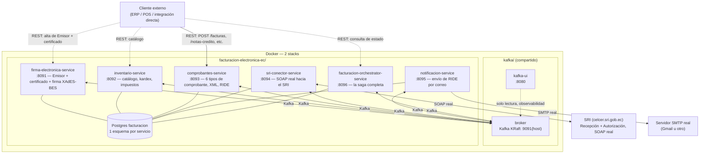
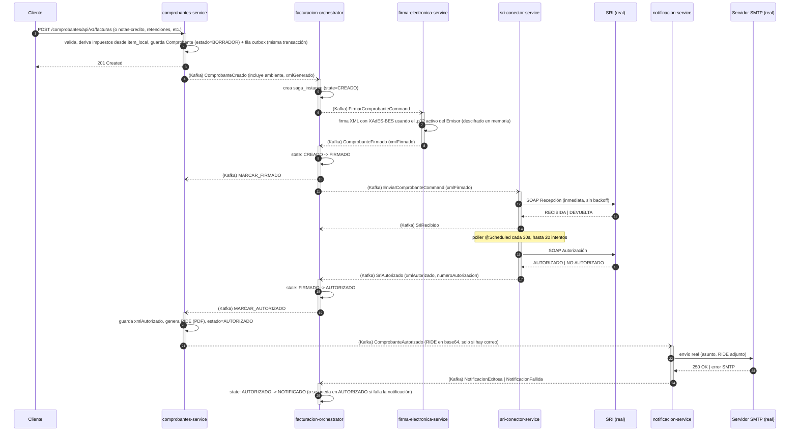
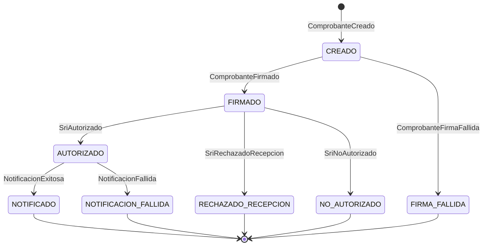
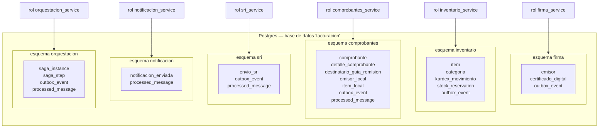

# Arquitectura — Facturación Electrónica SRI Ecuador (Java/Quarkus + Kafka)

Este documento explica **cómo está construido** el stack: el estilo arquitectónico, cómo se relaciona cada microservicio con los demás, el flujo completo de negocio de principio a fin (incluyendo la integración real con el SRI), y el diseño detallado de Kafka que hace posible que 6 servicios independientes se coordinen sin conocerse entre sí. Sigue el mismo patrón de saga por orquestación que `ecommerce/` (ver `../ecommerce/ARQUITECTURA.md`), pero con una diferencia central: aquí **no hay simulaciones** — la firma digital, el envío al SRI y el envío de correo son integraciones reales con sistemas externos de verdad.

## 1. Estilo arquitectónico

| Decisión | Qué significa aquí |
|---|---|
| **Microservicios con base de datos propia** | 6 servicios Quarkus independientes, cada uno dueño de su propio esquema de Postgres. Ninguno lee ni escribe directamente en las tablas de otro. |
| **Saga por orquestación** (no coreografía) | `facturacion-orchestrator-service` es el **único** que conoce el flujo completo (CREADO→FIRMADO→AUTORIZADO→NOTIFICADO). Los otros 5 no saben que forman parte de una saga — solo saben "me llegó un comando, lo ejecuto, publico si me salió bien o mal". |
| **Comunicación casi 100% asíncrona vía Kafka** | Ningún microservicio expone ni llama un endpoint REST de otro para el flujo transaccional. La única excepción deliberada es la subida del certificado `.p12` (`POST /emisores/{id}/certificado`, multipart — no tiene sentido modelar la subida de un archivo binario como un evento de Kafka). Todo lo demás — incluida la réplica de datos de Emisor e Item entre servicios — viaja por eventos. |
| **Arquitectura hexagonal / DDD por servicio** | Cada servicio se organiza en capas `domain` (modelo puro, sin anotaciones de framework) → `application` (casos de uso) → `infrastructure` (JPA/Panache, Kafka, REST, SOAP, XML-DSig) → `shared`. El dominio no depende de Quarkus, Kafka, ni de las librerías de firma/SOAP; es al revés. |
| **Transactional Outbox + Inbox idempotente** | Ver sección 6. Igual que en `ecommerce/`. |
| **Stack reactivo** | Quarkus + Java 21 + Mutiny + Hibernate Reactive Panache + SmallRye Reactive Messaging. El I/O bloqueante que no tiene alternativa reactiva (firma XML-DSig del JDK, `java.net.http.HttpClient` SOAP hacia el SRI, `quarkus-mailer`) se offloadea al worker pool y se retoma en el contexto de Vert.x correcto — ver [[feedback-quarkus-reactive-kafka-gotchas]]. |
| **Integraciones externas reales, no simuladas** | A diferencia de `ecommerce/` (pago/envío/notificación simulados a propósito para poder reproducir cualquier camino sin depender de terceros), aquí la firma digital (XAdES-BES sobre un `.p12` real), el envío/autorización SOAP contra el SRI (`celcer.sri.gob.ec`) y el envío de correo (SMTP real) son genuinos. Es el punto central de este proyecto. |

### Diagrama de despliegue

**Lectura clave del diagrama:** el cliente le habla por REST a `comprobantes-service` (para crear cualquiera de los 6 tipos de comprobante), a `firma-electronica-service` (para dar de alta un Emisor y subir su certificado) y opcionalmente a `facturacion-orchestrator-service` (para consultar el estado de la saga). `sri-conector-service` es el único servicio que sale fuera de Docker hacia una red externa real (el SRI); `notificacion-service` es el único que sale hacia un servidor SMTP real. Todos los demás servicios son invisibles para el cliente — su única puerta de entrada/salida es Kafka.

## 2. Los 6 microservicios y cómo se relacionan entre sí

| Servicio | Bounded context | Esquema BD | Ruta REST | A quién le manda comandos (Kafka) | Quién le manda comandos a él |
|---|---|---|---|---|---|
| `firma-electronica-service` | Emisor (multi-tenant) + certificado digital + firma XAdES-BES | `firma` | `/emisores/api/v1` | *(nadie, solo responde)* | `facturacion-orchestrator-service` (`FirmarComprobanteCommand`) |
| `inventario-service` | Catálogo (productos/servicios), kardex, impuestos | `inventario` | `/inventario/api/v1` | *(nadie, es origen de eventos, no recibe comandos de la saga)* | *(nadie — no participa en la saga de emisión)* |
| `comprobantes-service` | Los 6 tipos de comprobante SRI, XML, RIDE | `comprobantes` | `/comprobantes/api/v1` | *(nadie — es el origen de la saga)* | `facturacion-orchestrator-service` (`MARCAR_FIRMADO`/`MARCAR_AUTORIZADO`/`MARCAR_NO_AUTORIZADO`/etc.) |
| `sri-conector-service` | Integración SOAP real con el SRI (Recepción + Autorización) | `sri` | `/sri/api/v1` | *(nadie, solo responde)* | `facturacion-orchestrator-service` (`EnviarComprobanteCommand`) |
| `notificacion-service` | Envío del RIDE autorizado por correo al receptor | `notificacion` | `/notificaciones/api/v1` | *(nadie, solo responde)* | *(nadie — no es comandado, actúa directamente sobre el evento `ComprobanteAutorizado`)* |
| `facturacion-orchestrator-service` | La saga completa de emisión | `orquestacion` | `/sagas/api/v1` | `comprobantes-service`, `firma-electronica-service`, `sri-conector-service` | `comprobantes-service` (evento `ComprobanteCreado`, el disparador inicial) |

**Por qué la relación tiene forma de estrella y no de cadena:** los servicios de dominio (firma, comprobantes, sri, notificación) **no se conocen entre sí** — ninguno le manda un mensaje directamente a otro (con la única excepción documentada abajo). Todos hablan únicamente con `facturacion-orchestrator-service`, que decide el orden de ejecución. Igual que en `ecommerce/`, si un cambio en el flujo de negocio agrega o reordena un paso, ese conocimiento vive en un solo lugar: `SagaOrchestratorService.java` del orquestador.

**Las dos excepciones deliberadas a "cero REST/acoplamiento directo entre servicios":**
1. `inventario-service` e `firma-electronica-service` no participan en la saga de comandos — son **fuentes de datos de referencia** que otros servicios necesitan tener localmente para poder validar/enriquecer un comprobante sin llamar por REST en caliente. Publican `EmisorRegistrado`/`EmisorActualizado` (sin datos del certificado) y `ItemCreado`/`ItemActualizado` en tópicos propios; `comprobantes-service` los consume y mantiene una copia de solo lectura (`emisor_local`, `item_local`) — el mismo patrón de "vista materializada vía evento" en ambos casos.
2. `notificacion-service` no es comandado por el orquestador — consume directamente `ComprobanteAutorizado` desde `facturacion.comprobante.eventos.v1` (publicado por `comprobantes-service`, no por el orquestador) porque no hay ninguna decisión de negocio que tomar antes de notificar: si un comprobante quedó `AUTORIZADO` y tiene un correo, se notifica, punto. El orquestador igual observa `NotificacionExitosa`/`NotificacionFallida` para completar su propia máquina de estados, pero no es quien dispara el envío.

**Independencia real, no solo de código:** los 6 proyectos Maven no comparten ni una sola librería propia — cada servicio define sus propios records de mensaje Kafka en su paquete `application/event`, aunque el *shape* del JSON coincida con el que espera el consumidor. Mismo trade-off que en `ecommerce/`: pequeña duplicación de definiciones a cambio de poder redesplegar cada servicio de forma independiente.

## 3. Flujo completo de emisión de un comprobante (camino feliz)

**Puntos importantes de este flujo:**

1. **El cliente nunca espera a la saga completa.** El `POST /comprobantes/...` devuelve `201` en cuanto el comprobante queda guardado como `BORRADOR` — firmar, enviar al SRI y notificar ocurre después, de forma asíncrona. Para saber si terminó, el cliente hace polling a `GET /sagas/api/v1/{comprobanteId}`.
2. **Cada flecha `--)` (Kafka) implica, por debajo, el patrón outbox → relay → broker → inbox → efecto** (ver sección 6), igual que en `ecommerce/`.
3. **La autorización del SRI puede tardar** — el SRI documenta hasta 24h de SLA, aunque en la práctica observada contra el ambiente de pruebas responde en segundos. El poller de `sri-conector-service` está diseñado para esa espera (backoff, no polling agresivo).
4. **El correo es la única rama verdaderamente "best effort"**: un comprobante `AUTORIZADO` ya es legalmente válido tenga o no tenga correo, y tenga o no éxito el envío — ver sección 5.
5. **Tiempo real medido de punta a punta** (CREADO→AUTORIZADO, con el certificado real del usuario, contra el SRI real): ~19 segundos en el peor caso observado.

## 4. Máquina de estados de la saga

`SriRecibido` queda registrado en la bitácora de pasos (`saga_step`) pero **no** cambia `SagaInstance.state` — es un checkpoint informativo entre Recepción y Autorización, no un estado de negocio nuevo (misma idea que `StockReleased`/`PaymentRefunded` en `ecommerce/`). La validación de transición se aplica igual que en `ecommerce/`: `UPDATE saga_instance SET state = ? WHERE id = ? AND state IN (...)` atómico — una redelivery duplicada de Kafka simplemente no afecta ninguna fila.

## 5. Por qué esta saga no tiene compensación (a diferencia de `ecommerce/`)

Esta es la diferencia de diseño más importante frente a `ecommerce/`. Allá, un fallo a mitad de camino dispara comandos explícitos que deshacen lo ya hecho (`ReleaseStock`, `RefundPayment`, `CancelOrder`). **Acá no existe ningún comando de compensación**, porque no hay nada que sea seguro o legal deshacer automáticamente:

| Punto de fallo | Qué pasa | Por qué no hay compensación |
|---|---|---|
| Falla la firma (`ComprobanteFirmaFallida`) | `FIRMA_FALLIDA`, estado terminal | Nada se envió a ningún sistema externo todavía — no hay nada que deshacer. |
| El SRI rechaza en Recepción (`SriRechazadoRecepcion`) | `RECHAZADO_RECEPCION`, estado terminal | El comprobante nunca llegó a existir para el SRI — es como si nunca se hubiera enviado. |
| El SRI no autoriza (`SriNoAutorizado`) | `NO_AUTORIZADO`, estado terminal | Mismo caso — el documento no tiene validez legal, no hay "reversa" que hacer ante el SRI. |
| Falla la notificación (`NotificacionFallida`) | `NOTIFICACION_FALLIDA`, estado terminal — **pero el Comprobante en `comprobantes-service` se queda en `AUTORIZADO`, no cambia** | Una vez que el SRI autoriza, el comprobante **es legalmente válido con o sin correo enviado** — no hay ninguna acción de negocio que "cancelar" solo porque el destinatario no recibió el email. La discrepancia (saga en `NOTIFICACION_FALLIDA`, comprobante en `AUTORIZADO`) es intencional y es el único lugar donde queda registrada: reintentar el envío es una operación aparte (reenviar el correo), no una compensación de la saga. |

Esto es coherente con la resolución NAC-DGERCGC25-00000017 (vigente desde 2026-01-01): un final-consumer invoice ya autorizado no puede anularse salvo dentro de la ventana legal de 7 días del mes siguiente, y ni siquiera eso es una "compensación de saga" — es un proceso de negocio aparte (emitir una Nota de Crédito), no algo que este orquestador automatice.

## 6. Flujo detallado de Kafka

### 6.1 Convención de tópicos

`facturacion.<dominio>.<events|commands>.v1`, más un `.dlq` por cada tópico con consumidor real. 25 tópicos en total (13 pares evento/comando + su dlq, más el tópico de auditoría del orquestador), creados al arrancar el stack por `facturacion-topic-init` (reutiliza la imagen `../kafka/topic-init`, igual que en `ecommerce/`).

| Tópico | Productor | Consumidor (`group.id`) |
|---|---|---|
| `facturacion.emisor.eventos.v1` (+ `.dlq`) | firma-electronica-service | comprobantes-service (réplica local `emisor_local`) |
| `facturacion.inventario.eventos.v1` (+ `.dlq`) | inventario-service | *(reservas de stock, uso interno de inventario)* |
| `facturacion.inventario.comandos.v1` (+ `.dlq`) | *(reservado, no usado por la saga de emisión)* | inventario-service |
| `facturacion.inventario.item.eventos.v1` (+ `.dlq`) | inventario-service | comprobantes-service (réplica local `item_local`, deriva IVA/ICE) |
| `facturacion.comprobante.eventos.v1` (+ `.dlq`) | comprobantes-service | facturacion-orchestrator (filtra `ComprobanteCreado`) **y** notificacion-service (filtra `ComprobanteAutorizado`) — mismo tópico, dos shapes de evento, cada consumidor ignora la que no le corresponde vía el campo `eventType` |
| `facturacion.comprobante.comandos.v1` (+ `.dlq`) | facturacion-orchestrator | comprobantes-service (`MARCAR_FIRMADO`/`MARCAR_AUTORIZADO`/`MARCAR_NO_AUTORIZADO`/etc.) |
| `facturacion.firma.comandos.v1` (+ `.dlq`) | facturacion-orchestrator | firma-electronica-service |
| `facturacion.firma.eventos.v1` (+ `.dlq`) | firma-electronica-service | facturacion-orchestrator |
| `facturacion.sri.comandos.v1` (+ `.dlq`) | facturacion-orchestrator | sri-conector-service |
| `facturacion.sri.eventos.v1` (+ `.dlq`) | sri-conector-service | facturacion-orchestrator |
| `facturacion.notificacion.comandos.v1` (+ `.dlq`) | *(reservado, no usado — notificación no es comandada, ver sección 2)* | notificacion-service |
| `facturacion.notificacion.eventos.v1` (+ `.dlq`) | notificacion-service | facturacion-orchestrator |
| `facturacion.orquestacion.eventos.v1` | facturacion-orchestrator | *(auditoría, sin consumidor obligatorio)* |

`facturacion-orchestrator-service` es el único servicio que produce hacia **3 tópicos de comando distintos** y consume de **4 tópicos distintos** — su relay del outbox enruta cada mensaje pendiente según la columna `outbox_event.topic` de esa fila, y su lado `inventario-service` sigue el mismo patrón que `ecommerce/` para las dos rutas que expone (`ItemCreado` con su propio tópico separado de `eventos.v1` — ver la nota de "tax auto-derivation" en el historial del proyecto: fue la primera vez que un `OutboxRelay` de este stack necesitó enrutar hacia dos tópicos de salida distintos).

### 6.2 Orden garantizado: `comprobanteId` como key

Igual que `ecommerce/` usa `orderId`, acá **todo mensaje relacionado con un comprobante usa `comprobanteId` como key** (ver `OutboxRelay.java` de cada servicio, `OutgoingKafkaRecordMetadata.withKey(event.aggregateId.toString())`). Kafka enruta siempre la misma key a la misma partición, así que todos los eventos y comandos de un comprobante en particular se procesan siempre en el orden en que se publicaron, sin importar cuántas particiones tenga el tópico.

### 6.3 Outbox transaccional y 6.4 Inbox idempotente

Idénticos en mecánica a `ecommerce/` (ver `../ecommerce/ARQUITECTURA.md` secciones 6.3/6.4): escritura de negocio + fila de outbox en la misma transacción SQL, `OutboxRelay` `@Scheduled(every = "1s")` como único publicador real, e inbox con `processed_message` para descartar redeliveries sin reaplicar el efecto. La cadencia de 1s del relay es, además, una decisión regulatoria explícita: satisface el requisito de "transmisión inmediata" de la Resolución NAC-DGERCGC25-00000017 (vigente 2026-01-01) — no hay ninguna ventana de gracia de días hábiles como existía antes de esa resolución.

### 6.5 Dead Letter Queue

Cada tópico con consumidor real tiene `failure-strategy=dead-letter-queue`: un mensaje que falla su procesamiento de forma repetida se mueve a `<tópico>.dlq` en vez de bloquear la partición — mismo mecanismo de contención que `ecommerce/`.

### 6.6 Configuración de confiabilidad (resumen)

| Lado | Configuración | Por qué |
|---|---|---|
| Productor | `enable.idempotence=true`, `acks=all` | Evita duplicados por reintento de red; el productor no considera enviado el mensaje hasta que el broker lo confirmó de forma durable. |
| Consumidor | `enable.auto.commit=false` | El offset solo se confirma después de que el efecto de negocio ya quedó aplicado y persistido. |
| Consumidor | `auto.offset.reset=earliest` | Un consumer group nuevo procesa desde el principio del tópico en vez de perderse mensajes ya publicados — con la contrapartida de que un servicio nuevo arrancado tarde replaya todo el historial (ver nota operativa sobre `facturacion-orchestrator-service` en el historial del proyecto). |
| Consumidor | `failure-strategy=dead-letter-queue` | Ver 6.5. |
| Todos los mensajes | `key = comprobanteId` | Ver 6.2. |

## 7. Base de datos

Un solo contenedor Postgres (`facturacion-electronica-ec/db`), con **una sola base de datos** (`facturacion`) y **un esquema por servicio**:

**El aislamiento viene de los permisos de Postgres, no de bases físicas separadas** — mismo patrón que `ecommerce/` (ver [[feedback-postgres-schema-per-service]]): cada servicio se conecta con su propio rol, sin permisos fuera de su propio esquema, con `search_path` fijado del lado del servidor. El SQL de cada servicio vive versionado en `src/main/resources/db/migration/V*.sql` (Flyway, `migrate-at-start=true`).

**Particularidad de este proyecto:** los nombres de tabla y columna están en español y calcados de la terminología exacta del SRI (`clave_acceso`, `comprador_razon_social`, `docSustentoNumero`, etc.) — no traducidos libremente — para que el mapeo entre el modelo de datos y la ficha técnica del SRI sea directo al depurar un rechazo.

## 8. Particularidades técnicas de la integración real

Esta sección no tiene equivalente en `ecommerce/` porque allá todo lo externo es simulado. Acá sí importa cómo se resolvió cada integración:

| Integración | Cómo se resolvió | Por qué |
|---|---|---|
| Firma XAdES-BES | Hand-built sobre `javax.xml.crypto.dsig` del JDK (sin librería externa) | No existe una librería Java mantenida que implemente el perfil exacto de firma que exige el SRI; se verificó contra un certificado real (Security Data S.A.) que el X509 resultante y las 3 References (comprobante/KeyInfo/SignedProperties) son correctas. |
| SOAP hacia el SRI | Envoltorios SOAP hand-built + `java.net.http.HttpClient` + parsing DOM (sin CXF/JAX-WS ni generación de código desde el WSDL) | Mismo criterio "solo JDK" que la firma; los contratos reales (`RecepcionComprobantesOffline?wsdl`, `AutorizacionComprobantesOffline?wsdl`) se verificaron a mano contra el WSDL real antes de escribir los clientes. |
| Correo con el RIDE | `quarkus-mailer` estándar (SMTP real, STARTTLS puerto 587) | A diferencia de la firma/SOAP, acá sí hay una extensión estándar que cubre el caso sin necesidad de nada a medida. |
| Clave de acceso | 49 dígitos, mod-11 check digit, calculada en `comprobantes-service` | Algoritmo documentado en la ficha técnica del SRI, es el identificador único del comprobante ante el SRI y ante el propio sistema. |
| RIDE (representación impresa) | Generado en `comprobantes-service` a partir del comprobante autorizado, antes de que exista cualquier necesidad de notificarlo | Se genera una sola vez y viaja embebido (base64) en el evento `ComprobanteAutorizado` — `notificacion-service` no tiene ni necesita lógica de renderizado propia. |

## 9. Observabilidad y operación

| Qué | Dónde |
|---|---|
| Swagger UI de cada servicio | `http://localhost:<puerto>/<root-path>/q/swagger-ui/` |
| OpenAPI JSON | `http://localhost:<puerto>/<root-path>/q/openapi` |
| Health check | `http://localhost:<puerto>/<root-path>/q/health/ready` |
| Estado + línea de tiempo de una saga | `GET http://localhost:8096/sagas/api/v1/{comprobanteId}` |
| Inspeccionar tópicos/mensajes/consumer groups de Kafka | Kafka UI, `http://localhost:8080` |

| Servicio | Puerto host | Root path |
|---|---|---|
| firma-electronica-service | 8091 | `/emisores/api/v1` |
| inventario-service | 8092 | `/inventario/api/v1` |
| comprobantes-service | 8093 | `/comprobantes/api/v1` |
| sri-conector-service | 8094 | `/sri/api/v1` |
| notificacion-service | 8095 | `/notificaciones/api/v1` |
| facturacion-orchestrator-service | 8096 | `/sagas/api/v1` |
| Postgres (`facturacion-db`) | 5434 | — |
| Kafka broker (host) | 9091 (`kafka/.env` → `KAFKA_HOST_PORT`) | — |
| Kafka UI | 8080 | — |

## 10. Fuera de alcance, a propósito

- **Sin OIDC/Keycloak** — mismo punto de extensión identificado que en `ecommerce/`.
- **Sin manifiestos de Kubernetes** — el objetivo de despliegue es Docker Compose.
- **Sin esquema de contingencia del SRI** — solo se implementó el esquema offline (el que usa el SRI en producción); el esquema de contingencia online queda fuera de alcance.
- **IVA e ICE calculados de forma independiente sobre la misma base imponible** — la ley ecuatoriana real calcula IVA sobre (base + ICE) para ítems con ICE; documentado como simplificación conocida en el código de `comprobantes-service`.
- **Factura 1.1.0 (bloque de reembolso)** — fuera de alcance; si se agrega en el futuro, cada tipo de comprobante nuevo o campo opcional nuevo debe re-verificarse contra una llamada real de Recepción antes de darse por bueno (la ficha técnica por sí sola no fue suficiente para detectar 2 de los mismatches de XSD encontrados durante la construcción — ver historial del proyecto).
- **No hay reintento automático de notificación** — si `NotificacionFallida` queda como estado terminal de la saga, reenviar el correo es una operación manual/aparte, no algo que el orquestador reintente solo (a propósito: reintentar SMTP indefinidamente sin intervención podría enmascarar un problema real de configuración, como una contraseña de aplicación inválida).
